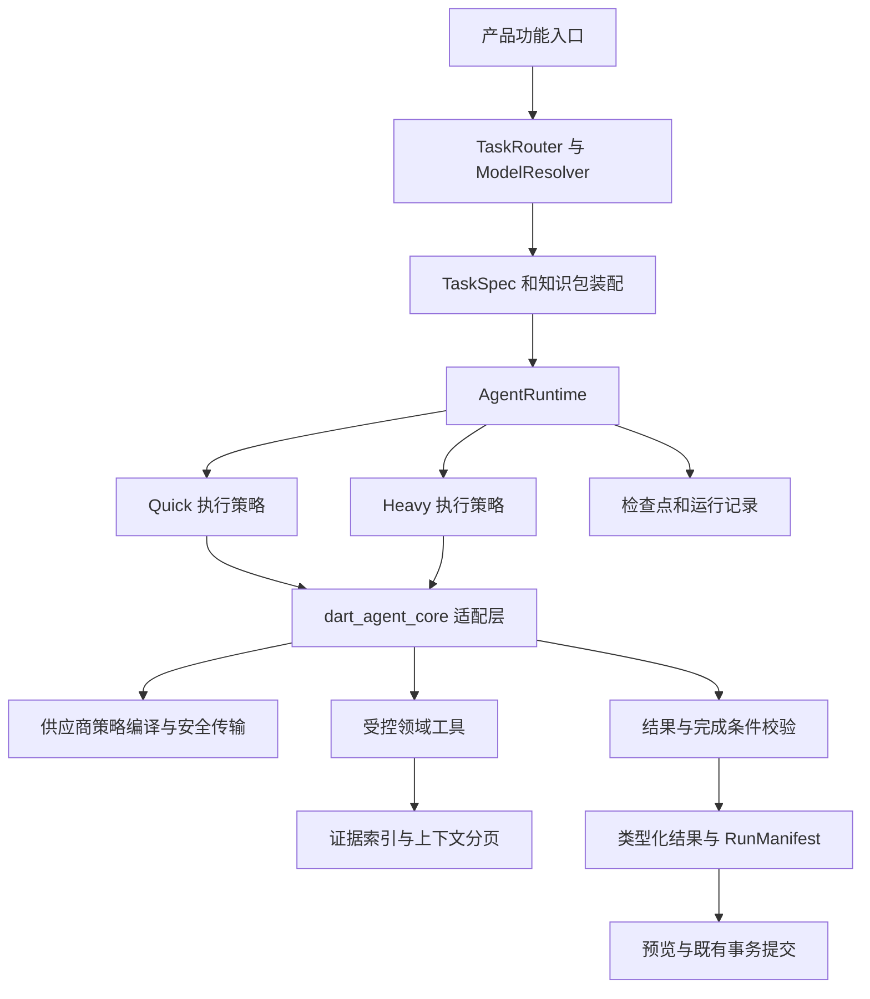

# Foliarc AI Agent 改造实施方案

版本：1.1。日期：2026-11-01。状态：用户已确认并授权分工、实现、Review、验收与自动合并。关联任务：GUL-643。

执行补充（用户最新要求，优先于旧版测试指标）：Arch/Opus (Ora) 负责 UI 与交互，Arch/GPT-Astra 负责技术架构，Dev/GPT-SOL 负责一般研发；父任务负责人负责 Review、合并、验收与持续推进。禁止子任务运行全量单元测试，只运行变更相关的定向测试和检查；不设高覆盖率硬门槛。保留关键协议、路由、引用、恢复和数据保护回归。UI 遵守：Avoid unnecessary secondary labels and descriptions. Let the layout do the explaining. Avoid unnecessary supporting text, descriptive copy, and redundant UI microcopy. 第 3 节列出的状态信息只在用户需要决策或处理异常时显示，正常状态避免重复标签和解释文案。

基线：`5689d1643e283725342746f674d95c43d9e49361`。适用读者：产品、客户端、Agent 运行时及测试开发人员。

本次改造统一所有业务 AI 交互的执行入口，明确区分快速任务和重型任务，并新增按功能分配模型的配置页面。快速任务通过调用参数关闭思考，重型任务使用完整 Agent 能力，并按任务加载预置知识、工具和完成条件。同时修复此前审计发现的引用错绑、长历史失败、工具上下文溢出、提示词冲突及重答历史不一致问题。

**1 需要落实的核心决策**

| 决策 | 本方案约定 |
|---|---|
| 两类任务 | `quick` 与 `heavy` 是执行策略，不是两份供应商配置，也不是按模型名称区分大小模型 |
| 统一入口 | 所有生成调用进入 `AgentRuntime`；领域代码不再持有裸 `LLMClient`，不再自行 generate/stream |
| 快速任务 | 使用相同 harness 的精简配置：不规划、不联网、不读取额外资料，通常一次生成，结构错误最多修复一次；每次调用关闭思考 |
| 重型任务 | 使用有状态 Agent、受控工具、上下文管理、阶段检查点、领域验证和必要的计划；具体能力按任务授权 |
| 模型分配 | 用户先创建服务/模型，再设置快速默认、重型默认，以及各功能覆盖项；同一个模型可承担多种功能 |
| 思考控制 | 快速任务要求协议层关闭，不能以隐藏思考、`low`、`minimal` 或“请直接回答”替代；不按“是否思考模型”限制创建 |
| 本期 harness | 复用并收敛到 `dart_agent_core`，通过适配层补齐治理；不自研 Agent 循环，不新增 Python/Node 后端 |
| 版本 | 先以现有固定版本 2.1.8 做兼容准入；若需要升级，单独提交版本变更及兼容回归，不混入业务迁移 |
| 领域能力 | 复用既有读取、图修改事务、笔记装配、翻译存储和缓存；已有人工确认和撤销语义继续生效 |
| 验收方式 | 确定性协议测试、真实任务质量评测和性能比较分别验收，覆盖率不能替代语义质量 |

选型原因：项目需要 Flutter 端侧执行、多供应商和本机模型，现有 SDK 已覆盖 Agent 循环、状态、工具、Skills 和 Hooks，能够承接本次收敛。上游功能说明见 [dart_agent_core](https://github.com/memex-lab/dart_agent_core)。这不等于认定其所有能力都已达到本项目的生产要求：阶段 S0 必须验证协议透传、思考关闭、工具回合和恢复；不通过的供应商/模型组合不能发布为受支持。若框架层出现无法通过受控适配或上游修复解决的缺口，提交单独的选型变更，不在业务代码中复制一套循环。

本期不引入自主多 Agent、任意脚本、文件系统 Skill 或新的向量数据库。“全功能 Agent”在这里指完整的任务执行与治理能力，不意味着默认开放全部权限。

**2 任务目录及路由边界**

由产品入口传入稳定 `taskType`，不增加一次模型调用来判断该走哪条路线。普通聊天默认重型；明确的翻译、查词、标题入口直接声明任务类型。输入文字中的“快速回答”不自动改模型或绕过重型任务的证据要求。

| taskType | 设置页功能名称 | 类别 | 输入与结果契约 | 预置知识包 |
|---|---|---|---|---|
| `selection_translate` | 选区翻译 | quick | 原文、源/目标语言 → 完整译文 | translation.basic |
| `word_lookup` | 单词释义 | quick | 词/短语、例句、源/目标语言 → 词形、释义、语境译文 | vocabulary.basic |
| `title_generate` | 标题生成 | quick | 问题或内容摘要 → 短标题 | title.basic |
| `assistant_chat` | 助手对话与解释 | heavy | 问题、上下文、会话分支 → 回答及证据 | assistant.core、explain |
| `conversation_summarize` | 对话总结 | heavy | 明确选定的对话范围 → 结论、要点、未决问题 | summary.conversation |
| `document_summarize` | 文档归纳 | heavy | 文档范围 → 分层摘要、覆盖范围、引用 | summary.document |
| `document_translate` | 全文翻译 | heavy | 文档范围、语言、术语 → 按原文稳定段落对齐的译文 | translation.document |
| `map_expand` | 思维导图扩写 | heavy | 目标节点、深度、方向、来源 → 待确认新增结构 | mindmap.expand |
| `map_generate` | 思维导图生成与更新 | heavy | 文档、现有结构、保护节点 → 生成结果/差异提议 | mindmap.document |
| `research` | 调研与查证 | heavy | 研究问题及读取/联网授权 → 证据支持的结论与未决项 | research.evidence |
| `study_notes` | 学习笔记整理与改写 | heavy | 材料、组织方式、编辑范围 → 提纲/章节/安置/改写 | notes.organize |
| `review_cards` | 复习卡与问题生成 | heavy | 原文范围 → 待确认复习内容 | review.grounded |

论文、视频查找属于 `research` 的子类型；简单句义解释默认属于 `assistant_chat`，不是查词。笔记中的“解释/改写”是 `study_notes` 的子类型。助手中的显式翻译快捷动作转为 `selection_translate`；自然对话要求分析翻译取舍时仍走 `assistant_chat`。

全文翻译中的分块翻译、术语整理、完整性检查，全部属于同一个 heavy run，并继承全文翻译选中的模型。**不会因为某个分块很短，就偷偷切换为选区翻译模型。** 文档导图的章节提炼也继承导图生成模型。标题属于独立 quick 子任务，使用标题功能的模型配置，不继承对话模型。

当前 `docs/full-translation.md` 的更新说明已将全文翻译作为主要入口；保留下来的阅读器调度/缓存是全文翻译的领域能力。未完成全文任务中的“重译一段/重试失败段”继承该任务模型；独立选区翻译使用 quick 配置。旧的按需阅读调用若仍可达，接入 `document_translate` 的限定范围任务，不能继续留作裸请求旁路。

内部 `context_compact`、`native_search`、`schema_repair`、`capability_probe` 也经过 Runtime 并记录用途。除独立标题外，前三者继承父 run 的模型与权限；探测固定使用被测模型，收到工具请求只校验协议，不执行工具。模型列表 GET、正文抓取、纯本地整理不是模型推理，不需要额外包装成生成任务。

**3 按功能选模型的配置页面**

设置新增“AI 功能”页面，沿用现有模型页的服务与模型列表。模型创建或保存后提供“分配给功能”入口，跳转并定位该页；不强制弹窗，不改动已有密钥保存流程。支持现有可使用 AI 的平台与窄屏布局，不借本次改造扩大平台支持范围。

页面按以下顺序呈现：

1. 快速任务默认模型；说明“调用时关闭思考”。
2. 重型任务默认模型；高级项提供“思考：自动 / 关闭 / 标准 / 深入”，只展示该模型支持的选项，默认自动。
3. 按上表分组的功能行。每行包含功能名、模型选择器、实际生效模型及状态；默认选项是“跟随快速默认”或“跟随重型默认”。
4. 页面底部“保存”和“恢复跟随默认”。编辑中的选择不影响正在执行的任务；保存后影响新任务。

模型选项显示“服务名 · 模型显示名”，绑定值必须是 `(serviceId, modelId)`，不使用显示名或数组下标。模型支持思考本身不导致选项被过滤；无法满足当前功能能力时显示具体原因。可保存尚未就绪的配置并显示“需配置”，但开始任务前必须拦截，不悄悄换成列表第一项。

| 状态 | 页面和任务入口行为 |
|---|---|
| 尚未创建模型 | 显示“先添加模型”入口，相关功能不可开始 |
| 未设置某类默认 | 仅该类继承项待配置；已显式绑定的功能仍可使用 |
| 快速模型可关闭思考 | 显示“思考已设为关闭”，实际请求必须应用关闭参数 |
| 模型不能关闭思考 | 显示“此模型无法关闭思考”；模型可以保留并用于其他功能，quick 功能不可按当前策略运行 |
| 能力未知 | 显示“需验证兼容性”，提供测试；不根据模型名字判断 |
| 模型已删除/停用 | 保留失效引用和原显示名，提示重新选择；不能自动清空后继承其他模型 |
| 密钥暂不可访问 | 提示连接不可用，保留绑定，不误标为模型能力不支持 |
| 用户删除被使用的模型 | 删除界面列出受影响功能；删除后保留对应失效状态，不自动分配其他服务 |

生产运行不进行隐式跨服务 fallback。兼容失败时提供“更换本次模型”或“打开 AI 功能设置”。快速任务不能降级成带思考请求后仍显示快速模式。

模型解析顺序固定为：**本次任务显式选择 → 该功能绑定 → 类别默认 → 未配置错误**。对话工具栏的模型选择只覆盖当前会话的 `assistant_chat`；显式发起的全文翻译、调研、总结、标题分别解析自己的功能设置。专用功能运行前显示其实际模型，避免“对话菜单选 A、实际用了 B”而无提示。

旧会话保存的模型迁移为会话级 assistant_chat 覆盖；新会话默认跟随功能配置，并显示实际生效值。清除覆盖才恢复跟随。设置页改动不会重写历史消息中的模型归属。

**4 配置与能力数据模型**

继续使用已有 `AssistantService`、`ServiceModel`、`ModelReference` 和钥匙串。新增配置存 `assistant.task-routing.v1`，与现有服务列表分离；保存时带 revision，串行写入并拒绝过时覆盖。这里只保存引用与策略，不保存密钥。

示例中的服务/模型 ID 仅用于说明结构：

```json
{
  "version": 1,
  "revision": 1,
  "defaults": {
    "quick": {"serviceId": "service-a", "modelId": "model-a"},
    "heavy": {"serviceId": "service-b", "modelId": "model-b"}
  },
  "bindings": {
    "selection_translate": {"mode": "inherit"},
    "word_lookup": {"mode": "inherit"},
    "document_translate": {
      "mode": "explicit",
      "model": {"serviceId": "service-b", "modelId": "model-c"},
      "reasoning": "auto"
    }
  }
}
```

未出现的 taskType 按注册表的类别继承。未知 version 不覆盖原数据；未知 taskType 保留以支持前后版本往返。quick 的 reasoning 固定为 off，不能由配置文件中的任意值绕过。heavy 未显式设置时跟随 heavy 默认策略。

| 新增契约 | 必需信息及约束 |
|---|---|
| `TaskSpec` | taskType、类别、输入/结果类型、promptVersion、schemaVersion、知识包列表、允许工具、所需能力、完成条件、执行策略；代码注册，不由模型改写 |
| `ModelCapabilityProfile` | 模型引用、协议/endpoint 指纹、模型版本信息、工具/结构输出/多模态能力、思考控制、上下文与输出容量、来源、验证时间、适配器版本 |
| `ThinkingCapability` | `notApplicable`、`switchable`、`alwaysOn`、`unknown`；另记支持的参数与值、组合约束，禁止用一个 bool 混同 |
| `CapabilityEvidence` | officialMetadata / maintainedProfile / wireProbe / userDeclared；记录 accepted 参数与语义依据，HTTP 200 不等于已关闭思考 |
| `ResolvedTaskConfig` | 解析后的模型引用、服务 revision/endpoint 指纹、能力快照、reasoning 请求策略、有效参数、版本及路由来源；无密钥 |
| `RunManifest` | runId、parentRunId、taskType、分支、配置快照、输入指纹、知识包版本、状态、阶段、统计、失败分类、结果/证据引用、checkpoint |

能力缓存与 `(serviceId, modelId, endpoint/protocol fingerprint, adapterVersion, modelRevision?)` 绑定。修改 endpoint、协议、模型、适配器或服务端模型元数据后使旧验证失效；不能把同名代理模型当作官方模型。名称匹配最多用于显示建议，不作为能力判断依据。

移除当前 `quickModelFor` / `assistantTitleModel` 按 haiku/mini/flash/small 自动选择的生产路由职责。其名字启发式不能证明速度，也不能证明关闭思考。所有新任务只从配置和能力档案解析。

**5 思考控制与供应商适配**

本方案中的“关闭思考”指关闭供应商暴露的扩展推理模式；它不承诺模型完全不进行内部计算。支持思考的模型，只要接口允许关闭，就可以用于 quick。天然不启用该模式的模型无需发送不支持的关闭字段。

| 协议 | quick 的适配方式 | 必须验证的限制 |
|---|---|---|
| OpenAI Responses | 对支持的模型发送 `reasoning.effort=none` | 支持值依赖具体模型，不能把 none 当作所有模型通用；部分模型拒绝 none。依据：[官方 reasoning 文档](https://developers.openai.com/api/docs/guides/reasoning) |
| OpenAI Chat Completions | 对支持的模型发送 `reasoning_effort=none` | 同时验证该模型在此协议下的任务能力，不能由 Responses 的支持推导 Chat 的支持。依据：[官方 reasoning 文档](https://developers.openai.com/api/docs/guides/reasoning) |
| Anthropic Messages | 对明确支持的组合发送 `thinking.type=disabled` | 与 effort 的组合限制按模型处理；部分模型无法关闭。隐藏 thinking display 不算关闭。特殊无前置思考模式仅在官方明确无工具场景等价、且适配验收通过时单独支持。依据：[官方 thinking 文档](https://platform.claude.com/docs/en/build-with-claude/thinking) |
| Gemini generateContent | 对支持关闭的模型使用 `generationConfig.thinkingConfig.thinkingBudget=0` | 例如 2.5 Flash 支持，2.5 Pro 不支持；不同系列的 thinkingLevel 及最小值不能统一当作 off。依据：[当前使用协议的官方说明](https://ai.google.dev/gemini-api/docs/generate-content/thinking) |
| Ollama OpenAI 兼容端点 | 针对实际服务版本和 `/api/show` 能力，采用已确认的 reasoning 参数映射 | 当前代码使用 `/v1/chat/completions`，不能直接塞原生 `/api/chat` 的 `think:false` 并假设生效；缺元数据或仅“无思考输出”证据时不宣称计算模式关闭。依据：[兼容协议](https://docs.ollama.com/api/openai-compatibility)、[thinking 能力](https://docs.ollama.com/capabilities/thinking) |
| 第三方 OpenAI-compatible | 使用服务专属适配 profile，例如文档明确的 enable_thinking 或其他字段 | 不能仅因协议叫 OpenAI-compatible 就发送 none；由服务文档、版本和实际 payload 验收共同确定，未知时保持 unknown |

实现落点是 `ProviderPolicyCompiler`：将规范化 `ReasoningPolicy` 与能力档案编译为严格白名单参数。UI、知识包、用户原文不能注入任意额外 HTTP 字段。政策编译后记录 requested/effective；供应商未返回可核实的执行状态时，记录“按已知协议请求关闭”，不伪造服务端证明。

核对本地 SDK 2.1.8 后已确认：Responses 的 `extra` 有白名单；Chat 客户端只透传部分字段，其中包含 reasoning_effort；Claude 透传 thinking/output_config；Gemini 透传 thinkingConfig。**把参数放入 ModelConfig.extra 不代表最终请求一定携带。** S0 必须捕获最终出站 JSON 验证。缺失透传能力优先用集中、类型化的适配器或上游修复补齐，不让每个业务功能加独立 Dio interceptor。

关闭策略每次请求都执行，包括修复、重试和标题生成。遇到明确不支持参数的错误，更新能力档案并结束本次请求；不删掉参数重试成默认思考，也不把鉴权/超时归为不支持。外部代理即使返回 200，也可能忽略未知字段；探测只能证明字段被接受，需与协议依据和可用的 usage/执行元数据组合判断。

heavy 的 auto 使用该模型支持的推荐/默认模式；标准/深入映射到已知有效 effort，关闭遵循同一能力检查。思考强度与完整 Agent 能力分开：一个不开扩展思考的模型仍可以按工具回合工作，前提是工具能力通过验证。

**6 统一运行时及模块边界**



调用契约建议如下；这些是接口设计，不是要求业务调用方实现供应商逻辑：

```text
ModelResolver.resolve(TaskRequest, RoutingConfig) -> ResolvedTaskConfig | ConfigurationFailure
KnowledgeRegistry.resolve(TaskSpec, version) -> KnowledgeBundle
AgentRuntime.start<T>(TaskRequest<T>, RunContext) -> RunHandle<T>
RunHandle.events -> Stream<RunEvent>
RunHandle.result -> Future<RunResult<T>>
RunHandle.pause() / resume() / cancel()
RunStore.load(runId) / checkpoint(snapshot) / complete(result)
ProviderPolicyCompiler.compile(config, capabilities) -> ProviderCallPolicy
TaskValidator.validate(result, expectedInputManifest) -> ValidationReport
```

Quick/Heavy 是同一 Runtime 的策略，不是两套日志、配置、SDK 和持久化。Quick 仍通过 SDK Agent lifecycle 完成请求；只关闭不需要的工具、计划及历史。Heavy 的 deterministic 工作流负责分块、队列、保存和确认，模型自主决定的工具回合由 SDK 执行。分块工作流可以顺序或有界并发调用受控 Agent，但不得出现另一个绕过 Runtime 的模型客户端。

工具返回类型统一包含 `items/evidenceIds/complete/nextCursor/notices`。读取工具与写入工具分开；写工具只能生成提议或领域草稿。实际持久写入由宿主校验和提交。工具失败返回结构化原因；禁止靠自然语言“成功”认定应用完成。

依赖方向：`mm_core` 定义与 SDK 无关的领域任务/结果/存储端口；`mm_assistant` 负责 Runtime、harness 适配、知识包、模型策略和 Agent；`mm_data` 负责 RunStore 与现有业务存储；应用层负责 Riverpod、设置、权限交互和任务视图。只有适配层与统一运行实现可以直接依赖 SDK 协议对象。

**7 两类任务的执行规则**

| 项目 | quick | heavy |
|---|---|---|
| 上下文 | 本次输入、必要例句和术语；不注入整份对话、图或文档目录 | 任务范围、相关历史、证据和阶段状态，按容量检索 |
| 工具 | 默认无工具；禁止隐藏联网与额外文档读取 | 由 TaskSpec 与授权交集确定；不加载无关工具 |
| 思考 | off，每次编译与验证 | auto 默认，允许按功能设置支持的策略 |
| 生成循环 | 通常 1 次；结构/非空校验失败可修复 1 次 | 有界工具循环，按阶段检查完成与覆盖范围 |
| 历史 | 临时运行记录；选区翻译等不污染主对话推理历史 | 有版本的会话分支/任务状态，可检索已完成结果 |
| 持久化 | 记录模型、版本、使用量和结果指纹；全文是否保存按原功能规则 | 检查点＋已验证的分块结果＋证据索引＋运行记录 |
| 展示 | 直接呈现结果及必要错误 | 展示任务阶段、进度、部分完成和待确认项，不展示内部提示词 |

快速任务不添加“先分析”“反思”“规划”模板。重型任务也不强制每次规划：只有需要拆解的任务生成/更新计划，计划结构由宿主校验；对话可以直接回答，调研需要证据，文档任务需要覆盖清单。

quick 初始单请求超时建议：标题 10 秒，查词/选区翻译 30 秒；heavy 文档阶段先沿用 2 分钟单请求超时，助手回合沿用现有 90 秒活动期限。它们是可调整的运行参数，不是响应速度承诺；实际性能按第 15 节评测。网络排队、模型生成及解析分别计时，等待用户确认不耗活动时间。

输出额度按任务与模型容量计算：标题先沿用 64 tokens；查词设有界结构额度；翻译按原文估算完整译文所需容量，超过模型容量先分块/提示转全文任务，不能截断后标记成功。Heavy 不继承一个统一的 4096-token 整任务上限；每次调用预留思考、工具封装和最终结果的空间。预算重写必须保留已编译的 reasoning、模型协议选项及其他必要字段。

**8 预置知识集和提示词装配**

预置知识集首期采用随应用发布、版本化的静态资源，包含任务方法、术语规则、结果示例、错误修复规则及所需工具声明。它不同于用户文档库：文档是任务证据，不自动成为系统规则。首期不增加用户安装任意 Skill 的入口。

| 知识包 | 重点规则 | 不应带入的内容 |
|---|---|---|
| translation.basic | 完整忠实、保留格式/占位符、明确语言、只输出译文 | 加粗结论、摘要、反问、无关引用 |
| vocabulary.basic | 词形、语境与词典义区分、音标未知可空 | 将猜测音标当权威词典结果 |
| summary.conversation | 区分已确认决策、建议、未决事项，保留关键约束 | 把旧的被替代决定当现行规则 |
| summary.document | 分层提炼、覆盖范围、重要事实与例外、来源绑定 | 未读章节的推测性归纳 |
| translation.document | 全文段落映射、术语一致、上下文衔接、漏译检测 | 为统一措辞而无提示改写用户手动译文 |
| mindmap.expand | 深度/宽度、避免重复、来源与创意区分 | 为凑深度生成空泛节点 |
| mindmap.document | 章节覆盖、层级合并、保护节点与差异说明 | 未确认删除/改写用户内容 |
| research.evidence | 问题分解、来源比较、证据支持、冲突与不确定性 | 将搜索摘要当正文、将论文元数据当全文 |
| notes.organize | 原文/自有笔记/AI 内容分离、ID 引用、可恢复章节输出 | 重写原始摘录和手动编辑块 |

装配顺序：固定安全与权限规则 → 任务目标及结果契约 → 对应知识包 → 用户本次任务要求 → 类型化输入数据与证据。用户任务偏好不能覆盖权限/结构约束；原文、网页、标题、节点正文作为低信任数据消息，不直接拼进 system prompt。JSON/XML 等分隔用于减少歧义，真正权限仍由代码执行。

将现有 `assistantAnswerStyle` 拆成各任务的输出风格，禁止全 Skill 继承“加粗结论＋2–3 点”。为每个 TaskSpec 固定 promptVersion、schemaVersion 与 knowledgeVersion；schema 与 DTO 校验共享契约。输出支持原生结构化格式时使用对应能力；同时保留本地校验。NDJSON 继续用于逐条草稿，但用户可见的最终结果必须通过整个任务完成条件检查。

修复提示提供安全的 `{code,path,reason}` 和已接受 ID/遗漏项，只修失败部分，不能重新生成已提交副作用。模型不能通过 activate_skills 扩大 TaskSpec 的工具权限；运行时取任务允许、用户授权、平台能力三者交集。

**9 各重型任务的工作流**

| 功能 | 处理阶段 | 完成条件与恢复单位 |
|---|---|---|
| 助手对话/解释 | 解析问题范围 → 按需读取/检索 → 回答 → 引用验证 | 必要证据可解析，缺资料明确说明；按完整模型/工具回合恢复 |
| 对话总结 | 冻结选定分支范围 → 分段提炼 → 合并决策与未决项 → 验证 | 覆盖所选消息范围，不纳入已替代分支；按分段摘要恢复 |
| 文档归纳 | 建立章节/段落清单 → 容量分块 → 提炼 → 分层合并 → 覆盖核对 | 每个范围有已处理/排除/失败状态，失败范围不会伪装完成 |
| 全文翻译 | 冻结任务配置 → 本地去重/复用 → 术语准备 → 分块翻译 → 对齐/术语校验 → 保存 → 批次确认 | 原文 ID 与完整译文一一对应；每段原子保存，人工修改永不被批量覆盖 |
| 脑图扩写 | 读取目标结构和证据 → 计划候选分支 → 扩写 → 深度/重复/依据校验 → 有限补全 → 提议 | 每个请求目标有结果或明确未完成原因；预览树与实际应用树同样验深度 |
| 导图生成/更新 | 章节清单 → 分块要点 → 分层合并 → 结构/差异 → 覆盖与保护校验 → 确认 | 范围覆盖、无环、依赖正确、保护节点完整、来源可追溯；章节缓存复用 |
| 调研/查证 | 问题分解 → 搜索候选 → 抓正文快照 → 比较证据 → 补缺 → 输出 | 结论有支持片段或明确未核实标记，来源冲突被保留；按证据/子问题恢复 |
| 笔记整理/改写 | 收集材料 → 提纲 → 分节写作/增量安置 → 领域装配校验 → 确认 | 引用材料 ID 有效，手动块受保护，未用材料列出；按完整章节恢复 |

全文翻译仍使用既有 TranslationScheduler 的队列、去重、用量账本、批次 review 与恢复，不重新实现另一套调度器。其生成端口改为调用 Runtime 的 heavy 子步骤；上下文和术语由文档任务统一管理。子步骤沿用同一配置快照，跨批修改术语只影响未来分块，并记录新的要求版本。

大文档不只按“200 条材料”或目录章节拆分；还按模型实际输入容量拆分，并保留段落 ID、来源范围及少量重叠上下文。最终汇总也执行分层归并，不能把全部章节要点无限拼到最后一次请求。无工具支持的模型不能被当作全功能 heavy Agent 悄悄降级；能力不符合 TaskSpec 时在开始前提示选择其他模型。

**10 上下文 引用和重答语义**

以稳定 `evidenceId` 表示证据身份，至少绑定学习集、文档/来源、内容版本、定位与片段 hash。模型使用稳定身份，`[source:N]` 和 `[page:N]` 仅在一条消息渲染时分配，不再作为跨轮全局主键。持久化 citation 保存消息内别名到 evidenceId 的映射。

旧消息显示继续使用原映射；旧历史进入新模型请求前，按当轮保存的 reads/citations 重建身份。无法无歧义恢复的标记移除引用能力并标注需重读，不把历史 `[source:1]` 猜成当前 source:1。切换主文档、切模型、重答和压缩均要保留同一证据身份。

ContextAssembler 同时预算系统规则、工具 schema、历史、输入数据、工具响应及最终回答。页读取、脑图分支、网页、搜索和论文结果都使用同一容量分配接口。工具完整内容保存在本地证据仓库；返回上下文不足时使用分页/检索，不把整个结果塞入历史后再报错。模型 token 计数可用时优先使用；否则使用保守估算并声明估算值，不能把字符数当精确 token 数。

在容量接近门槛时压缩旧的完整回合，保留最近问题、约束、结果索引、计划和证据 ID。压缩是 Runtime 中的受控内部任务，继承父模型并计入 usage；摘要不能创建新授权或升级原文中的指令。压缩失败时保留原历史并提供可恢复状态，不破坏会话。

重答采用**从目标用户消息处分叉**：先取其之前的完整回合，加上原问题及当时上下文快照，生成新分支；不把旧答案及其后续轮次再发给模型。旧分支保持可读。实际已提交的图修改/笔记是工作区事实，不能因分叉重新执行；提示中只提供当前执行凭据和实际状态。需要再次修改时生成新的提议，重新校验 revision。

供应商协议块与正文分开存储。净化引用或重写文本不能破坏工具调用 ID、签名或供应商要求回传的 opaque reasoning 元数据；这些字段不显示为答案，也不复制进一般诊断。跨供应商/不兼容模型切换时重建规范历史，不转发另一供应商的签名。S0 包含此协议往返测试。

**11 生命周期 预算和容错**

Run 状态使用 `created → validating → running`，可进入 `awaiting_user/paused/interrupted`，最终进入 `completed/partial/failed/cancelled`。领域中的 `review` 等状态通过适配映射，不要求修改所有历史文件中的枚举。只有输入范围清单全部满足完成条件，才标记 completed；存在失败或遗漏项必须是 partial。

暂停和取消明确区分：暂停停止派发新请求，允许已在途的完整结果校验并保存；取消发出取消信号、停止新请求并保留已持久化结果。取消前已完成验证但尚未落盘的结果，可按当前 run 的提交规则保存；取消后的迟到响应不能污染新 run。窗口关闭按既有全文翻译规则暂停；崩溃后的 running 恢复为 interrupted，不自动重发未知结果的请求。

新任务启动时冻结解析配置、知识版本和范围。修改功能路由只影响后续新 run。服务被停用、删除或 endpoint 变更时，已在途结果正常收尾；下一次派发前暂停，重新验证，不能向新地址发送旧任务凭据。改变任务模型须用户在任务页显式选择“后续使用该模型”，创建新配置阶段，并保留先前结果归属。

| 故障 | 处理策略 |
|---|---|
| 401/403、密钥读取失败 | 不自动重试模型，提示连接/凭据问题 |
| 关闭思考不支持、必需工具能力不支持 | 配置失败，不移除限制重试，不回退其他服务 |
| 收到 429/可重试 5xx | 由统一重试策略有界退避，遵守 Retry-After 和当前活动期限；用户暂停可中断等待 |
| 连接中断、超时、部分流失败 | 结果标记未完成；是否重试由任务明确策略决定，不把部分文本当成功 |
| 快速任务格式错误 | 最多一次格式修复，仍关闭思考；失败显示可重试错误，标题保留本地占位 |
| 重型结构错误 | 只修失败部分，默认每阶段最多 2 次；仍失败则 partial/failed，不无限循环 |
| 输入超模型容量 | 先压缩/拆分；无法保留最小语义单元时提示范围过大，不静默截断 |
| 输出截断 | 不提交半段译文/半个 JSON；拆分后处理或提示继续，不伪装完整 |
| 保存失败 | 不因本地保存失败重新购买同一份已验证结果，保留待提交结果与幂等键 |
| 写入版本冲突 | 保留提议、要求重新预览；不覆盖最新用户编辑 |

一次逻辑请求只能有一个重试责任方。迁入 Runtime 的任务关闭 SDK/HTTP 的自动叠加重试；翻译原有调度器保留调度责任，但网络重试策略委托同一个 RetryPolicy，避免“3 次 × 3 次”。HTTP 重试、结构修复、用户重答是不同 attemptReason，并共享相关阶段预算。

继续允许用户选择的大型文档和多节笔记完成整个任务，不恢复旧的固定整任务字符数/token/时长硬配额。增加的是模型容量感知的单请求边界、流缓冲保护、阶段循环上限和累计用量展示。已有全文翻译超预估暂停规则保留。没有明确 token 用量的请求记为 estimated/unknown；不显示假精确费用。

`docs/map-generation-engine.md` 与 `docs/study-notes-ai-contract.md` 目前明确不设置应用输出 token/响应总额限制。本方案在实现时需同步修订这些条款：区分“取消任意整任务配额”和“按模型单次容量分块/限制解析器内存”。不将这项调整描述成现有需求本来就允许的小修复。

**12 存储 缓存和迁移**

RunStore 位于学习集的 `ai-runs/v1/`，使用单一版本化 envelope，manifest/事件/检查点原子更新或串行日志写入。存储必要范围引用和内容指纹，避免重复复制整本书。任务结果继续写入既有对话、翻译、脑图、笔记仓库，RunStore 不成为第二份业务事实源。

AgentState 为 harness 私有状态，存入带 sdk/version 的子字段；应用只消费 RunResult 和领域实体。模型事件有稳定 eventId/sequence，迟到/重复事件不能重复提交。提议和领域写入沿用持久幂等凭据；关闭后重启不执行旧的未完成工具。

缓存分两层：已有用户可见译文/笔记属于持久业务成果，修改模型或提示版本不会自动删除或重译；可复用生成缓存则绑定内容指纹、源/目标语言、任务/提示/schema/知识版本、术语要求及必要模型策略。查词缓存必须加入源语言和自动检测状态。跨模型复用完整旧译文允许，但显示原模型/要求版本；用户发起重译才生成替代版本，人工编辑保护继续生效。

迁移按以下规则一次性执行，任何失败均可重跑：

1. 保留 `assistant.services.v1` 与现有 Keychain 账户；新增能力字段采用可空/unknown 默认，不改密钥名称。
2. 新路由不存在时，将旧默认模型填入 heavy 默认；quick 默认也可预填同一引用，但只在能力已确认可关闭/不启用思考时标记可运行，否则显示待验证。不得按名字自动挑另一个小模型。
3. 新配置落盘成功后写 migrationVersion。再次启动不覆盖用户选择；没有默认模型时保持未配置。
4. 旧会话保留原显示数据，按第 10 节迁移历史引用；建立 assistant_chat 会话覆盖。旧字段不能继续与新路由形成双重默认来源。
5. 活跃旧翻译/脑图/笔记任务先标记 interrupted；保留已验证结果与批次 review。恢复时按用户原模型构建配置快照，能力不足则提示配置，不自动改模型重算已完成部分。
6. 旧缓存可作为既有结果读取；缺少语义版本信息时不得假装是新版本生成缓存命中。输入内容变化时只失效对应片段，用户修改和可追溯历史保留。

回滚仅停用新执行入口，不自动倒退已经迁移的持久状态。发布前保留迁移备份和数据兼容读取测试；旧版本不理解的新任务保持可读的结果快照，不尝试恢复执行。灰度开关不能令已迁移 quick 路径退回无关闭思考保障的裸调用。

**13 文件改动关系和实现范围**

下表为建议落点，开发时可按现有包组织细化文件名，但职责不能重新散落到 UI。

| 位置 | 改动 |
|---|---|
| `packages/mm_core/lib/src/assistant/` | 新增任务类型、运行结果、证据身份、TaskValidator/RunStore 端口 |
| `packages/mm_assistant/lib/src/runtime.dart`、`hooks.dart` | 抽出公共生命周期；原 AssistantRun 成为兼容门面；保留 Policy/Proposal/Citation 并接入统一上下文 |
| `packages/mm_assistant/lib/src/task_runtime/` | 新增 registry、router、quick/heavy 策略、checkpoint、运行事件与失败策略 |
| `packages/mm_assistant/lib/src/model_policy/` | 新增能力档案、thinking 编译、参数透传适配、解析配置快照 |
| `packages/mm_assistant/lib/src/knowledge/` | 版本化任务知识包与提示装配；配套 fixture |
| `services.dart`、`service_catalog.dart`、`providers.dart` | 扩展能力发现与服务 revision；统一出站策略；删除生产名字启发式路由 |
| `translation.dart`、`word_lookup.dart`、`titles.dart` | 改为 Runtime 适配器；修正缓存键及结束状态校验 |
| `translation_scheduler.dart` | 继续承担队列/持久化职责，生成调用接入 heavy 子步骤，统一重试和配置快照 |
| `expansion.dart`、`map_generation.dart`、`study_notes/organizer.dart` | 迁移直接调用，复用解析器并增加完整性报告/局部修复；不丢弃既有领域验证 |
| `network.dart`、`web_search.dart` | 原生搜索的模型调用纳入 Runtime 子步骤和 usage；搜索 API/抓取继续独立端口 |
| `packages/mm_data/lib/src/` | 实现版本化 RunStore/迁移、原子提交与缓存索引；复用会话存储纪律 |
| `apps/marginmind/lib/features/assistant/` | 新增路由设置 Provider、AI 功能页、模型分配入口；改造 controller 的重答分支与模型显示 |
| `apps/marginmind/lib/settings/settings_window.dart` | 新增 AI 功能导航及窄屏布局；按平台能力显示 |
| 各功能 controller/factory | 传 taskType/输入范围，显示有效模型/部分完成状态，移除裸连接构造 |
| `docs/assistant-architecture.md`、ADR、翻译/脑图/笔记契约 | 同步新执行与预算语义，避免旧文档继续要求直接调用 |
| 测试与工具 | 新增路由、wire payload、引用分支、长任务恢复、语义评测及依赖边界检查 |

现有 `ModelParagraphTranslator`、`IdeaExpander`、`MapGenerator`、`NoteOrganizer` 端口可先保持不变，由实现委托 Runtime，降低 UI 迁移成本；随后清理已无职责的旧循环。不得长期同时保留两个可执行的生产路径。

**14 分阶段交付与依赖**

每阶段交付包含代码、测试、短文档及自查结果。阶段表是执行顺序，不表示本轮已创建或派发子任务。

| 阶段 | 依赖 | 交付物 | 放行条件 |
|---|---|---|---|
| S0 harness 与协议准入 | 方案确认 | 固定版本兼容矩阵；出站 thinking 参数 fixture；工具回合/签名往返；能力档案契约 | 支持的组合有明确能力依据；SDK 不吞字段；不能关闭的组合正确报告不可用 |
| S1 路由与设置 | S0 | 两类默认/功能覆盖、配置页面、模型分配入口、迁移和生效快照 | 不按名字选模型；删除/停用/跨服务同名/未知能力/保存失败均按规则处理 |
| S2 运行时与正确性 | S0，接口对齐 S1 | Runtime、RunStore、稳定引用、统一容量、历史压缩、重答分支、任务化风格 | 前次五个探针转为正式回归；新增重答实际请求历史测试；无串源和持久超限死局 |
| S3 快速任务迁移 | S1、S2 | 选区翻译、查词、标题全部走精简 Agent | 每个 attempt 实际关闭思考；输出契约正确；无标题/词义旁路 |
| S4 重型任务迁移 | S1、S2 | 对话/总结/调研，全文翻译，扩写/导图，笔记/复习卡分批接入 | 所有业务推理进入 Runtime；每个功能保留缓存、恢复、确认和撤销契约 |
| S5 集成与发布 | S3、S4 | 定向集成验收、可用真实服务的代表性质量/性能检查、迁移/回滚验证、更新后的 ADR | 第 15 节关键正确性条件通过；已支持平台无关键回归；仅公布已验证的模型/服务组合 |

S4 建议依次交付：助手与引用 → 全文翻译 → 扩写/导图 → 笔记与调研内部调用收口。每迁完一个功能就移除其旧生成旁路。依赖边界检查允许 SDK/client 调用仅出现在 harness/供应商适配/测试，检查既覆盖 generate/stream，也覆盖手写生成 API 请求。

**15 测试与可量化验收**

以下为本次改造的目标门槛，不是当前已达到的结果。当前基线仅有上一轮审计的 285 项 mm_assistant 测试通过，以及五项离线问题复现。

| 范围 | 验收用例与门槛 |
|---|---|
| 模型路由 | 表驱动覆盖所有 taskType、覆盖优先级、同名跨服务、失效引用、旧会话和运行中设置变更；结果 100% 符合契约 |
| 思考关闭 | 每个声明支持 quick 的适配组合，检查最终 HTTP body、重试/修复 body、明确不支持错误及代理忽略参数情况；禁止误把隐藏/low/缺 usage 判为 off |
| Agent 边界 | 业务生成旁路为 0；能力探测/原生搜索/标题/压缩有 manifest 或父子调用记录；禁止重复工具副作用 |
| 引用 | 多轮、换主文档、多个 source:1、跨模型、压缩和重答后，证据身份零错绑；旧标记无法恢复时不能猜测 |
| 长上下文 | 历史超过旧 60000 字符、超大单节点、长网页、超大章节、最终合并超限均能拆分/降级为明确 partial，不能永久卡住会话 |
| 快速结果 | 标题非空/长度合规；查词源语言隔离；翻译无模板污染、段落/占位符完整；截断不算成功 |
| 重型完成度 | 覆盖清单无遗漏伪完成；导图深度与保护节点正确；失败部分可恢复，已完成部分不自动重复付费 |
| 恢复与提交 | 暂停无新请求、在途结果可保存；取消后迟到结果隔离；崩溃恢复、保存失败重试、revision 冲突、幂等凭据均通过 |
| UI | 模型创建→功能分配→开始任务全链路；quick 不可关闭、heavy 工具不支持、模型删除、设置保存失败均有可执行提示；已支持平台与窄屏无溢出 |
| 测试范围 | 子任务禁止全量单元测试；仅对变更文件/模块运行定向测试、格式与静态检查。覆盖率不设 >80% 等高门槛；关键状态转移与错误边界保留有效测试 |

优先执行固定且脱敏的代表性小样本，涵盖两类任务、中英文本、长上下文、冲突来源和部分故障；由父任务负责人选择必要的跨功能用例。旧版 150 例 × 每组合 3 次的大规模评测不是本次交付前置门槛，可作为后续质量基线建设；不得为凑样本拖慢子任务或产生不受控模型费用。不以一次通过推断整个服务矩阵的生产支持。

选定用例的确定性结构/定位/权限不变量要求全通过。语义质量检查翻译忠实/完整/术语一致、解释依据、摘要覆盖和导图实用性；保留失败案例，不仅报告均值。小样本不足以证明总体 95% 成功率，不以未测量的统计指标作交付声明。不能只用同一个被测模型给自己打分。

快速任务性能比较需固定服务、模型、输入、并发和网络，记录排队、首结果、完整结果的 P50/P95、token 和成功率；与同模型基线比较，运行时附加延迟建议控制在 100ms 内，端到端 P95 不劣化超过 10%。关闭思考通常有利于速度，但不保证所有模型都会更快；未达标时定位缓存/装配/服务端原因，不能谎报关闭或牺牲完整性。重型任务记录完整任务成功率、每阶段修复次数、复用比例、恢复成功率和单位有效结果成本。

真实联调按已配置且允许使用的测试账号进行，标注费用及测试范围；没有验证的组合继续显示 unknown，不因 mock 全绿就宣称可用。CI 使用离线 fixture 与协议假服务，真实质量评测独立运行，避免每次提交自动产生不受控费用。

实现阶段仅对变更路径执行格式检查、静态检查和明确列出的 Dart/Flutter 测试文件；修改 Python 工具时再运行对应测试。子任务不得执行全库测试、全库 coverage 或无关测试集合。父任务根据集成风险执行必要验收，不重复各子任务已充分验证的用例；已有强制 CI 门禁不能通过关闭检查绕过。

**16 已发现问题与交付闭环**

| 前次审计问题 | 本方案处理位置 | 负责阶段 |
|---|---|---|
| 跨轮引用错绑 | 稳定 evidenceId、历史映射迁移 | S2 |
| 长历史反复 budget 失败 | 容量估算、完整回合压缩、可恢复状态 | S2 |
| 工具结果撑爆上下文 | 所有工具共享容量与分页 | S2 |
| 翻译继承总结模板 | 按任务拆分知识/风格 | S2、S3 |
| 重答 UI/模型历史不同步 | 从目标消息处分叉 | S2 |
| 超长章节与汇总瓶颈 | 容量分块、分层归并、完整性清单 | S4 |
| 多套生成旁路 | 单一 Runtime 与依赖边界门禁 | S3、S4、S5 |
| 查词源语言缓存串用 | 缓存语义键与版本 | S3 |
| 原文混入 system | 类型化低信任数据、固定政策层 | S2 |
| 合法结构被当作任务完成 | 覆盖/依据/partial 契约 | S4 |
| 修复反馈和工具说明不足 | 结构化验证反馈、任务工具说明 | S2、S4 |
| 真实质量与追踪不足 | RunManifest、独立质量评测及性能报告 | S2、S5 |
| 新增按功能分配模型 | 两类默认、功能覆盖、配置冻结与迁移 | S1 |
| 新增快速任务关闭思考 | 能力档案、策略编译、最终 wire 验证 | S0、S3 |

方案已确认，从 S0 开始实施；完整交付以 S5 验收通过为准。各阶段由父任务负责人审查后自动合并，并按实际依赖放行后续子任务，无需再次等待用户确认。

**S0 实施附录：接口归属与协议准入（GUL-644）**

本文 v1.1 正文保持原样。以下是 S0 的实现边界；不是 S1–S4 已接入生产的声明。

| 唯一入口 / 文件 | 当前内容 | 后续负责人 / 使用约束 |
|---|---|---|
| `mm_core.dart` → `src/agent/contracts.dart` | SDK 无关统一导出 | 后续直接使用这些类型，不另建同名协议 |
| `mm_core/src/agent/tasks.dart` | 12 个稳定 TaskType、quick/heavy 与知识包映射；TaskSpec、TaskRequest<T>、RoutingConfig、TaskModelBinding、ModelResolver、KnowledgeRegistry | S1 实现解析/持久配置，领域迁移注册具体 TaskSpec/schema/validator；TaskRequest 的 T 是结果类型，input 是由 inputSchema 验证的不可变 JSON |
| `mm_core/src/agent/models.dart` | ModelReference、协议/能力身份与证据、ReasoningPolicy、ProviderCallPolicy、ResolvedTaskConfig | ModelReference 从旧 services 移入，旧入口重导出同一类型；无密钥。能力身份包含服务 revision、模型 revision、精确 endpoint/protocol 指纹及适配版本 |
| `mm_core/src/agent/runs.dart` | AgentRuntime.start、RunHandle.events/result/pause/resume/cancel、RunStore.load/checkpoint/complete、RunContext/Manifest/Result/Event、验证与用量 | S2 实现 Runtime，mm_data 实现持久化；checkpoint/complete 是 CAS 原子写端口，失败不得重新生成结果；未提供 stub 运行实现 |
| `mm_assistant/src/model_policy/compiler.dart` | CapabilityProfiles、DefaultProviderPolicyCompiler、validateTaskCapabilities、policyModelConfig、verifyPolicyPayload | S1 校验 TaskSpec 所需能力并解析配置；S2 在每个模型请求前调用编译/SDK 转换，保持同一配置快照 |
| `mm_assistant/src/providers.dart` | connectAssistant 新增可选 callPolicy；编码后校验策略与连接身份 | S2 新连接必须传 callPolicy，并使用 policyModelConfig；旧业务调用暂未迁移，不能据此声称全应用已关闭思考。服务 revision 的重新检查归 Resolver/Runtime，连接层核对实际地址/协议/服务/模型 |
| `mm_assistant/src/hooks.dart` | 预算修改通过 ModelConfig 的完整 JSON 往返，只替换 maxTokens | 保留 temperature/topP/topK/generationConfig/extra，不再遗漏非 extra 的协议参数 |
| `mm_assistant/test/model_policy_test.dart` 与 `test/fixtures/model_policy/` | 最终传输字节 JSON、工具/签名回放 fixtures、流式与重试、已知缺口回归 | 固定 SDK 2.1.8；fixture 使用虚构服务和凭据，不表示实际服务验证 |

RoutingConfig 保留完整不可变 JSON，包括未知 taskType；未知版本拒绝解释，S1 存储层须保留原文且不得覆盖。typed getters 只读取已知 binding/default；无模型时返回 null，解析优先级、删除后失效引用、revision 写保护、旧配置迁移仍属于 S1。TaskSpec 是注册契约，S0 不伪造领域提示或生产完成判据。

策略编译仅支持封闭 recipe 集合：省略、effort none/medium/high、thinking disabled、thinkingBudget 0。协议组合不合法明确失败；未实现的 vendor 自定义字段与 Anthropic/Gemini 强度映射明确不支持。quick 忽略更强 reasoning 请求并固定 off；notApplicable 必须有语义与 wire 依据才可省略字段；alwaysOn 拒绝 off；unknown、单独 HTTP 成功、wireProbe 或 userDeclared 都不构成准入。无预置生产模型能力：CapabilityProfiles 未命中始终 unknown。真实档案由后续具有语义依据的探测/维护流程提供，不能从模型名字生成。

| SDK 2.1.8 路径 | 离线已验证 | 未准入 / 未验证 |
|---|---|---|
| Chat Completions | reasoning_effort=none 最终 body；流式；429 重试与后续调用仍 off；工具 ID 与 reasoning_content 回放 | 模型是否支持 none、第三方代理是否忽略字段、真实语义均未验证；enable_thinking/原生 think 不在 SDK Chat 白名单，当前编译器不支持 |
| Responses | reasoning.effort=none；流式；重试；工具 call_id/result 配对 | **手动历史重放丢失 reasoning item/encrypted_content**：metadata 保存了原响应，但 SDK encoder 未使用，不能准入需要 opaque reasoning 的重放。现有连接关闭 autoPreviousResponseId，S0 不以开启隐式服务端状态绕过 |
| Anthropic Messages | thinking.type=disabled；流式；多 thinking 签名、redacted_thinking、tool_use 块的顺序与内容经 JSON 持久化再发保持一致；真实 SDK Agent 流式累积也保留块 | 真实模型关闭语义及 effort 组合未验证；不同服务/模型间签名不可迁移，S2 必须按配置身份重建历史 |
| Gemini | thinkingBudget=0；流式；单签名与工具 ID/结果回放 | **多工具签名不保真**：SDK 只存最后一个 thoughtSignature，再附到首个 functionCall，fixture 明确复现；该路径不可准入。真实模型是否允许 0 未验证 |
| Ollama Chat | 与实际 /v1/chat/completions 路径一致的 reasoning_effort 编码、流式、重试、工具 ID 往返 | 实际服务版本/API 元数据与 none 关闭语义未验证，不把原生 /api/chat 的 think:false 当成兼容支持 |

“缺口回归通过”表示准确复现并记录限制，不表示该组合已支持。S0 没有升级 SDK、修改业务生成调用或设置 UI。validateTaskCapabilities 对要求通用 historyReplay 的 Responses/Gemini 任务保守拒绝，即使远端档案宣称 supported 也不能覆盖已知 SDK 缺口；需单独修复/升级并增加保真验收后放行。SDK 客户端只做被测编码和回放，所有 Agent 循环仍由 SDK 执行。

接入顺序：Resolver 取得精确 CapabilityIdentity → 查询档案并 validateTaskCapabilities → compile 得到 requested/effective 与白名单协议参数 → 冻结 ResolvedTaskConfig → Runtime 为每个 attempt 使用 policyModelConfig，连接传入 callPolicy → 编码后 verifyPolicyPayload 拦截丢失/额外 reasoning 字段。400 不会删除参数重试；429/5xx 沿用既有有界传输重试。鉴权与网络失败不是不支持证据；能力失效与探测更新由 S1/S2 负责，Runtime 迁移时关闭叠加重试。
