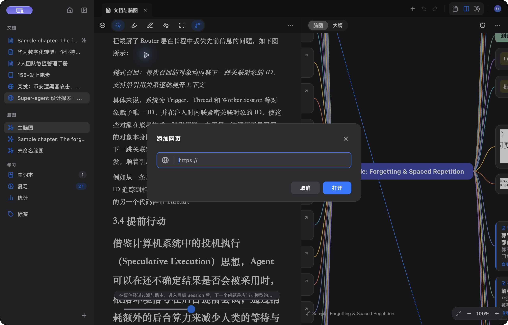
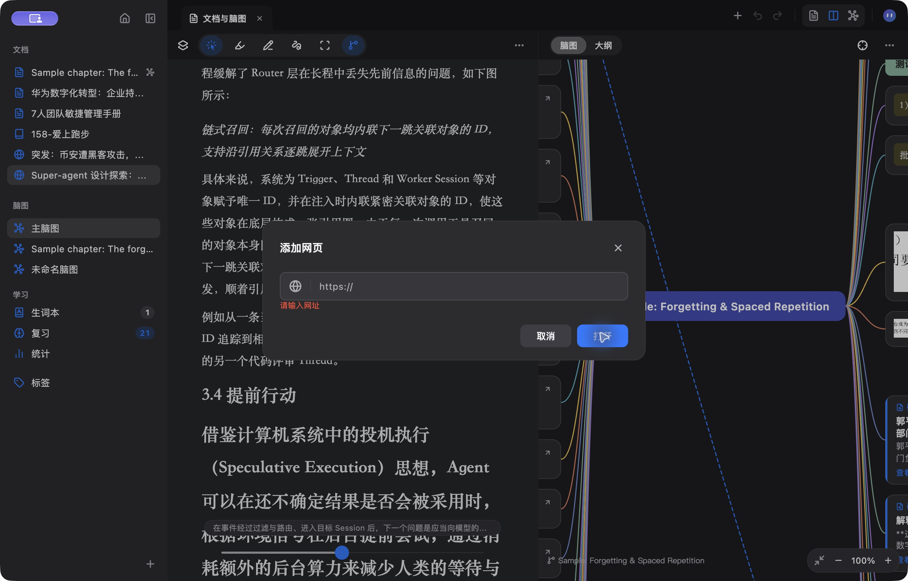
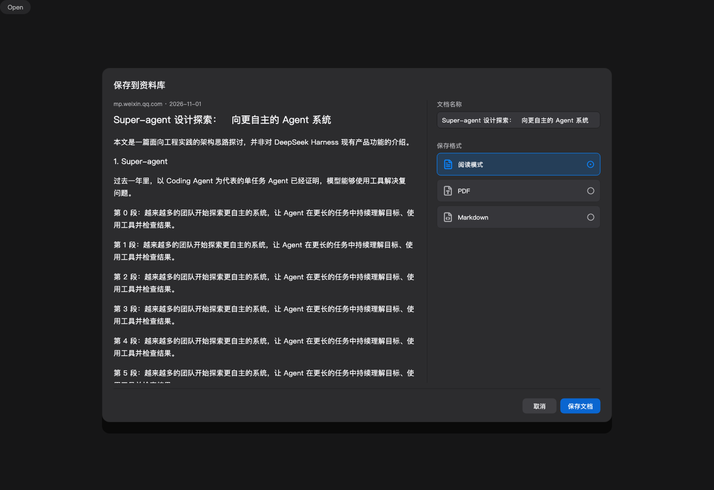
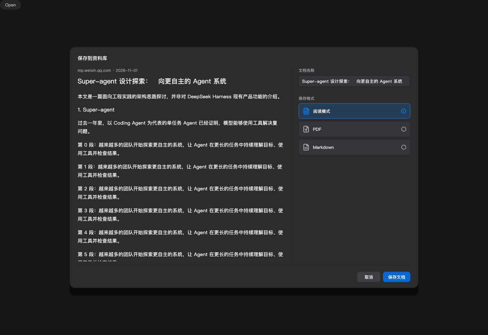

# 网页相关桌面对话框检查

2026-11-01。范围为“添加网页 / 打开”和网页转文档的“保存到资料库”。

## 结论

发现并修正两处字号偏差，按钮尺寸和整体材质一致。

| 项目 | 打开网页 | 保存到资料库（修正后） | 依据 |
| --- | --- | --- | --- |
| 弹窗标题 | 15pt、700 | 15pt、700（原18pt） | MMSheet 默认标题 |
| 表单标签 | 当前设计无可见标签，输入有语义名称 | 12pt、500（原13pt、400） | MMFormRow 弹窗标签 |
| 输入文字 | 13pt | 13pt | MMTextField / mmText.body |
| 底部按钮 | 高32pt、最小宽72pt、圆角8pt、文字13pt | 同左 | MMButton + MMDialogScope |
| 按钮间隔 | 8pt | 8pt | MMSheet |
| 外框 | 圆角16pt、0.5pt细边、相同背景与阴影 | 同左 | MMSheet |

地址栏40pt、文档名称框36pt属于不同控件的既有尺寸；格式选择卡48pt，文章预览15pt及1.75行高，承担内容展示职责，保留原设计。文章标题20pt也属于预览内容，不与弹窗标题混用。

## 检查步骤

1. 打开网页：正常。实际macOS应用截图检查标题、地址栏、取消/打开按钮，未见裁切或错位。
2. 空地址提交与输入：正常。实际应用展示“请输入网址”，按钮位置稳定；输入后清除错误，回车打开示例网页。
3. 保存到资料库：已修正。使用当前生产组件在测试引擎中渲染，检查桌面1512×1040、矮窗口900×420和390×780布局；修正标题和表单标签字号。正文与设置分栏、预览滚动、取消和保存按钮可见性通过既有测试。

## 当前截图

打开网页（macOS实际应用，Retina截图的像素数为逻辑尺寸两倍）：

空地址错误（macOS实际应用）：

保存到资料库（修正前，生产组件测试渲染）：

保存到资料库（修正后，生产组件测试渲染）：

## 验证与限制

- Flutter 3.47.6：`flutter test --no-pub test/web_conversion_layout_test.dart test/browser_test.dart`，8项通过。
- 两个弹窗所属文件 `flutter analyze --no-pub`，无问题。
- 配色、字体和尺寸依据当前mm_design组件与docs/design-system.md；地址栏专用尺寸依据现有选定设计。
- 实际应用截图为深色；保存弹窗截图来自真实生产组件的测试渲染，不能代表已安装应用已更新。未替换应用。
- 已检查输入语义名称、格式选项选中语义和Esc关闭的代码路径；未完成屏幕阅读器、系统放大文字及浅色主题的实际应用验收，不宣称全面无障碍合规。
