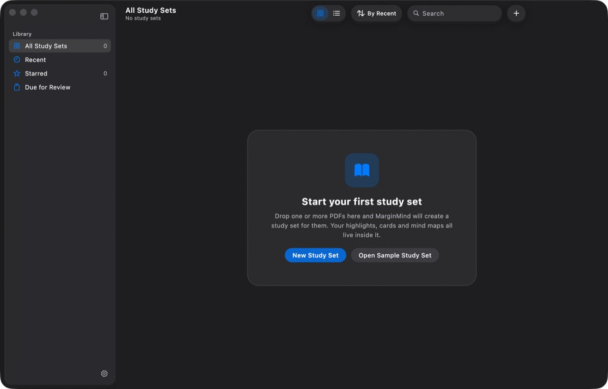
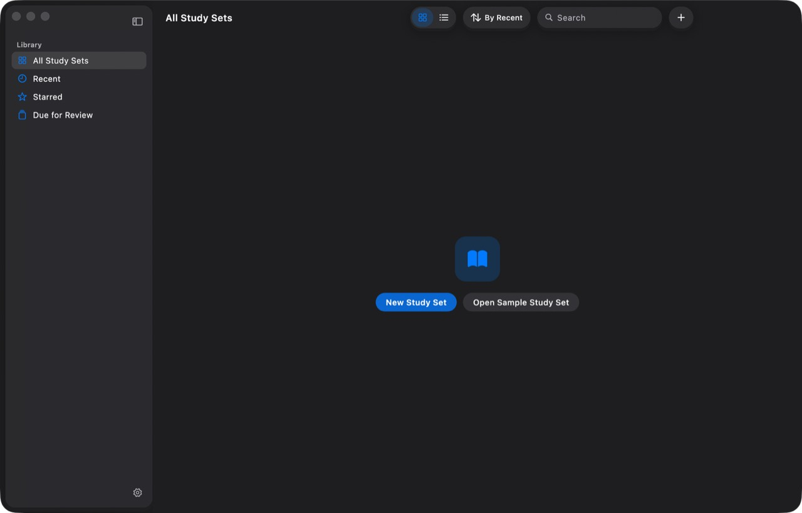
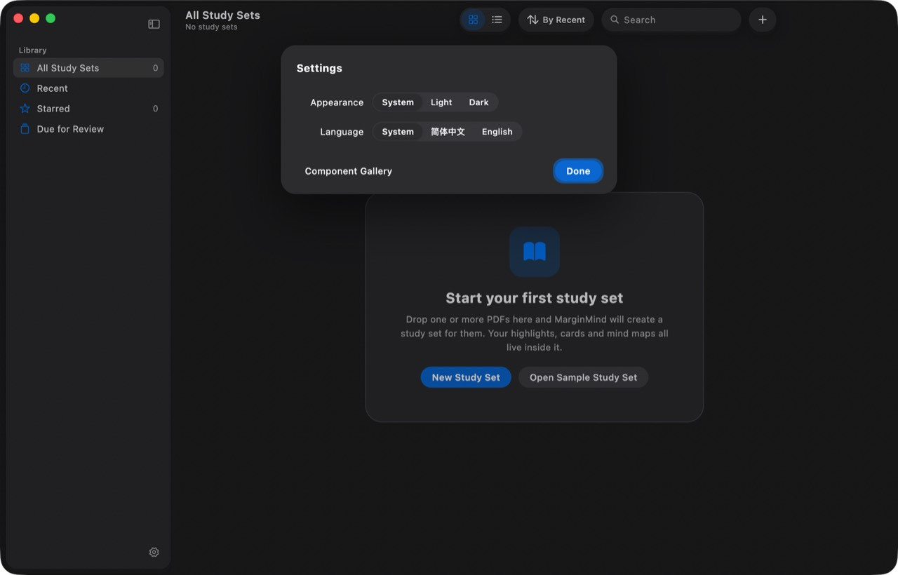
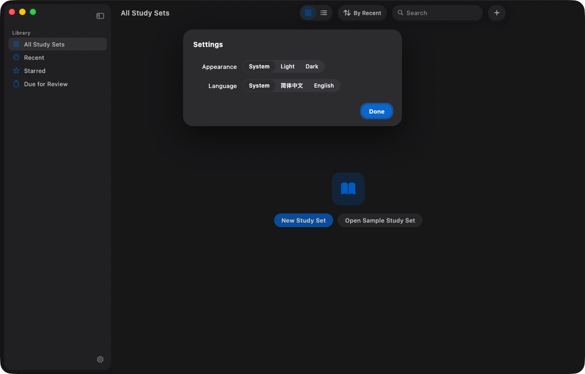
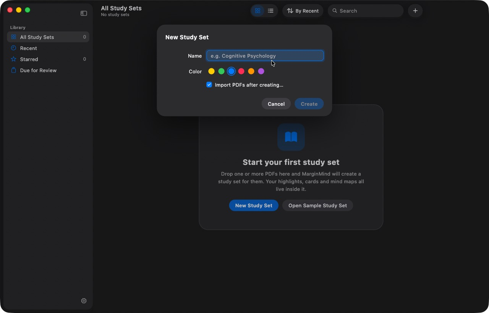

# GUL-501 资料库与无障碍验证

2026-10-26，远程 Mac mini（Apple 芯片），macOS 26.6.2、Flutter 3.47.2。修改前为 `main`（`8bb4d8a`），
修改后为本分支，两者都是 `flutter build macos --release` 构建，独立 bundle ID
`io.github.mylxsw.marginmind.review501`，保留 Release 沙盒 entitlements，从空资料库启动。

## 结果

| 编号 | 修改前 | 修改后 |
| --- | --- | --- |
| U-L2 | 带边框卡片 + 标题 + 两行说明；页头副标题“No study sets” | 只有图标和两个按钮，页头没有副标题 |
| U-L4 | “全部”“已收藏”显示 0 | 空资料库不显示任何计数 |
| U-G2 | Release 设置里有“Component Gallery” | Release 设置里没有该按钮 |
| U-L1 | “新建学习集”先弹出起名表单（名称 / 颜色 / 创建后导入） | 见下方说明 |

## 截图

| | 修改前 | 修改后 |
| --- | --- | --- |
| 空资料库 |  |  |
| 设置 |  |  |
| 新建学习集 |  | — |

## 未在真机上完成的项

验证时同一台 Mac 上另有其他任务在跑 PDF 性能基准，其窗口持续抢占前台：

- **U-L1 打开面板**：菜单命令和打开面板需要应用成为前台，自动化无法稳定获得焦点，没有拍到“选 PDF → 生成并打开”的真机过程。行为由 `library_test.dart` 的三个用例覆盖（先选 PDF 生成并打开、取消不创建、文件夹视图），真机步骤列为 `macos-acceptance.md` 的 L-1。
- **U-L3 VoiceOver**：Flutter 只在 VoiceOver 打开时向系统暴露语义树，而打开 VoiceOver 会干扰同机的性能基准，因此没有录制朗读。语义结构由 `mm_design/test/semantics_test.dart` 与 `library_test.dart` 验证（按钮、侧栏行、学习集卡片各读一次，内部星标按钮仍可单独聚焦），真机朗读列为 L-3。
- **拖入 PDF 悬停态**：自动化拖拽无法模拟从访达拖入文件，列为 L-2。
