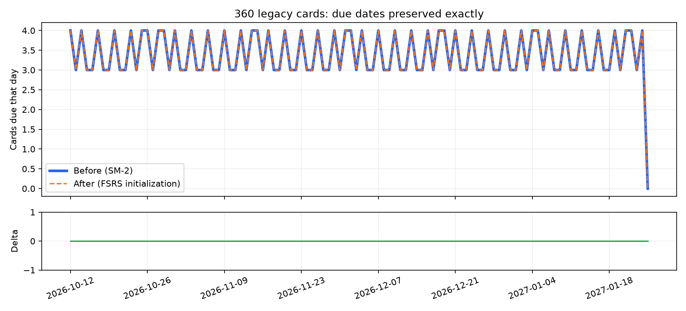

# GUL-508：FSRS-5 验证

## 实现与参考

调度与记忆公式固定到官方 [ts-fsrs v4.5.2](https://github.com/open-spaced-repetition/ts-fsrs/tree/cdd9158eedf81f3b962bf63f8d49346fcdccf8e6)，
采用其 FSRS-5 默认 19 参数、90% 保留率、无 fuzz 的 BasicScheduler。
[官方参考测试](https://github.com/open-spaced-repetition/ts-fsrs/blob/cdd9158eedf81f3b962bf63f8d49346fcdccf8e6/__tests__/FSRSV5.test.ts)
中的首评、间隔序列及记忆状态均已移植对拍；MIT 许可随仓库保存在 `third_party/ts-fsrs-LICENSE`。

- 参考间隔：`0, 4, 14, 44, 125, 328, 0, 0, 7, 16, 34, 71, 142`。
- 参考记忆状态：stability ≈ 48.4848、difficulty ≈ 7.0866。
- 产品保留旧 `reps` 的“连续成功次数”语义，不将其改为参考库的总评分次数。
- 最大间隔约束在评分排序之后再应用，防止 Hard/Good/Easy 的递增约束越过上限。
- 整组权重与目标保留率、最大间隔可注入；预览和实际评分使用同一配置。

## 迁移回归

固定数据集 `packages/mm_data/test/fixtures/fsrs-cohort.json` 有 360 张旧卡，含逾期、半天、成熟、重学、
不同 ease 与 lapses，旧间隔 0～365 天。通过真实 `FileLibraryStore` 的格式 5→6 迁移加载，
仅补缺失记忆状态，保留旧排期的每个字段及原始备份。106 天的逐日到期数量 delta 全部为 0，
逐日累计复习队列也逐项一致；首次保存写入记忆状态，重开不重复初始化。

初始 stability 取旧正间隔（夹限 .01～36500 天）；零间隔取默认 Again stability。
初始 difficulty = clamp(5 + 2 × (2.5 − ease) + ln(1 + lapses), 1, 10)。
这只是缺少完整历史时的有界估计，不宣称能恢复真实记忆参数；迁移不重排 due，实际评分才使用 FSRS。

[曲线 CSV](due-curve.csv) · [曲线图](due-curve.png)



复现（仓库根目录）：

```sh
dart run packages/mm_data/tool/fsrs_migration_curve.dart
# Python 环境需安装 matplotlib
python3 tool/plot_fsrs_migration.py
```

## Mac mini Release

2026-10-26，macOS 26.6.2，Flutter 3.47.2；修改前 `787cc5c` 与本分支均 `flutter build macos --release` 成功。
使用独立 bundle ID `io.github.mylxsw.marginmind.review508before` / `review508after` 的临时非沙盒签名副本，
隔离 Application Support 数据；未更改发布 entitlements。此次 GUI 验证不覆盖正式沙盒包启动。

| 验证 | 结果 |
| --- | --- |
| 同一份旧数据迁移 | 前后资料库均 2 张到期卡，原 due 不变 |
| 评分预览 | 评分 1–4 与布局不变；SM-2 为 10 分钟 / 1 天 / 3 天 / 3 天，FSRS 为 5 分钟 / 2 天 / 3 天 / 8 天 |
| 点击 Good | 唯一日志 1→3 天，同时写入记忆状态（S=3.46735238、D=6.08539138） |
| 退出重开 | 待复习数 1，JSON 字节不变，无重复日志 |

[修改前资料库](before-library.png) · [修改后资料库](after-library.png) ·
[修改前评分](before-rating.png) · [修改后评分](after-rating.png) ·
[重开](after-reopen.png) · [评分后原始数据](after-rating.json)

## 自动检查

- format、analyze 通过。
- 七个测试套件全部通过；汇总覆盖率 92.88%，mm_core 96.72%，mm_data 96.81%。
- 对照 Git diff 与 LCOV，新增/修改的可执行源码行 102/102 覆盖（100%）。
- 新增组件回归验证预览使用持久化记忆状态及注入配置，实际保存与预览一致。
- Python 工具测试 11 项通过。
- macOS 原生测试 4 项通过。
- 修改前后 Release 构建成功。

物理键盘验收见 `docs/macos-acceptance.md` 的 GUL-508 项。
