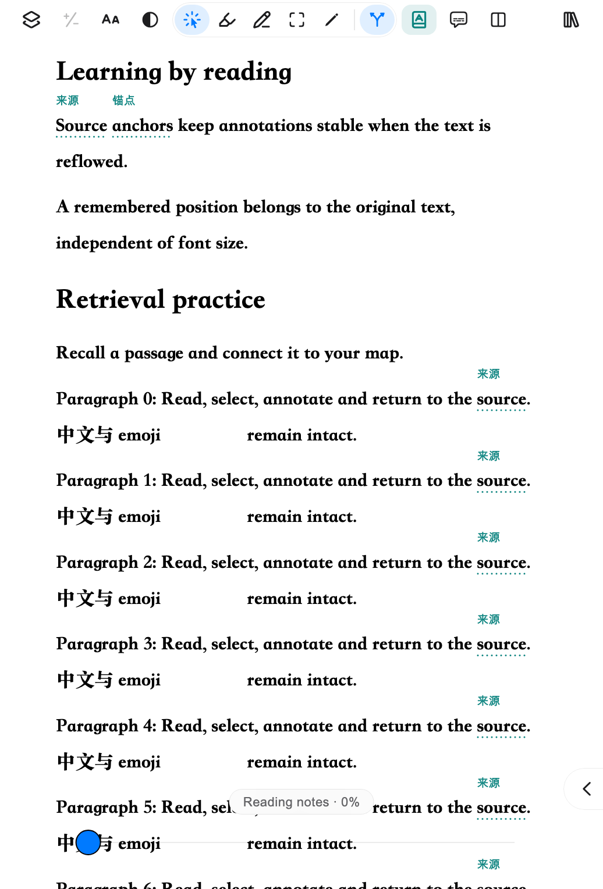
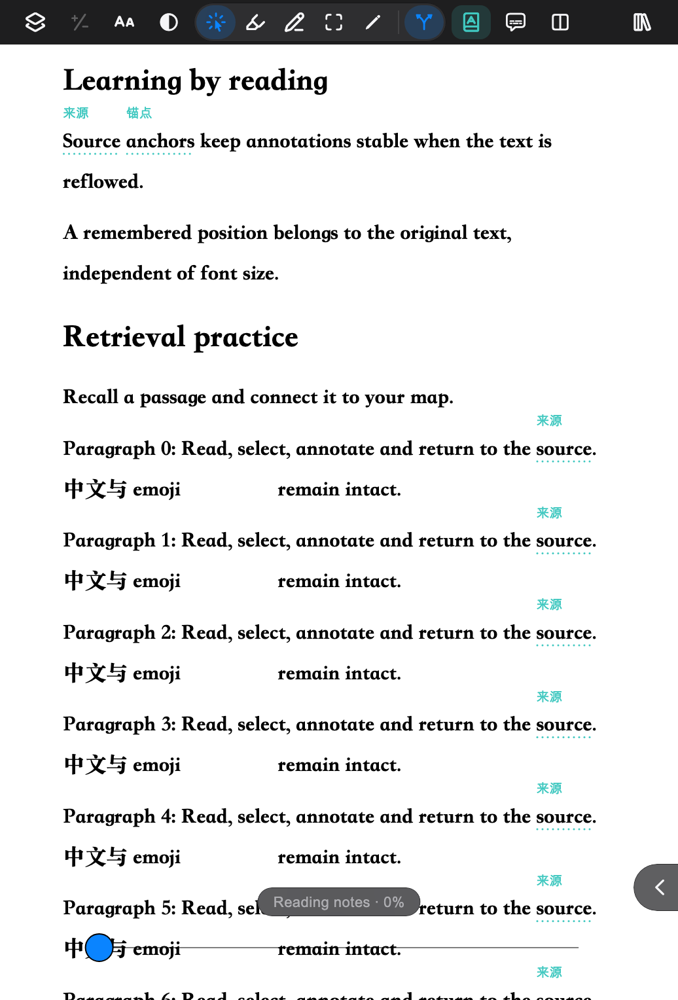

# GUL-597 验证记录

生词提示使用临时绘制层；不改正文布局，不创建标注或学习集撤销记录。PDF 使用原页字符框，流式文档使用 canonical anchor；两种阅读器都只为可见页和相邻页保留显示几何。匹配沿用 128 段 LRU，流式几何上限 6 组，PDF 几何随离开视口邻域淘汰。

命中卡片打开后才按当前词建立全文导航索引：流式文档扫描 canonical 文本而不排版离屏章节，PDF 逐页读取文本；关闭卡片会停止后续扫描。这是取得准确 `n / N` 所需的按需操作，不在滚动路径上执行。加入后闪烁也适用于关闭提示的文档，闪烁结束仍保持关闭。

## 自动验证

覆盖范围包括 UTF-16 到字符框/流式矩形、跨行与已掌握过滤、邻页淘汰、释义空隙退化、明暗 golden、拖选优先、全文导航与失败恢复、移出和撤销、详情入口、快捷键/工具栏/Aa/偏好持久化、新增闪烁与关闭状态。截图导出使用像素检查，验证屏幕含青绿提示而导出不含提示。

常规 golden 使用 Flutter 测试字体；以下真实字体截图用于人工检查：

| 阅读器（释义） | 命中卡片 |
| --- | --- |
|  |  |
|  |  |

实际执行：

- `python3 tool/coverage.py`：12 个套件全部通过（应用 960 项通过、30 项条件性跳过），总体 91.86%。
- Rebase 最新 main 后，重新运行 `packages/mm_design` 全套（171 项通过），以及应用全套（961 项通过、30 项条件性跳过） `flutter test --coverage --coverage-package='^(marginmind|mm_pdf|mm_reflow)$'`；跨包采集用于统计应用集成测试覆盖到的 PDF/流式代码。
- `flutter analyze --no-pub`、`dart format --output=none --set-exit-if-changed apps packages`：通过，643 个 Dart 文件无需格式改动。
- `python3 -m unittest discover -s tool/tests`：26 项通过。
- `MM_SCREENSHOTS=../../docs/evidence/gul-597 flutter test --no-pub test/vocabulary_hint_screenshot_test.dart`：浅深色两项通过。
- macOS Release 性能目标构建成功；`xcodebuild test` 定向运行 `RunnerTests` 中工具栏原生命中、全屏失败恢复、完整指针转发三项：全部通过。未把这些结果当作完整 OCR/浏览器/钥匙串原生测试套件的结果。

最终合并覆盖率 **92.13%**；新增可执行行 **676/695（97.27%）**，以 `git diff HEAD` 新增 `lib/` 行和合并 LCOV `DA` 记录求交集（包含生成的本地化代码，声明/空行不计）。逐文件数据见 [changed-coverage.json](changed-coverage.json)。

## 性能复现

设备：Apple M4（10 核）、16 GB，macOS 26.6.2；Flutter 3.47.2 / Dart 3.13.2，macOS Release，1000 × 700 窗口。沿用仓库现有 300 页 benchmark 文档生成器，生词本 1000 词，其中 7 词反复出现在该文档。使用同一程序内的关闭提示作基线，分别测量下划线、释义；并非两个历史提交的比较。

每种模式分别执行线性滚动和模拟惯性滚动，每次驱动 360 次 vsync（实际收到 352–361 条 FrameTiming）；`first` 为该模式首次遍历，`repeat` 为再次遍历，不宣称清除了系统/PDF 引擎缓存。原始 UI/raster/total 帧耗时（微秒）和 RSS 保存在 [pdf-frames.json](pdf-frames.json)。运行性能程序时不并行运行测试。

| 模式 | 首次线性滚动 p95 | 首次惯性滚动 p95 | 重复线性滚动 p95 | 重复惯性滚动 p95 | >16.67ms 帧 |
| --- | ---: | ---: | ---: | ---: | ---: |
| 关闭（基线） | 1.964ms | 1.963ms | 1.953ms | 1.970ms | 0% |
| 下划线 | 7.343ms | 6.892ms | 7.113ms | 7.132ms | 0% |
| 释义 | 7.890ms | 6.839ms | 8.027ms | 8.284ms | 0% |

本次所有采集帧均低于 16.67ms。下划线/释义有可测的绘制成本，但本机该基准未出现超出 60Hz 帧预算的帧；结果不外推到所有设备。

```sh
swift tool/sample/make_benchmark_pdf.swift apps/marginmind/assets/sample/benchmark.pdf
cd apps/marginmind
flutter build macos --release --target benchmark/vocabulary_hints.dart
build/macos/Build/Products/Release/MarginMind.app/Contents/MacOS/MarginMind
```

程序输出 `VOCABULARY_BENCHMARK_JSON=...` 后自行退出。该程序只使用内存生词仓库与偏好，不读取或覆盖用户生词/设置；生成的 300 页 PDF 不纳入版本控制。模拟滚动测量不等于人工触控板体验测试。

## 自审

- 入口到出口：PDF/流式、设置与菜单、卡片导航/编辑/撤销/详情均有对应验证。
- 边界与失败：无文本/无字框、已掌握、文档隐藏、异步过期、导航/持久化失败、释义碰撞和边界均有处理；长卡片可滚动。
- 资源：定时器、PDF 监听器、TextPainter 与导出 image 均释放；异步读取在关闭卡片/阅读器后停止发布；缓存有界。
- 导出隔离：PDF 临时高亮不参与自动裁边，流式截图在独立 scene 中排除提示层，不闪动屏幕。
- 安全与一致性：未新增网络访问、凭据或依赖；中英文 ARB、设计令牌与文档同步。
- 自审/回归发现并修复：截图图层在滚动时的失效断言、Aa 英文窄面板溢出、卡片底栏宽度、PDF 每帧重复重建与释义重复测量。
