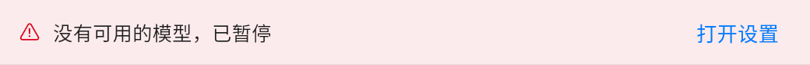
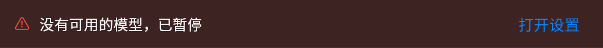
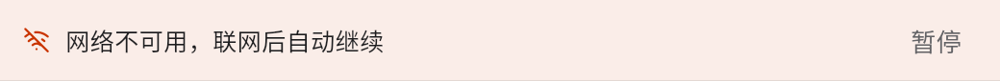
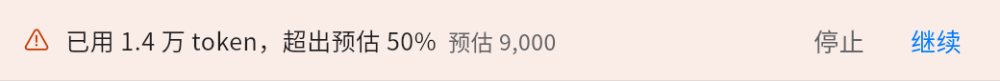
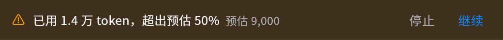

# GUL-619: 全文翻译 · 失败、预算与通知界面 (Stage 4 · E)

## 1. 概述

本交付实现 `docs/full-translation.md` §3.5、§5、§9、§10 以及 `design/prototype/full-translation.html` 场景 9、10、11、14 定义的窄条提示、断网自动续译与 HUD、超出预估确认、后台完成系统通知与无障碍/减少动态效果：

- **AI 栏标题栏下方窄条 (`FullTranslationStrip`)**：
  - **API Key 失效**：`API Key 无效，已暂停` + 副文本 `已译内容已保存`，操作：`打开设置`、`重试`。
  - **没有可用的模型**：`没有可用的模型，已暂停`，操作：`打开设置`。
  - **断网等待 (`offline`)**：`网络不可用，联网后自动继续`，操作：`暂停`。
  - **超出预估 50% (`budget`)**：`已用 {tokens} token，超出预估 50%` + 副文本 `预估 {estimate}`，操作：`停止`、`继续`。
- **断网恢复自动继续与 HUD**：
  - 网络不可用引起的 `offline` 状态在联网恢复时自动继续翻译，并弹出 HUD `网络已恢复，继续翻译`。
  - 用户主动点击 `暂停`（`pauseReason: user`）的任务在网络恢复时保持暂停，不会自动继续。
- **超出预估确认 (`budgetAcknowledged`)**：
  - 当累计用掉的 token 超过开始前预估的 150% 时暂停在当前段之后，显示超出预估窄条；点击 `继续` 置 `budgetAcknowledged = true`，同一任务后续不再重复询问。
- **窗口不在前台时的系统通知 (`MMSystemNotification` / `SystemNotificationChannel`)**：
  - 平台能力说明：通过 `packages/mm_platform` 新增 `MMSystemNotification`（通道 `marginmind/system_notification`），macOS 端由 `apps/marginmind/macos/Runner/MainFlutterWindow.swift` 中的 `SystemNotificationChannel` 调用原生 `UNUserNotificationCenter` 发送系统通知；非支持平台或无权限时静默降级返回 `false`。
  - 当全文翻译进入 `done` 且应用窗口不在前台（`AppLifecycleState != AppLifecycleState.resumed`）时，发送系统通知：标题 `全文翻译完成`，正文 `{文档名}`（无未译段落）或 `{文档名} · {n} 段未译`（有未译段落）。
- **无障碍与减少动态效果**：
  - 顶栏胶囊具备完整读屏标签：`全文翻译，{percent}%，第 {batch} 批，{done} / {total} 页`。
  - 页码网格每格具备按钮语义与完整读屏标签：`第 {page} 页 · {state}`。
  - 检查点具备 `SemanticsRole.dialog`、`namesRoute`、`scopesRoute`、`liveRegion`，出现时播报标题且不抢夺阅读焦点。
  - 开启系统“减少动态效果”（`MediaQuery.disableAnimations` / `MMAppearance.reduceMotionOf`）时，任务面板翻译中页码格停止呼吸动画并改为静态强调色，阅读译文占位停止闪烁动画。

## 2. 视觉证据 (Light / Dark 窄条截图)

### 2.1 API Key 失效 (`strip-key-light.png` / `strip-key-dark.png`)

### 2.2 没有可用的模型 (`strip-no-model-light.png` / `strip-no-model-dark.png`)

### 2.3 等待网络 (`strip-offline-light.png` / `strip-offline-dark.png`)

### 2.4 超出预估 (`strip-budget-light.png` / `strip-budget-dark.png`)

