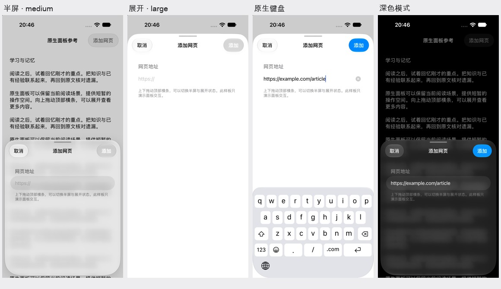

# UIKit 原生 Sheet 参考原图

独立参考 App，不是已完成改造的 Foliarc。高度通过样板测试命令切换，尚未进行手指拖动验收，也未验证与 Flutter 的混合呈现。

[研究与接入方案](../../ios-native-presentation-review-2026-11-02.md) · [样板源码](../../prototypes/ios-native-sheet-reference/README.md) · [采集信息](capture.json)

- [半屏](01-medium.png)
- [展开](02-large.png)
- [键盘输入](03-keyboard.png)
- [深色半屏](04-medium-dark.png)
- [未保存确认](05-unsaved-confirmation.png)
