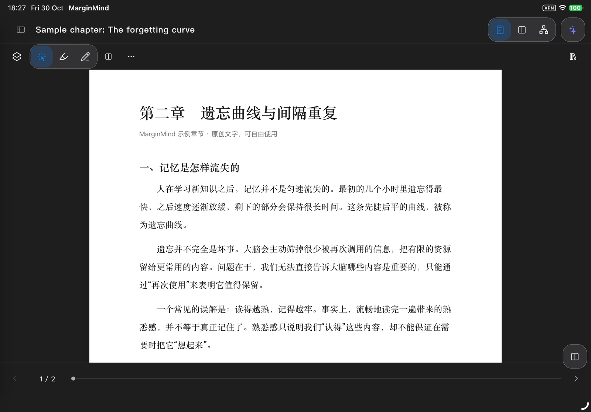
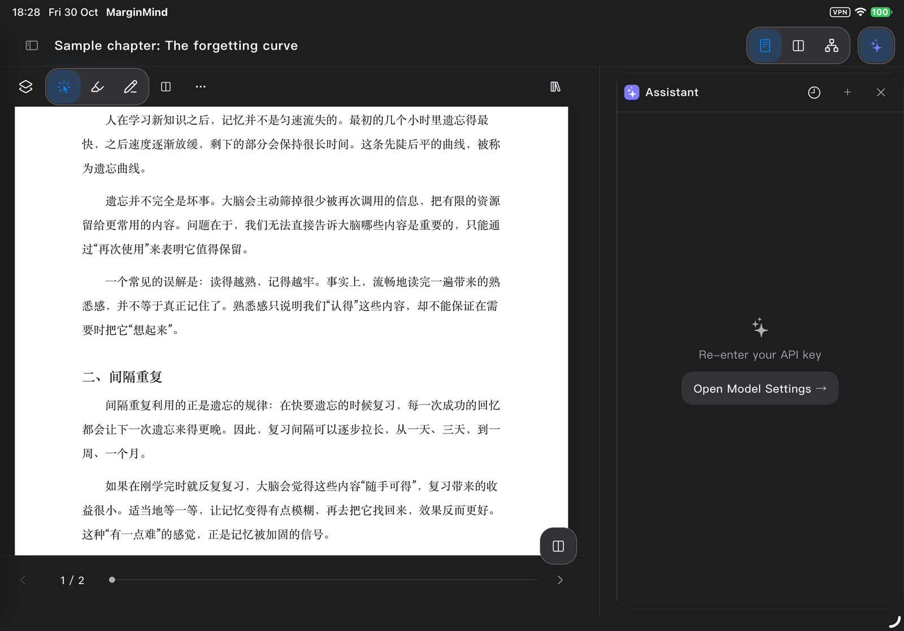
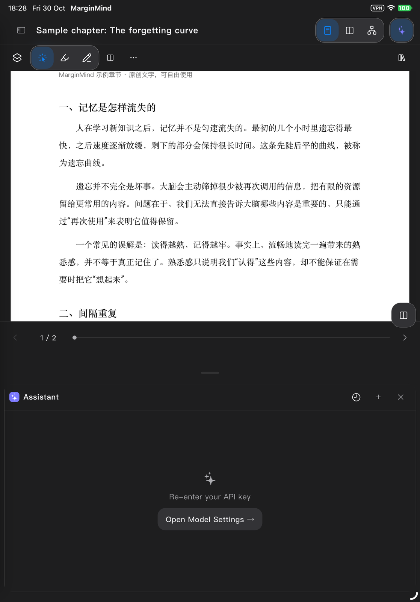
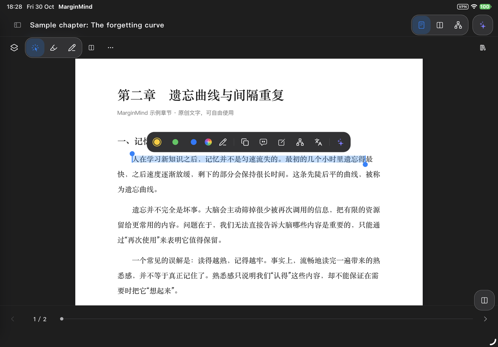
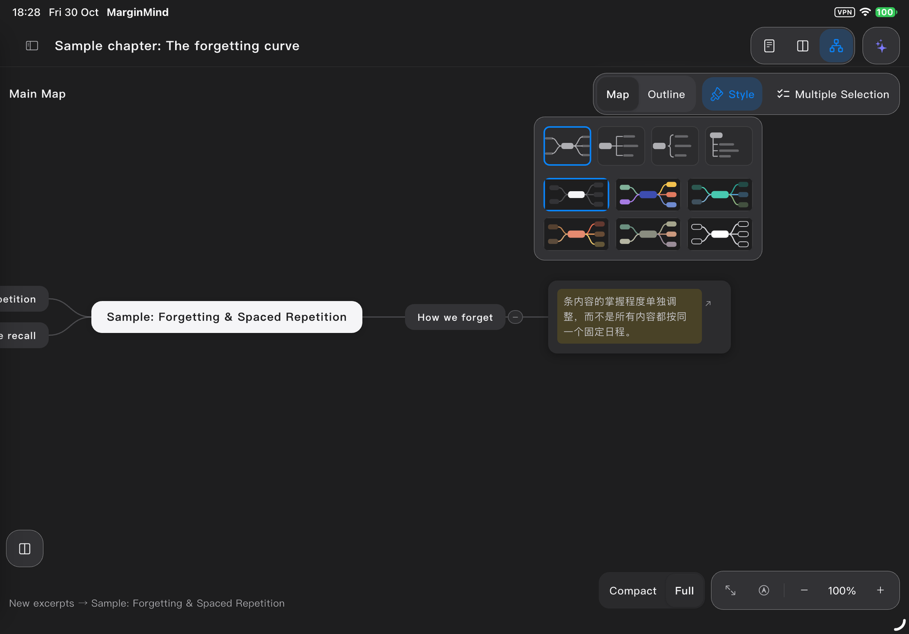
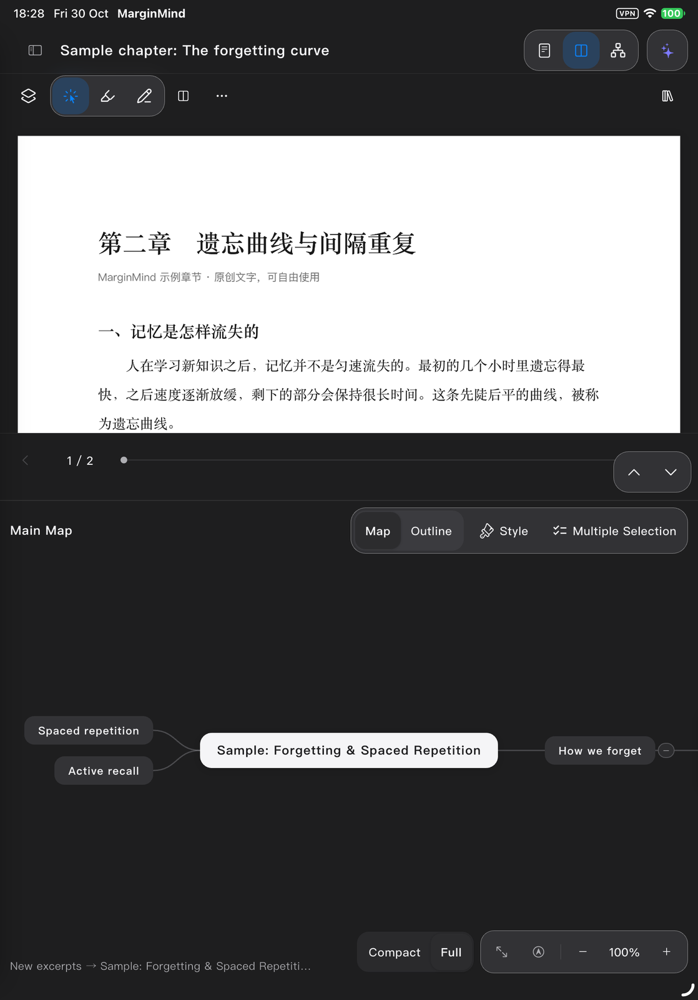

# iPad 适配修复与验收

2026-10-30。版本 **0.8.0（9）**，在连接的 iPad Pro 11 英寸（第 4 代，iPadOS 27.2）覆盖安装，保留原有数据。源码基线为 `384236e`，修复位于 `codex/ipad-adaptation` 的独立工作区。

## 修复结果

- 助手改为参与布局的伴随面板：横屏靠右，竖屏在下方，可调高度。打开面板后仍可操作原文；旋转和键盘弹出不会改写已保存的阅读布局。
- 脑图样式面板不再触发重新适应画布。打开、关闭均保留缩放和位置。
- iPad 分页有独立底栏，正文不再被页码、进度条覆盖。
- 按钮、输入框、开关和可交互复选框统一保留至少 44 点的点击区域；接鼠标后不缩回桌面尺寸。PDF 选字把手使用细杆圆点，拖动区域同样为 44 × 44 点；把手与选字工具栏共享操作区域，拖动不再被误判为点击外部而清除选区。
- iPad 界面正文增至 15 点，辅助文字增大，图标视觉尺寸与点击区域分开。PDF 正文和脑图节点字号保持原值。
- 阅读工具保留选取与文字标注，低频命令进入“更多”；脑图节点常用动作加文字，低频命令进入菜单。
- 次级工具组采用较平的材质和轻分隔。修正助手装饰图标溢出，并让资料库卡片随放大字号增加高度。
- iPad 面板空间与横竖分栏按可用空间分别计算，不再同时受 1180 点断点控制；设置窗口避让系统键盘。

这些变化由平板条件控制。Mac 原有控件尺寸、字体、工作区布局和样式面板行为保留；未替换本机安装的 Mac 应用。

## 验证

| 检查 | 结果与范围 |
| --- | --- |
| 两轮修复完整回归 | 976 通过，34 跳过；覆盖原有 Mac、iPhone、阅读、标注、脑图和助手逻辑 |
| 最终针对性回归 | 28 通过，含 13 项 iPad 适配检查及资料库回归；包含新增的 1.3 倍字号场景 |
| 设计组件测试 | 173 通过；同时断言 Mac 原有尺寸、iPad 的 44 点区域及鼠标输入后的稳定性 |
| 选字针对性回归 | 54 通过，覆盖选字、下划线及 iPad 适配 |
| PDF 组件测试 | 111 通过；新增把手仅在 iPad 主阅读器启用，默认路径保留 |
| 静态分析 | 无问题 |
| Mac Release | 构建成功 |
| iPad Release | 开发签名校验成功，覆盖安装成功 |
| 真机自动操作 | 工作区与设置键盘两项 XCTest 通过，包含真实长按选字、把手拖动、原文滚动、助手开关、脑图样式开关和横竖屏切换 |

布局测试覆盖 834 × 1194、1194 × 834、1024 × 768、600 × 900、500 × 900，以及 1179/1180 点附近。相机测试分别保存并比较 53%、100%、200% 下的完整变换矩阵。软件键盘检查包含竖屏不能误判成横屏、发送按钮和设置关闭按钮仍可点击。

选字把手补修后，重新运行了 54 项选字/适配回归和 111 项 PDF 测试，并再次完成 Mac 和 iPad 构建。

真机通过系统截图留证，使用项目自带示例文档。选字检查没有创建或删除摘录。原始日志及 `.xcresult` 留在本地忽略目录 `build/`；下列截图仅等比例缩小。

真机助手显示需要重新输入 API Key，因此没有向真实模型发送请求。发送与回包使用测试服务完成回归。Apple Pencil 手感、外接触控板实物、VoiceOver 和所有动态字号档位未做真机验收；鼠标尺寸保持和 1.3 倍字号已由界面测试覆盖。

## 真机截图













## 复验入口

应用测试位于 `apps/marginmind/test/ipad_adaptation_test.dart`，尺寸检查位于 `packages/mm_design/test/tablet_chrome_test.dart`。真机用例位于 `tool/ipad_acceptance/`，操作已经安装的 Release 应用，要求界面为英文。设置 `IPAD_DEVICE_ID` 和 `APPLE_TEAM_ID` 后，在仓库根目录运行：

```sh
xcodebuild test \
  -project tool/ipad_acceptance/iPadAcceptance.xcodeproj \
  -scheme iPadAcceptance \
  -destination "id=$IPAD_DEVICE_ID" \
  -derivedDataPath build/iPadAcceptance \
  -resultBundlePath build/iPadAcceptance.xcresult \
  -allowProvisioningUpdates \
  DEVELOPMENT_TEAM="$APPLE_TEAM_ID"
```
