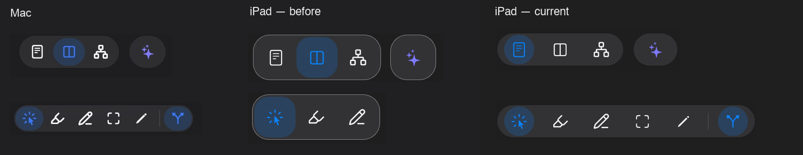
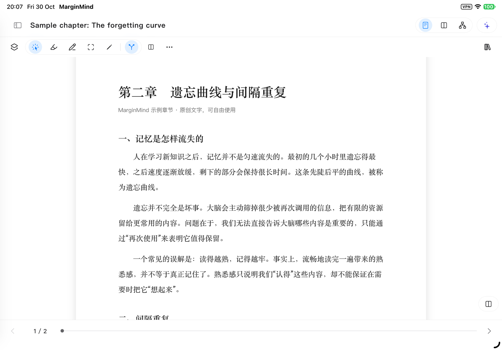
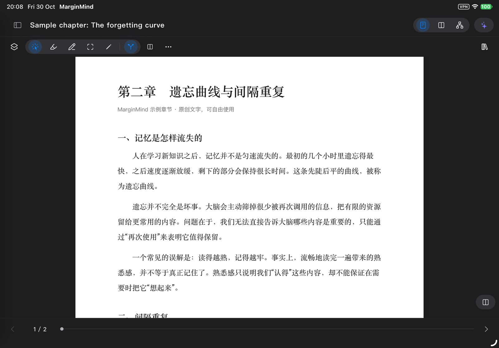
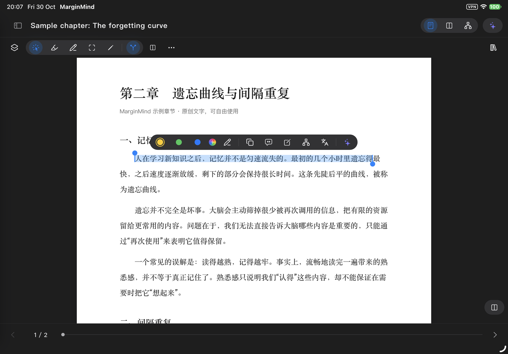
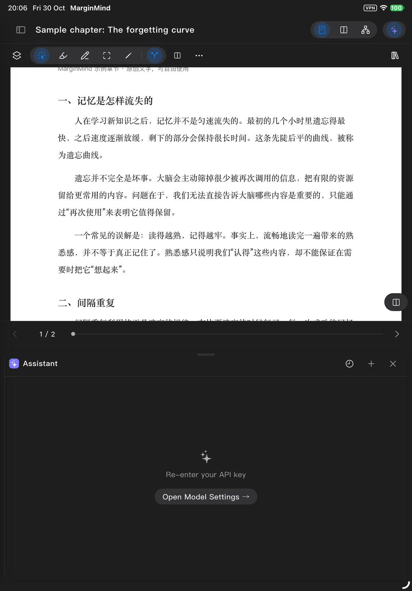

# iPad 控件与 Mac 视觉统一

版本：0.8.0（10）。以现有 Mac 视觉为基准，当前源码仅在平板条件下启用新外观。

## 当前验收状态

**0.8.0（10）已覆盖安装到连接的 iPad，实机交互和实际画面复核均完成。** 保留原有数据，恢复测试前的主题偏好。临时测试程序已移除，主应用已重新启动。

## 变更

- 点击区域与可见背景分开：工具按钮可见高度 32 点，工具组可见高度 36 点，点击区域至少 44 点；图标沿用 Mac 共用集合，工具图标为 18 点，文字按钮图标为 16 点。
- 胶囊圆角按可见尺寸计算：按钮 16、工具组 18；分段控件融入同一工具组，避免重复底色和多层外框。
- 平板描边改用 Mac 的 `hairline`。原实现 `separator.withValues(alpha: .45)` 把淡色分隔线的透明度直接替换成 45%，导致边框过亮。
- 分页底栏在不需要来源说明时由原来的 80 点占位（64 点加 16 点悬浮间隔）收至 52 点，仍为进度和翻页保留 44 点操作高度；有来源说明时保留相应空间。
- 伴随面板之间只留 8 点视觉间隔；竖屏调整把手的 44 × 44 点触控区位于标题栏中间，不覆盖分页操作。横屏不可拖动的分隔线不占用 44 点空白。
- 阅读区按实际可用宽度显示命令：足够宽时直接显示框选、画笔和同步，窄分栏收进“更多”。资料库收藏按钮也采用紧凑可见尺寸和完整触控区。
- 保留 Mac 原有尺寸和渲染分支。未替换本机 Mac 应用。

## 已完成验证

- 应用完整测试：980 通过，34 跳过。
- 设计组件测试：178 通过。
- iPad 专项测试：15 通过，包括新把手区域、非重叠布局、放大字号、键盘与缩放保持。
- Mac 控件组合在浅色、深色下与修改前 RGB 像素一致，并加入对应截图回归。该检查使用确定的测试字体，实际图标呈现仍由实机截图验收。
- 静态分析无问题。
- Mac Release 与签名 iPad Release 均构建成功；iPad 包签名校验通过，版本确认为 0.8.0（10）。
- 紧凑下拉按钮恢复明确的按钮辅助功能标记。组件回归验证按钮身份、44 × 44 点范围和边缘点击打开命令菜单；真机已验证“更多”与菜单操作。

## 实机验收

iPad Pro 11 英寸（第 4 代），iPadOS 27.2。最终 `verified-ui.xcresult` 中五个用例全部通过：

| 用例 | 核验内容 | 结果 |
| --- | --- | --- |
| 横屏工作区 | 普通按钮至少 44 × 44 点，“更多”打开菜单，选字与把手拖动，助手、样式菜单 | 通过 |
| 竖屏工作区 | 助手不覆盖正文，44 × 44 点把手实际拖动改变面板高度，关闭及上下分栏 | 通过 |
| 旋转 | 从横屏转竖屏后打开助手、拖动调整、关闭 | 通过 |
| 系统键盘 | 横竖屏输入框操作，关闭按钮保持在键盘上方 | 通过 |
| 浅深主题 | 阅读器、选中节点工具栏、样式预览、竖屏分栏，并恢复原主题 | 通过 |

初次把全部流程串在一个长用例时，旋转后的 XCTest 控件树读取曾失败，实机画面仍显示面板。该失败未算作通过；最终按流程独立启动测试会话复验，五项均通过。系统键盘在开发截图中被隐藏，避让通过真机控件坐标验证。未输入密钥或发起真实模型请求。

本地构建、完整日志和实机结果位于 `build/ipad-density-20261030/`。复验入口沿用 `tool/ipad_acceptance/` 和上一轮文档中的 `xcodebuild test` 命令；当前工程包含上述五项用例。

## 实机截图

下面均为连接的实体 iPad 截图。整屏图仅按长边 1600 像素等比例缩小；对比图按每逻辑点 2 像素裁切，保持原比例，未修改控件外观。从左到右是 Mac 参考、iPad 修改前、iPad 本版。

其他画面：[选中节点工具栏](node-toolbar-dark.png)、[脑图样式](map-style-light.png)、[竖屏分栏](split-portrait-light.png)、[横屏助手](companion-landscape.png)。
