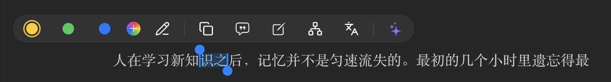
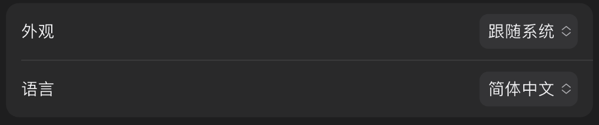
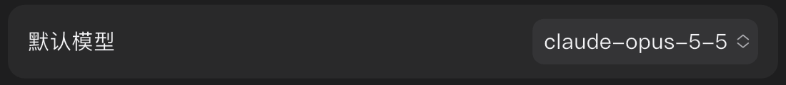
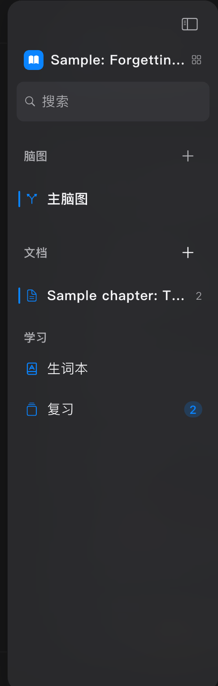

# iPad 笔输入、触屏打开与设置控件

版本：0.8.0（11），已覆盖安装到 iPad Pro 11 英寸（第 4 代，iPadOS 27.2），原有文档和标注保留。

## 当前状态

代码、构建和实机界面检查完成，临时测试程序已移除。当前打开示例 PDF 的画笔工具，等待用户用真实 Apple Pencil 试写反馈；**尚不把程序模拟笔事件当作实际握笔体验已通过**。

## 定位与修复

1. 中文选字：PDF 的默认长按会选择整个文字片段，中文片段可能就是整行。平板改为按字符起选，连续拉动按字符扩展，拉动把手可以继续精调；连续拉丁字母和数字仍按词起选。平板的 Pencil 和鼠标均走精确选择，保留轻点链接、批注以及编辑框本来的操作。
2. 短笔画：原来的拖动识别需要先移动一段距离才开始；落笔后的小点、短线还会被“少于两个点”或“小于 2 个 PDF 点”的过滤排除。平板 Pencil 改为直接采集落笔、移动、抬笔和取消事件，落笔生成可绘制点，抬笔补齐末点；自由线保留短点，降低采样过滤距离。手掌先落在页面或随后触碰，都不应抢走正在书写的手势；抬笔后手指仍可阅读滚动。PDF 与重排文档复用笔输入区域，选择把手和批注编辑层保留自己的操作。
3. 设置下拉框：原先把 44 点触控要求直接用作背景高度。现在与本轮按钮统一为 32 点可见高度，至少 44 点点击范围；统一圆角和箭头尺寸，覆盖通用、模型及其他共用弹出选择器的设置页。
4. 学习集：触屏卡片、列表改为单击打开，列表行在 iPad 上保留 44 点高度；Mac 继续使用双击打开。
5. 工作区侧边栏：iPad 文档、脑图和网页条目使用细标记线与文字加重表示选中，取消整块选中底色；保留选中语义、操作区域和键盘焦点提示。Mac 沿用原样。

## 验证

| 检查 | 结果 |
| --- | --- |
| 应用完整测试 | 984 通过，34 跳过 |
| PDF 组件测试 | 117 通过 |
| 设计组件测试 | 181 通过 |
| 静态分析 | 无问题 |
| Mac 控件浅深色截图回归 | 通过 |
| iPad 签名 Release / Mac Release 构建 | 通过 |
| iPad 实机界面用例 | 7 项通过，另有画笔工具准备检查 1 项通过 |

笔事件回归覆盖一个点和连续 20 条短笔画、手掌先触碰后落笔、取消、手指滚动、Pencil 和鼠标的两字选择、用 Pencil 拖动把手、空白处取消选择，以及扫描页继续提供 OCR 提示。短笔画用例收到了完整的 21 条提交。这些是程序输入事件测试，未测量真实 Apple Pencil 的端到端延迟。

实机检查使用触控自动化，覆盖卡片和列表单击进入、选中条目语义与新侧边栏、设置弹出菜单和 44 点触控区域、实际部分选字与把手扩选、横竖屏面板、键盘避让和浅深主题。保留了原来的中文界面、阅读配色、语言及主题偏好。首次脚本按英文定位失败，随后增加中英文定位并完整复验通过，未将定位失败计作产品通过。

最后签名包的 `CFBundleVersion` 已核对为 11。实机结果为 `build/ipad-input-20261030/device-after/localized-ui.xcresult` 与 `pencil-ready.xcresult`；构建和测试日志同在 `build/ipad-input-20261030/`。复验脚本位于 `tool/ipad_acceptance/`。

## 实机画面

以下是连接的实体 iPad 截图裁切，保持原像素比例，只展示相关控件；未把页面上原有手写内容作为本次修复后的书写证据。

