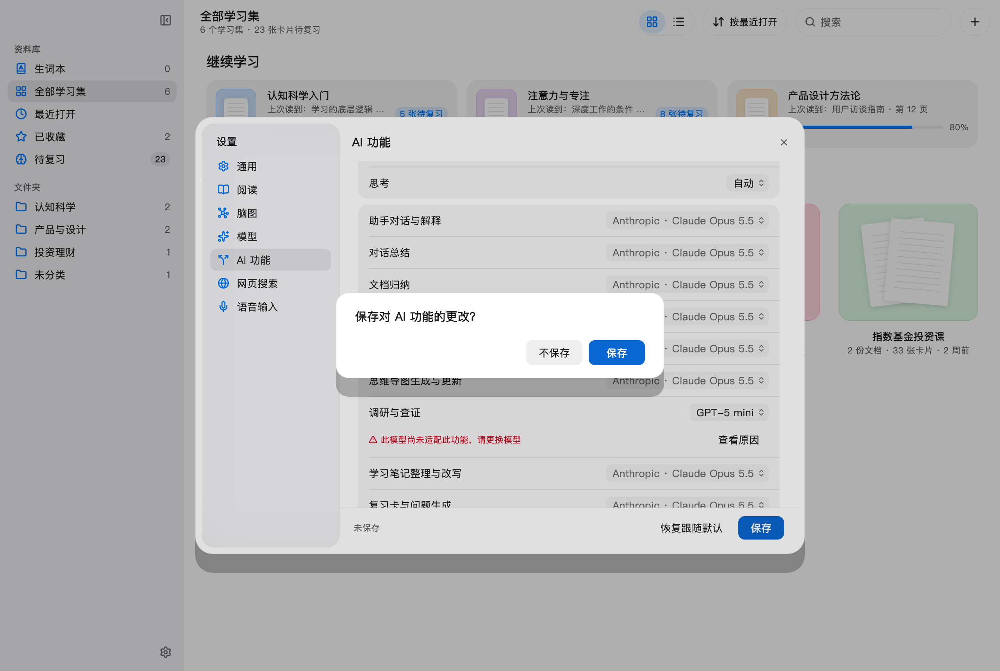
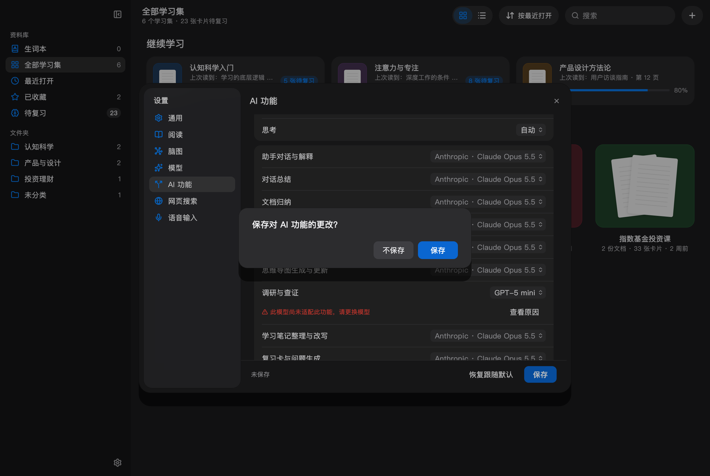

# 设置按钮与无正文确认框

桌面配置页文字按钮改为8pt圆角，与确认框共用MMRadii.field。字号、字重、按钮高度不变。未改变工具栏等其他页面按钮，也未改变触控平台原有圆角。

无正文MMSheet直接省略child，去掉原先额外20pt的正文间隙，上下内边距由24/18改为20/16pt。该确认框总高由134缩为108pt。AI功能未保存确认、清理网页数据确认均已接入。有正文的弹窗布局不变。

验证：组件及设置表单25项测试、AI功能保存/不保存行为1项测试通过；3个改动代码文件分析无问题。另用现有设置截图测试临时增加关闭确认步骤，浅深色各通过1次；截图生成后删除临时测试。

截图使用生产设置窗口及确认框的Flutter测试渲染，不能代表已安装应用已更新。本次未替换已安装应用。

