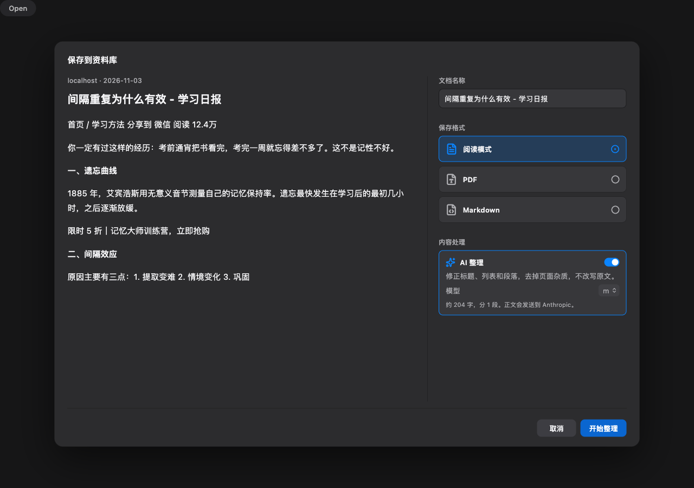
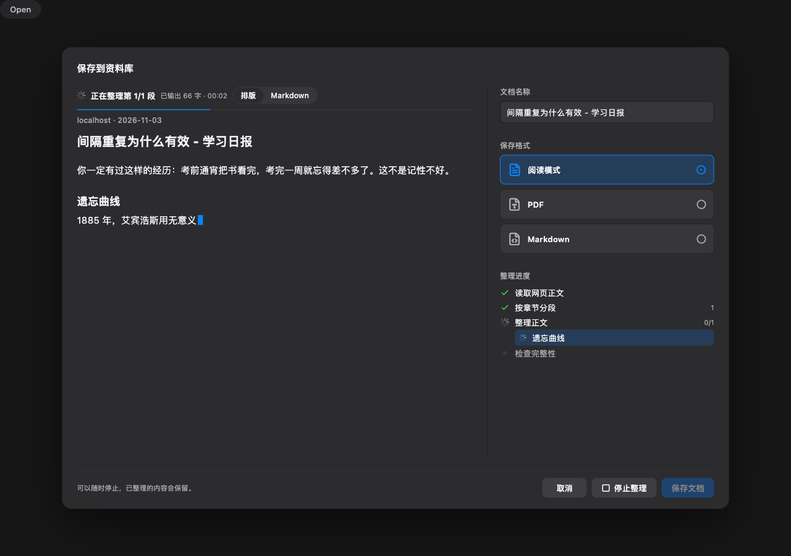
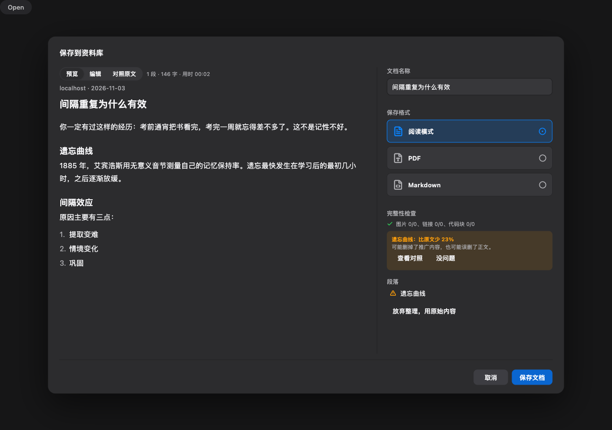
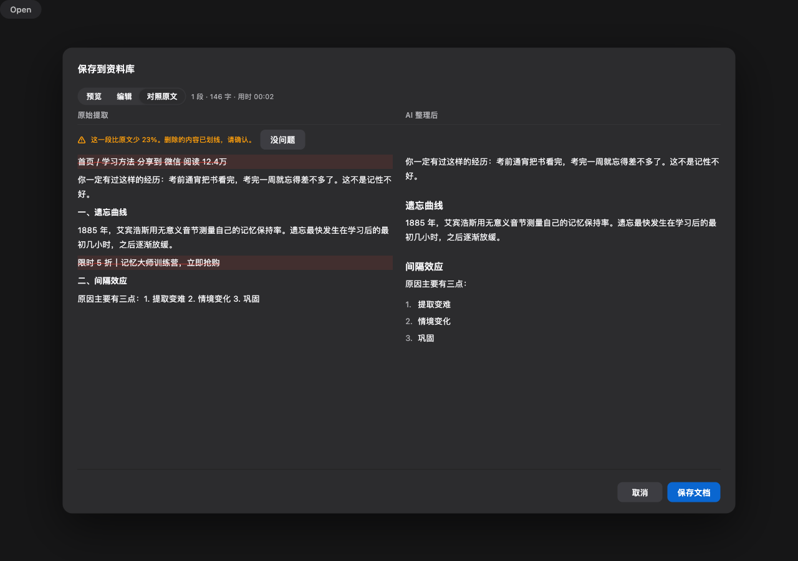
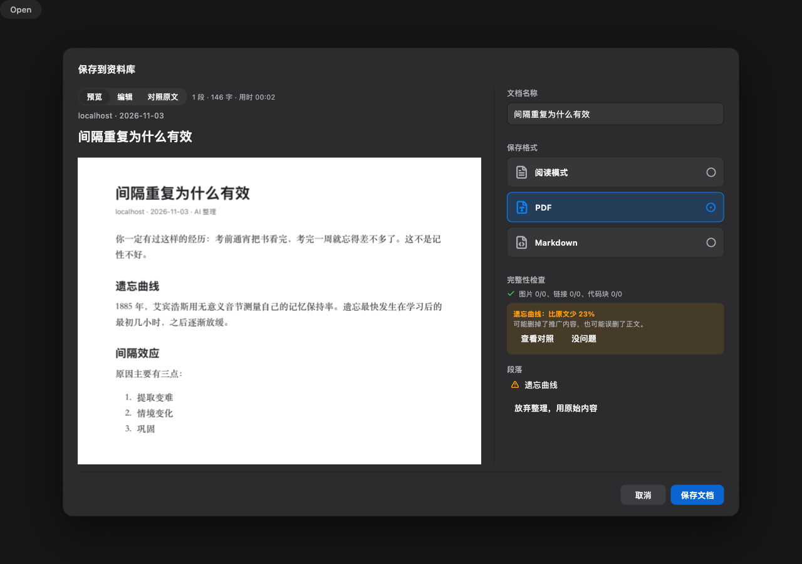

# 网页 AI 整理的 macOS 验收

由 `integration_test/web_format_test.dart` 在 macOS 上生成：真实 WebKit 抓取本地杂乱测试页、真实转换弹窗、真实打印 PDF。模型回复是测试脚本写死的，没有调用真实模型，所以这里不能说明整理质量。

底部的“Open”和深色背景来自测试外壳。PDF 经 PDFium 读回后确认：含整理后的正文和“AI 整理”标记，不含页面导航和广告。

