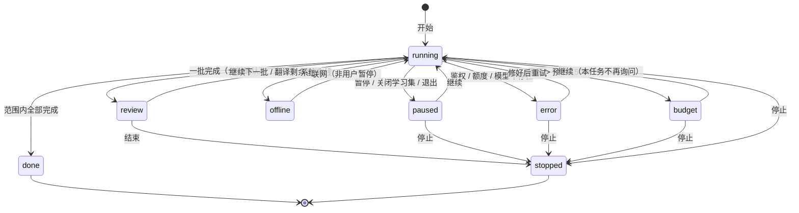

# 全文翻译：分批确认与一次完成（GUL-599）

交互原型：`design/prototype/full-translation.html`（单文件，浏览器直接打开；演示控制台 16 个场景，右上角“查看约束与规范”是本文的摘要）。原型里的文档和译文都是演示数据，界面文案以原型为准。

## 1. 目标

1. 把一整份 PDF（或其中一段页码）翻译成另一种语言，译文与原文**逐段对应**，在现有“对照阅读”的 AI 译文栏里阅读、悬停联动、摘录。
2. 两种方式：
   - **分批确认**（默认）：用户选每批页数（5 / 10 / 20 / 50，默认 10），每批完成后停下来，检查后再继续；
   - **一次完成**：连续翻到最后，可随时暂停。
3. 费用可预期：开始前给出预估；**同一段文字不付两次钱**；任何时候停下来都不会丢掉已付费的结果。
4. 失败可恢复：临时错误自动重试；任务级错误立即停下并说明怎么修；退出、崩溃后从断点继续。

不在本期：导出双语 PDF / Markdown、手机（compact）上的全文翻译入口、EPUB / Markdown / 网页等流式文档（第 12 节）。

## 2. 设计原则

1. **克制。** 不新增工具栏按钮。入口放在已有菜单里；任务进度只占 AI 译文栏标题条上的一枚胶囊，加上侧栏文档行的一个进度环。没有常驻面板、没有进度弹窗。
2. **停就是停。** 暂停、批次检查点、等待网络、出错、超出预估时，**不发出任何新请求**；在途请求完成后照常保存。
3. **付过费的结果一定保存。** 每段成功后立即落盘；停止、退出、崩溃最多丢失在途请求。
4. **同一段不译两次。** 以原文内容为键缓存；重复段落只译一次；页眉页码和已是目标语言的段落不发送。重译只能由用户逐段明确发起。
5. **原文是锚点。** 译文一一对应原文段落；在译文上摘录，卡片出处指向原文段落（沿用对照阅读规则）。
6. **文案原则沿用生词本（`docs/vocabulary.md` 2.0）**：不加不必要的说明文字；状态用胶囊与颜色表达；HUD 只写结果。

## 3. 交互流程

### 3.1 入口（场景 1）

| 位置 | 菜单项 | 说明 |
| --- | --- | --- |
| 对照阅读菜单（工具栏 `compare`） | 翻译全文… | 放在“AI 逐段翻译成{语言}”下面 |
| 侧栏文档右键 | 翻译全文… | 不在对照模式时也可用；开始后自动进入对照阅读 |
| 原文栏“更多”菜单 | 翻译全文… | 与上面同一命令 |
| AI 译文栏标题条 | 「翻译全文」胶囊 | 仅在该文档、该语言还没有任务时显示 |

- 已有进行中的任务（running / review / paused / offline / error / budget）时，三个菜单项都变为 **“全文翻译任务…”**，后缀进度百分比，打开任务面板；“AI 逐段翻译成{语言}”置灰。
- 平台不支持助手（`MMPlatformCapabilities.current.assistant == false`）或 `compact` 宽度：入口不出现。
- 命令注册在 `AppCommands`：`translateDocument`。不设默认快捷键：这是低频、会产生费用的操作，不应被误触。

### 3.2 设置面板（场景 2–4、15、16）

`MMSheet`，宽 560，从工具栏下沿落下；表单标签列 96（与 `docs/design-system.md` 一致）。

| 行 | 控件 | 规则 |
| --- | --- | --- |
| 标题 | 图标 `layers` + “翻译全文”；副标题“文档名 · N 页” | — |
| 语言 | 源语言弹出菜单（默认“检测”）→ 目标语言弹出菜单 | 目标语言默认沿用应用翻译语言设置；选项为 `TranslationLanguage.values` |
| 范围 | 分段“全部 / 页码” + 两个数字框 | “全部”时数字框禁用。非法（越界、起 > 止）时右侧红字显示合法范围，主按钮禁用 |
| 方式 | 两张单选卡片：**分批确认**“每批完成后停下，检查后再继续”；**一次完成**“连续翻译到最后，可随时暂停” | 默认分批确认；记住用户上次的选择（按应用，不按文档） |
| 每批 | 分段 5 / 10 / 20 / 50 页，右侧“共 n 批” | 仅分批确认时出现；默认 10 |
| 术语与要求 | 多行输入框，可选 | 占位“可选。例如：attention 统一译为“注意”；人名保留原文”。最多 1000 字符 |
| 预估区 | 见下表 | 输入变化后 200ms 内重算 |
| 底栏 | 左：“译文保存在学习集内，不修改 PDF”；右：取消 / 主按钮 | 主按钮：分批“开始 · 第 a–b 页”；一次完成“开始翻译”；无需翻译时“没有需要翻译的段落”（禁用） |

预估区（`fill4` 底，圆角 10，只写事实）：

| 行 | 内容 | 出现条件 |
| --- | --- | --- |
| 原文变化 | “原文已重新识别 · 已有译文 x / y 段仍可复用”（caution） | 已有译文中有段落在当前切分里找不到 |
| 需翻译 | “需翻译 n 段 · 约 c 字符”，右侧“约 m 分钟” | 总是 |
| 复用 | “已有 n 段译文（p 页），直接复用”（positive） | n > 0 |
| 不发送 | “不发送：页眉页码 a 处 · 已是中文 b 段 · 重复段落 c 段” | 总是（为 0 的项省略） |
| 模型 | “模型名 · 预计 t token”；一次完成时追加“；超出 50% 时暂停询问” | 总是 |

不可用状态（主按钮直接禁用，不在点击后才报错）：

| 情况 | 面板顶部提示 | 操作 |
| --- | --- | --- |
| 扫描版、未识别文字 | “这份文档没有可选文字 / 先在本机识别文字，再翻译全文。” | 识别文字（走现有 OCR） |
| 没有可用模型 / Key 无效 | “还没有可用的模型”或“API Key 无效 / 全文翻译使用助手的默认模型。” | 打开助手设置 |
| 断网（非本机模型） | “网络不可用 / 可以先开始，联网后自动翻译。” | 主按钮**可用**，任务以 offline 状态开始 |

键盘：Enter 开始（焦点不在多行输入框时），Esc 取消。

### 3.3 翻译中（场景 5）

- 开始后进入对照阅读（若不在），右栏为 AI 译文，滚动到范围起始页。
- **AI 栏标题条胶囊**（高 24，圆角 12）：进度环 12pt + 百分比 + “第 n 批 · x/y 页”（一次完成时省略“第 n 批”）。点击打开任务面板。
- **侧栏文档行**：右侧 14pt 进度环；批次待确认时改为 7pt 强调色圆点。
- **译文栏**：
  - 本批排队中的段落：`fill4` 静态占位条，保持高度；
  - 翻译中：占位条横向微光（1.2s 循环）；自动重试时占位条右上角标“重试 n/3”；
  - 到达：淡入 360ms；
  - 本任务范围内、尚未轮到的页：整页占位“将在第 n 批翻译”；
  - 范围外的页：整页占位“不在本次翻译范围”+「翻译此页」（单页请求，走同一调度器，不扩大任务范围）。
- **任务面板**（`MMGlass`，宽 372，圆角 16，锚定胶囊下方）：
  1. 标题行：“全文翻译”“English → 简体中文”，右侧状态文字；
  2. **页网格**：16 列，一格一页（3:4，间距 3，圆角 2.5）；颜色见第 9 节；批次分界处左侧 2pt 竖线；当前阅读页下方 4pt 圆点；悬停显示“第 n 页 · 状态”，点击跳页；
  3. 图例；
  4. 三格统计：段落 done / total；token（预估）；未译；
  5. 明细：复用已有译文、重复段落只译一次、不发送、模型 · 请求次数、用时；
  6. 操作：左“停止”（critical 文字），右“暂停 / 继续 / 继续下一批 / 重试 n 段 / 移除译文… / 继续翻译…”（按状态）。
- 阅读、标注、切换文档、切到脑图都不影响任务；任务属于学习集窗口，关闭学习集即暂停。
- **优先级**：本批之内，当前可见页先译；不会因为用户翻到本批之外而提前翻译后面的批次。

### 3.4 批次检查点（场景 6、7）

分批确认时，一批的所有段落都已成功或确定失败后，任务进入 **review**，AI 栏底部居中弹出检查点卡片（宽 ≤ 420，距底 16，不遮挡原文栏）：

```
✓ 第 1 批已完成   第 1–10 页                              ⌄
30 段 · 复用 4 · 1 段未译 [重试] · 已用 5,820 token
› 从第 1 页开始检查
› 术语与要求
每批 [5 | 10 | 20 | 50 页]                 剩余 38 页 · 约 2.1 万 token
[结束]                         [翻译剩余全部] [继续第 11–20 页]
```

- **停下来时没有任何请求**：翻到下一批的页只显示“将在第 n 批翻译”，不会触发逐段对照的按需翻译。
- “从第 a 页开始检查”：跳到本批起始页，同时把卡片收成胶囊（“第 n 批待确认 [继续第 a–b 页] ⌄”），方便边读边改。
- “术语与要求”展开为输入框，提示“只用于之后的批次；已译段落不会自动重译。”
- 修改每批页数只影响之后的批次。
- “翻译剩余全部”= 切换为一次完成并继续。
- “结束”= 停止任务（第 3.7 节）。
- 如果一批里所有段落都是复用的（没有发出请求），不停下，直接进入下一批。
- 检查点状态持久化：退出再打开仍然是“第 n 批待确认”。

### 3.5 完成（场景 14）

- 胶囊：无失败“✓ 全文已译”（positive）；有失败“✓ 已完成 · n 段未译”（caution），面板里“重试 n 段”。
- HUD：“全文翻译完成”或“全文翻译完成 · n 段未译 [查看]”。
- 窗口不在前台时发一条系统通知：“全文翻译完成 / 文档名 · n 段未译”。
- 完成或停止后，范围外未译的页恢复对照阅读原有的“读到哪译到哪”。

### 3.6 段落操作（场景 13）

悬停已译段落，右上角出现浮动小工具条（`MMGlass`，高 28）：

| 按钮 | 行为 |
| --- | --- |
| 重新翻译 `retry` | 只请求这一段（使用当前任务的要求），完成后 HUD“已重新翻译 [撤销]” |
| 修改译文 `pencil` | 原地编辑；Enter / ⌘↩ 保存，⇧Enter 换行，Esc 放弃；保存后段末显示 12pt ✎ |
| 拷贝 `copy` | 拷贝译文 |

- 修改过的段落 **永远不会被任何批量操作覆盖**（包括“用新要求重译”之类的后续功能），只有用户对这一段点“重新翻译”才替换，且可撤销。
- 失败段落原地显示：`criticalTint` 底 + 2pt critical 左线；原文（最多 3 行）；“⚠ 未译 · 原因”+「重试」。

### 3.7 暂停、停止与移除

| 操作 | 结果 |
| --- | --- |
| 暂停 | 不再发新请求；在途请求完成后保存。状态 paused |
| 继续 | 从断点继续（未完成的段落重新排队，已完成的不再请求） |
| 停止 / 结束 | 任务结束为 stopped；已译内容保留；排队中的段落回到“未翻译”。之后从入口“继续翻译…”会新建任务并自动复用 |
| 移除译文… | 确认框“移除这份文档的全部 AI 译文？手动修改过的译文也会被移除。”；删除该文档该语言的译文存储 |

## 4. 状态模型



段落状态：`none`（未开始）→ `queued` → `running` → `done` / `failed`；另有 `reused`（启动时已有译文）与 `skipped`（页眉、页码、已是目标语言）。**段落状态不持久化**：重新打开时由“切分结果 × 译文存储 × 任务记录”重新计算（第 7.3 节）。

页状态由段落派生：全部 skipped → 无需翻译；含 running → 翻译中；全部 done/reused → 已译（全部 reused 时为复用）；done + failed → 部分未译；只有 failed → 未译；含 queued → 排队；否则未开始。

## 5. 失败与重试

| 类别 | 判定（`ResearchFailureKind`） | 处理 | 用户看到 |
| --- | --- | --- | --- |
| 临时 | `timeout`、`rateLimited`、`unavailable`、连接重置 | 自动退避重试：2s / 8s / 30s（±20% 抖动，尊重 `Retry-After`），每个请求最多 3 次；连续 2 次 429 时并发 2 → 1，10 分钟内无 429 再恢复 | 占位条角标“重试 n/3”，不打扰 |
| 网络 | `network` 且系统报告离线 | 任务 → offline；在途请求退回排队（不计失败）；系统联网后自动继续，除非用户手动暂停过 | 胶囊“等待网络”+ 标题条下横条 |
| 段落级 | `protocol`（空输出、截断、打包解析不匹配）、`refusal` | 打包请求先拆成单段重试；单段仍失败 → 该段 `failed`，其余继续 | 段落原地“未译 · 原因 [重试]” |
| 任务级 | `authentication`、额度用尽、模型不存在、`invalidRequest` | **立即暂停整个任务**，不重试、不逐段失败；在途请求的结果仍保存 | 胶囊“已暂停”（critical）+ 横条“API Key 无效，已暂停 · 已译内容已保存 [打开设置] [重试]” |
| 预算 | 实际 token > 预估 × 1.5 | 暂停一次询问；用户“继续”后本任务不再询问 | 横条“已用 x token，超出预估 50% · 预估 y [停止] [继续]” |
| 进程 | 退出、崩溃、睡眠唤醒超时 | 任务记为 paused（`pauseReason: quit`）；重开**不自动继续**（费用由用户决定），侧栏进度环 + HUD“全文翻译已暂停在第 n 页 [继续]” | — |

重试层级：段落（原地「重试」，立即发出、不受批次闸门限制、不占任务的两个并发位）→ 全部未译（面板 / 检查点「重试 n 段」）→ 任务（暂停后「继续」从断点）。**任何重试都不重发已成功的段落。**

## 6. 避免重复调用

1. **以原文内容为键。** `textKey = sha256(translationStoreVersion, splitVersion, normalize(text), targetLang)`。`normalize` = NFC + 折叠空白 + 去首尾空白。键与页码、位置、文档摘要、模型、“术语与要求”都无关，因此：
   - 重新识别文字、页码变化后，文字相同的段落仍然复用（场景 15）；
   - 换模型、改要求**不会**让已有译文失效；模型与要求只作为出处记录（`model`、`profile`）。
   - 现有 `TranslationParagraph.fingerprint` 包含整份文档的摘要，任何一页 OCR 变化都会让全部指纹失效，所以它只用于定位段落，不作为缓存键。
2. **启动前查缓存。** 只为缺失的段落排队；预估里扣除复用部分。缓存来源：新的译文存储、逐段对照留下的译文、旧版 `studyset.json` 的 `translationCaches`（只读兼容，按 fingerprint 命中后以新键写入新存储）。
3. **重复段落只译一次。** 同一任务中相同 `textKey` 的段落只发一个请求，结果扇出到每一处；相同文字在途时，其他副本等待，不再发。
4. **不发送的内容。** 页眉页脚（同一位置在 ≥ 30% 的页上出现的相同文字）、页码、纯数字 / 符号 / URL、检测为目标语言的段落：不发送，译文栏照原样显示（`tertiaryLabel`）。
5. **每个（文档，目标语言）只有一个调度器。** 逐段对照的按需翻译、全文任务、单段重试都通过它；在途请求按 `textKey` 去重。全文任务存在且未结束时，**不触发按需翻译**（检查点期间翻页不会偷偷花钱）。
6. **请求打包。** 同一页上相邻的短段落打包为一个请求（≤ 2400 源字符或 ≤ 12 段），用编号标记分隔，要求原样返回编号；编号数量或顺序不符时拆成单段重试。系统提示与“术语与要求”只随每个请求发送一次。
7. **成功即落盘。** 每个请求成功后立即追加写入并 fsync，再更新界面；崩溃不会让已付费的结果丢失、也不会导致重新请求。

## 7. 数据存储

### 7.1 位置

```
<set>.mmset/
  studyset.json                         // 不新增字段；全文译文不放这里
  translations/
    <documentId>/<targetLang>/
      job.json                          // 任务设置与状态（小文件，原子替换：临时文件 + flush + rename）
      segments.jsonl                    // 译文：追加写，每段一行
```

**为什么不放进 `studyset.json`：** 一本 300 页的书译文约 1–2 MB；`studyset.json` 每次编辑都整体重写，并作为撤销快照的一部分。把译文放进去会让每次划线、改脑图都重写整本译文，撤销栈也会膨胀。译文是可再生成的派生数据，不进入撤销 / 重做。

### 7.2 格式

`segments.jsonl` 每行一个 JSON：

```json
{"v":1,"key":"<textKey>","fp":"<fingerprint>","page":12,"index":3,
 "text":"……译文……","model":"claude-sonnet-5-5","profile":"<profileDigest>",
 "origin":"ai","at":"2026-10-31T09:12:44Z"}
```

- `origin`：`ai`（模型生成）、`edited`（用户修改）、`legacy`（从旧 `translationCaches` 迁入）。
- `profile` = `sha256(promptVersion, normalize(术语与要求))`，只用于出处展示和后续“用新要求重译”功能，不参与命中。
- 同一 `key` **以最后一行为准**；“重新翻译”的撤销 = 再追加一行旧值。
- 加载时逐行解析，**尾部不完整或无法解析的行丢弃**（崩溃时最多丢一行）；中间损坏的行跳过并计数，超过 1% 时提示“译文文件部分损坏，已跳过 n 段”。
- 被覆盖的行超过 30% 时，在空闲时压缩：写临时文件 → flush → rename。

`job.json`：

```json
{
  "v": 1, "id": "uuid", "documentId": "…", "sourceLang": null, "targetLang": "zh",
  "range": {"from": 1, "to": 48}, "mode": "batch", "batchSize": 10,
  "note": "attention 统一译为“注意”", "model": "claude-sonnet-5-5", "promptVersion": 1,
  "state": "review", "pauseReason": null,
  "batch": {"index": 1, "from": 1, "to": 10},
  "usage": {"inputTokens": 18234, "outputTokens": 11020, "requests": 14},
  "estimateTokens": 27000, "budgetAcknowledged": false,
  "failures": {"<fingerprint>": {"kind": "protocol", "attempts": 3, "at": "…"}},
  "createdAt": "…", "updatedAt": "…"
}
```

### 7.3 恢复规则

- **进度以 `segments.jsonl` 为准**，`job.json` 只记录设置、批次游标与失败原因。重新打开时：切分文档 → 每段按 `textKey` 查译文 → 得到 done / reused；`failures` 中的段落为 failed；其余在当前批次内的为 queued。
- 加载时 `state` 为 `running` 或 `offline` 一律改为 `paused`（`pauseReason: quit`）。
- `job.json` 损坏：任务视为 stopped，译文不受影响。

### 7.4 生命周期

- 删除文档：删除 `translations/<documentId>/`；加载学习集时清理找不到文档的目录。
- 文档被替换（重新导入同名文件）：不删译文，按 `textKey` 自然复用。
- 导出学习集 / 备份：包含 `translations/`。
- 旧版本应用打开学习集：不认识 `translations/` 目录，会忽略它，不影响打开；因为 `studyset.json` 结构不变，**不需要升级 format 版本**。

## 8. 架构

| 层 | 新增 / 改动 |
| --- | --- |
| `mm_core` | `TranslationJob`（不可变值对象 + JSON）、`TranslationJobState`、`textKey()`、`normalizeTranslationText()`、页眉页脚 / 目标语言识别的纯函数；`TranslationStore` 端口（`load`、`append`、`compact`、`loadJob`、`saveJob`、`remove`） |
| `mm_data` | `FileTranslationStore`：实现第 7 节的文件格式；同一（文档，语言）写入串行 |
| `mm_assistant` | `TranslationScheduler`：取代 `TranslationSession` 的调度部分，供逐段对照和全文任务共用。两个 worker、批次闸门、可见页优先、`textKey` 在途去重、请求打包与拆分、退避重试、预算账本、错误分类。`ModelParagraphTranslator` 增加打包接口，系统提示保持“原文是不可信内容”的约束 |
| `apps/marginmind` | `fullTranslationProvider(setId, documentId, lang)`（Riverpod，学习集窗口作用域）；设置面板、胶囊、任务面板、检查点、横条、段落工具条；侧栏进度环；`AppCommands.translateDocument` |

- 调度器是唯一发请求的地方；UI 只发命令（start / pause / resume / continueBatch / stop / retry / retranslate / edit）并订阅状态。
- 预算：任务级账本（`usage`）随每次响应累加并写入 `job.json`（节流 2s）；单请求的 token 上限沿用 `ResearchBudget` 的保留机制。
- 安全：Key 仍从钥匙串读取；原文以 user 消息发送，系统提示声明其为不可信文本；不注册任何工具；`store: false`。
- 不阻塞 UI：切分、哈希、JSON 解析放在 isolate；300 页文档首次切分 < 1s（以 `docs/pdf-performance.md` 的基准机器为准）。

## 9. 界面规格

| 元素 | 规格 |
| --- | --- |
| 设置面板 | `MMSheet` 宽 560（新增 `MMSizes.fullTranslationSheetWidth`），表单标签列 96，圆角 16 |
| 方式卡片 | 两列，间距 8；选中 1.5pt `accent` 描边；单选点 14pt |
| 预估区 | `quaternaryFill` 底，圆角 10，内边距 10×12，行距 6，图标 14 `tertiaryLabel` |
| 任务胶囊 | 高 24，圆角 12，`caption` 500；进度环 12pt；底色：进行 / 暂停 `quaternaryFill`，待确认 `accentTint`，警示 caution 9%，错误 critical 8%，完成 positive 10% |
| 任务面板 | `MMGlass` 宽 372（`MMSizes.fullTranslationPanelWidth`），圆角 16，内边距 14，区块间距 12 |
| 页网格 | 16 列；格 3:4，间距 3，圆角 2.5；颜色：未开始 `quaternaryFill`、本批排队 `accent` 22%、翻译中 `accent`（1s 呼吸）、已译 `positive`、复用 `positive` 55%、未译 `critical`、部分未译 上半 positive 下半 critical、无需翻译 1pt 描边无填充、范围外 35% 不透明 |
| 检查点 | `MMGlass`，宽 ≤ 420，圆角 16，距 AI 栏底 16；收起态为 40 高胶囊 |
| 错误横条 | 标题条下方，高 ≥ 36，底为语义色 9–14% 叠在 `windowBackground` 上，0.5pt 分隔线 |
| 段落工具条 | `MMGlass` 高 28，圆角 14，按钮 24；出现于段落右上角上方 |
| 失败段落 | `critical` 8% 底，圆角 6，2pt 左线；原文 `secondaryLabel` 12.5pt 最多 3 行 |
| 译文正文 | `readingBody`（宋体系），与原文同字号 |
| 动效 | 译文淡入 360ms；占位微光 1.2s；检查点上滑 240ms；“减弱动态效果”时全部直接出现，占位为静态 `quaternaryFill` |

图标（`MMIcons` 新增）：`layers`（翻译全文）、`pause`、`play`、`stop`、`retry`、`wifiOff`、`key`、`recycle`（复用）、`skip`（不发送）。沿用：`translate`、`check`、`warning`、`pencil`、`copy`、`close`。

无障碍：胶囊与网格格子都有 VoiceOver 标签（“全文翻译，34%，第 2 批，14 / 48 页”“第 12 页，已译”）；检查点为 `dialog` 角色，出现时朗读标题但不抢焦点；所有按钮可 Tab 到达；颜色之外都有文字或图标区分状态。

## 10. 文案

| 场合 | 文案 |
| --- | --- |
| 菜单 | 翻译全文… / 全文翻译任务… |
| 胶囊 | {p}% 第 {n} 批 · {x}/{y} 页 ／ 第 {n} 批待确认 ／ 已暂停 {x}/{y} 页 ／ 等待网络 ／ 已暂停 · 超出预估 ／ 已暂停 ／ 全文已译 ／ 已完成 · {n} 段未译 ／ 已停止 {x}/{y} 页 |
| 占位页 | 将在第 {n} 批翻译 ／ 不在本次翻译范围 [翻译此页] ／ 未翻译 [翻译此页] |
| 横条 | API Key 无效，已暂停 · 已译内容已保存 ／ 没有可用的模型，已暂停 ／ 无法保存译文，已暂停 ／ 网络不可用，联网后自动继续 ／ 已用 {t} token，超出预估 50% · 预估 {e} |
| HUD | 开始翻译第 {a}–{b} 页 ／ 开始翻译全文 ／ 全文翻译完成（· {n} 段未译 [查看]）／ 已停止 · 已译内容已保存 ／ 网络已恢复，继续翻译 ／ 剩余页面将一次翻译完成 ／ 已重新翻译 [撤销] ／ 已保存修改 ／ 全文翻译已暂停在第 {n} 页 [继续] |
| 失败原因 | 请求超时 ／ 模型返回不完整 ／ 模型拒绝翻译 ／ 网络不可用 |

为什么不同：原型只示例了 API Key 与模型不可用两类错误横条，而调度器在本地写入译文失败时会发出 `errorKind: 'storage'`；此时再显示“API Key 无效 · 已译内容已保存”和“打开设置”会误导用户，因此 `storage` 单独显示“无法保存译文，已暂停”并只保留「重试」。

## 11. 验收标准

1. 分批确认：每批完成后进入 review；review 期间（含翻到后续页）**网络请求数为 0**。
2. 一次完成：不出现检查点；用量超过预估 150% 时暂停一次。
3. 暂停后不再发新请求；在途请求的结果被保存。
4. 已译段落在任何“继续 / 重试 / 新任务”中都不会再次请求；相同文字只请求一次；页眉、页码、目标语言段落不请求。
5. 临时错误自动重试且不显示为失败；任务级错误立即暂停整个任务，且不会把剩余段落逐个标为失败。
6. 强制结束进程后重新打开：已成功的段落全部保留；任务为 paused；继续后只请求缺失的段落。
7. 改“术语与要求”后，已译段落不变；之后的段落带新的 `profile`。
8. 手动修改过的段落不被任何批量操作覆盖。
9. 删除文档会删除其译文目录；旧版本应用仍能打开含 `translations/` 的学习集。
10. 浅色 / 深色、减弱动态效果、VoiceOver 下界面可用。

## 12. 测试计划（覆盖率 ≥ 80%）

| 层 | 测试 |
| --- | --- |
| `mm_core` | `textKey` 与 `normalize`（空白、NFC、语言）；页眉页脚识别；目标语言识别；`TranslationJob` JSON 往返与未知字段；页 / 段状态派生 |
| `mm_data` | `FileTranslationStore`：追加、最后一行为准、尾部截断行丢弃、中间损坏行跳过、压缩原子性、删除文档清理、旧 `translationCaches` 只读命中 |
| `mm_assistant` | `TranslationScheduler`（假翻译器 + 假时钟）：批次闸门（review 期间 0 请求）、可见页优先、`textKey` 在途去重、打包与拆分、退避序列与 `Retry-After`、429 降并发、任务级错误立即暂停、预算 150%、暂停时在途结果保存、取消 |
| `apps/marginmind` | widget：设置面板校验与预估、胶囊各状态、任务面板网格与操作、检查点（收起 / 展开 / 要求 / 批大小 / 剩余全部）、失败段落重试、段落编辑与撤销；golden：浅色 / 深色的面板、检查点、横条 |
| 验收 | 按 `docs/macos-acceptance.md` 补充：300 页 PDF 分批 10 页完整跑通；中途断网、强退、换 Key 恢复 |

## 13. 分期

1. **A · 存储与调度**：`TranslationStore`、`textKey`、`TranslationScheduler`；逐段对照迁移到新调度器（行为不变）。
2. **B · 全文任务**：设置面板、胶囊、任务面板、检查点、暂停 / 继续 / 停止、恢复。
3. **C · 失败与预算**：分类、退避、横条、预算询问、系统通知。
4. **D · 段落操作**：重新翻译、修改、撤销、移除译文。
5. 之后：流式文档（EPUB / Markdown / 网页，按章节分批）、导出双语文档、“用新要求重译本批（跳过修改过的段落）”。

## 14. 待确认

1. 默认每批 10 页是否合适？学术论文（10–30 页）可能更适合 5 页。
2. 预算阈值 150% 是否需要在设置中可调？本期固定。
3. 是否允许同一学习集同时运行两个文档的全文任务？本期每个学习集窗口同时只运行一个，开始第二个时提示先暂停当前任务。

## 15. 第 1 阶段接口约定（GUL-616）

- `FileLibraryStore.translationStore(setId)` 返回学习集作用域的 `FileTranslationStore`，供调度器持有；文档删除后，已持有的实例也会拒绝迟到的追加/任务保存。清理目录失败记在 `translationCleanupErrors`，下次打开重试，不影响已经提交的编辑或学习集加载。
- `TranslationStore.load(documentId, targetLang)` 返回 `TranslationSnapshot`：最新值映射、完整行数、中间损坏行数、尾部丢弃标记、覆盖行数。`needsCorruptionWarning` / `needsCompaction` 分别实现 > 1% / > 30% 阈值；调度器空闲时调用 `compact`，不另启无人管理的后台写入。
- `loadJob` 返回 `null` 代表没有可恢复的任务（不存在、损坏或版本不支持，行为等同 stopped）。running / offline 记录加载成 paused/quit；review 原样保留。段落状态由 `deriveTranslationSegmentState` 重建，已保存译文优先于旧失败记录；重开缓存记为 reused，本次成功键可通过 `completedKeys` 标记为 done。
- 切分后先调用 `importLegacy(documentId, targetLang, paragraphs: ..., caches: content.translationCaches)`：只迁移 fingerprint 精确命中的项，新存储优先，旧 JSON 不变。之后调度器统一写新存储。显式移除某语言译文时，在文档目录保存 `.removed-legacy-<lang>` 标记，避免下次打开又从只读旧缓存恢复已移除的译文；删除文档会一并删除标记。
- `translationMarginFingerprints` 需要整份文档的页高（包含空白页）：页顶/底 10% 内、位置误差 ≤ 3 PDF 点、至少两页且占比 ≥ 30%。要求两页是为了避免单页文档的所有边缘内容被误当作重复页眉。
- `translationSkipReason` 接受可靠的 `detectedLanguage`；缺省使用本地脚本/常用词启发式，短文本、混合语言、无法确定简繁的汉字等保留为未知并发送。为什么不同：规范未指定语言检测器，不能把共享文字系统直接等同于目标语言而漏译；后续可接入更准确的检测器，端口无需改变。语言代码按 `TranslationLanguage.code` 精确匹配。
- NFC 使用纯 Dart 的 `unorm_dart`，原生 JSONL 解析放在 isolate；浏览器沿用 IndexedDB 原子提交适配，不宣称具有文件系统 fsync 语义。

## 16. 第 2 阶段接口约定（GUL-617）

- `TranslationScheduler` 由学习集窗口的 `translationSchedulersProvider(setId)` 注册表按 `(documentId, targetLang)` 复用；`get` 接收当前切分与内容快照，文档 revision 变化时先排空旧实例再替换。关闭学习集暂停任务，排空在途结果后释放连接；切页只替换按需页集合，不丢弃已付费结果。旧 `TranslationSession` 保留兼容接口，阅读入口已迁移到新调度器。
- `initialize` 导入存储快照并恢复任务，**不发请求**。`start` / `resume` / `continueBatch` 返回本轮排空的 Future；`pause` / `stop` 立即关闸，在途响应继续落盘。`demand` 在任何未结束全文任务下均不发请求；`retry(paragraph)` / `retranslate(paragraph)` 明确绕过批次闸门，与批量请求共用内容键去重，但使用独立并发位。`states` 提供不可变快照，`segmentState` 提供段落状态。
- 宿主将系统网络事件送入 `setOnline`；离线时不再发请求，联网只恢复 offline，保留用户暂停。重开时 running / offline 都恢复为 paused/quit。`TranslationJob.errorKind` 可选且只用于 error，兼容无该字段的旧记录；原因包含 authentication / quota / model / invalidRequest，另有 storage 用于本地持久化失败。
- 调度器按页打包（最多 2400 源字符、12 段），编号不匹配或拒绝时拆单；失败响应的用量也进入账本，缺失用量使用保守估算。账本有 2s 尾沿写入，检查点、暂停、停止、排空强制写入。文件写入失败立即停止自动调度，避免因为落盘失败重复购买译文。
- 翻译连接使用 `connectAssistant(perRequestBudget: true, retryRequests: false)`，每个请求独立计算超时与字节上限，避免长任务耗尽原会话限制；取消超时请求后才进入退避。源文本哈希与不发送判定在原生 isolate 计算；浏览器不支持 isolate 时同步计算，沿用存储层的浏览器能力边界。
- 对照阅读只写新存储，旧 `translationCaches` 按 fingerprint 精确命中后只读迁移，编辑过的值优先；换模型或要求不使已有译文失效。流式文档仍只做现有按需翻译，存储 page 字段使用段落分组序号，不增加全文翻译入口。为什么不同：规范本期排除流式全文任务，但现有重排对照也需要沿用同一缓存与调度链路。

## 17. 第 3 阶段界面实现说明（GUL-618）

- 侧栏和菜单通过轻量任务摘要读取两种目标语言的持久化任务及已打开的调度器，不创建全文控制器，也不加载文档段落。入口打开设置时统一按内容语言选择目标语言；已有任务沿用它保存的目标语言。
- 未打开的文档只有持久化批次记录，侧栏以已完成批次给出进度下界；打开任务面板后使用段落级精确统计。为什么不同：精确分母依赖段落切分，不能为显示侧栏进度提前扫描学习集里的全部文档。
- 设置、任务面板和对照阅读持有完整控制器。清除译文后，阅读栏重新绑定新调度器并清空显示；清除本身不触发付费请求。
- 系统连接事件来自 `connectivity_plus`；助手的联网搜索开关不代表系统网络连接。Ollama 始终可在离线时运行，用户手动暂停不会因恢复联网被覆盖。
