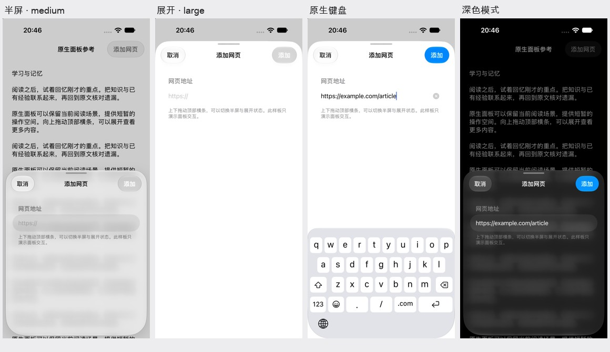

# iPhone 原生呈现方式复核

日期：2026-11-02。依据苹果 HIG、UIKit 文档、WWDC 官方讲解、当前项目与本地 Flutter/UIKit SDK 实现。

本轮产出是规范核对、接入方案和独立原生参考样板。正式 Foliarc 应用尚未替换为这些原生界面。样板不访问应用文档、账号、设置或 AI 服务。

## 结论

上一轮修复了不少布局和业务问题，但没有达到 iPhone 平台的视觉与交互完成度。尤其是手机面板被固定为全高、玻璃组件被改成不透明表面，解决了部分异常，却偏离了用户期待的系统体验。

这轮应建立 iPhone 专用的呈现层：短任务采用系统 Sheet，操作选择与确认采用系统菜单或确认组件，完整页面采用符合 iOS 层级的导航和排版。文档、脑图与业务逻辑继续复用，不能为了外观另起一套数据状态。

## 系统组件是什么

用户描述的是可调整高度的 **Sheet（底部面板）**。它可以停在若干高度，这些停靠高度叫 **detents**。UIKit 的系统入口是 `UISheetPresentationController`，SwiftUI 对应 `sheet` 与 `presentationDetents`。

苹果提供 medium 和 large 两个系统高度，也允许自定义。可伸缩面板应展示顶部拖动柄，并处理内容滚动与面板伸缩之间的衔接。[UIKit 文档](https://developer.apple.com/documentation/uikit/uisheetpresentationcontroller)、[HIG Sheets](https://developer.apple.com/design/human-interface-guidelines/sheets)。

这不等于所有弹窗都必须半屏。复杂任务可以使用大尺寸或全屏；手机横屏的紧凑高度不支持 medium，不能继续强行保留半屏。[medium 可用性](https://developer.apple.com/documentation/uikit/uisheetpresentationcontroller/detent/medium())。

## 当前实现的问题有具体代码依据

| 位置 | 当前行为 | 问题 |
| --- | --- | --- |
| `packages/mm_design/lib/src/widgets/bottom_sheet.dart:125` | `keyboard > 0 || phone ? max : ...` | 手机总取最大高度，用户无法选择半屏状态 |
| 同文件第 129 行 | `if (!phone) handle` | 手机不显示展开面板的拖动柄，也失去了这条拖动入口 |
| 同文件第 82 行 | 手机几何更新使用零时长 | 原为解决键盘过渡异常，不能代替自然的交互动画 |
| `packages/mm_design/lib/src/widgets/glass.dart:47,186` | 手机直接走不透明表面分支 | 名称仍为 Glass，实际没有系统 Liquid Glass 材质 |
| `packages/mm_design/lib/src/widgets/sheet.dart` | Flutter `showGeneralDialog` 与自绘容器 | 不是 UIKit 的 Sheet，系统不会替它管理整套呈现行为 |
| `apps/marginmind/lib/settings/settings_window.dart:29` | 手机设置使用 Flutter 页面与自绘控件 | 全屏并非错误；还需要完善 iOS 导航、分组、字号与控件语言 |

`MaterialPageRoute` 本身不代表一定使用安卓转场，Flutter 的主题可以为 iOS 配置对应过渡；这里的关键区别是这些页面仍由 Flutter 绘制，不能把类名或“底部出现”当成系统原生呈现的证据。

## Liquid Glass 应该用在哪里

苹果将 Liquid Glass 主要用于悬浮的导航与操作层。正文、阅读纸面、列表内容和脑图画布应保持可读，不应整页覆盖玻璃。也应避免玻璃层层叠加。[HIG Materials](https://developer.apple.com/design/human-interface-guidelines/materials)、[Meet Liquid Glass](https://developer.apple.com/videos/play/wwdc2025/219/)。

对本项目的应用建议：

- 首页、阅读页的导航和工具操作优先采用系统控件的背景、图标和分组。
- Sheet 的圆角、遮罩、伸缩和材质交给系统，避免自己画白边与多层阴影。
- 文档和脑图继续作为内容层，避免透出背景文字影响阅读。
- 标题栏与内容区可以有合理的材质差异，但应由层级和滚动边缘效果衔接；“统一”不等于把每个区域都涂成同一种白色。
- 使用系统字号、动态文字、语义颜色和交互目标尺寸，让表单与导航同时符合手机习惯。

苹果的 UIKit 新设计讲解强调系统组件对新设计的适配，以及自定义背景可能遮挡材质的问题。这对原生组件成立，不会自动将 Flutter 自绘组件变成 UIKit 控件。[Build a UIKit app with the new design](https://developer.apple.com/videos/play/wwdc2025/284/)。

本地 SDK 头文件确认 `UIGlassEffect` 从 iOS 26 起可用，`UISheetPresentationController` 从 iOS 15 起可用。手机的实时系统信息也确认具备相关原生能力。正式接入应保留原有最低系统版本，在旧系统使用相应的系统呈现，不为玻璃效果直接提高最低版本。

## 各页面的建议

以下是针对 Foliarc 工作流的设计建议，不是苹果要求每个产品照搬的页面模板。

| 场景 | 建议呈现 | 关键行为 |
| --- | --- | --- |
| 添加网页、重命名等短表单 | 原生 Sheet，按内容选择初始高度，允许展开 | 取消与提交放在顶部标准操作区；输入时按系统键盘布局调整 |
| 新建学习集 | 原生表单 Sheet；复杂步骤进入面板内导航 | 保留草稿；避免每一步再叠一个面板 |
| 目录、书签、缩略图 | medium / large Sheet | 保留阅读背景；列表可以展开；选择定位后关闭 |
| 脑图节点详情、批注属性 | 可伸缩 Sheet | 清楚对应当前对象；需要边看正文边操作时评估非模态模式 |
| AI 助手 | medium / large Sheet；输入或长会话时提供展开空间 | 关闭保留会话与草稿；引用查看使用明确的返回层级 |
| 设置 | 原生分组列表与层级导航；大尺寸 Sheet 或完整页面 | 不强制半屏；字号、返回、保存、退出规则统一 |
| 删除、放弃更改 | 系统 Alert / Action Sheet，按任务选择 | 不复用普通表单容器；破坏性操作语义明确 |
| 分享与文件选择 | 系统已有分享、文件选择组件 | 维持原生行为，衔接好前后任务 |

Sheet 的 medium 在横屏紧凑高度下不适用，应允许系统适配，不能把竖屏的高度比例复制过去。可滚动内容、输入框、关闭行为与未保存状态必须一起设计。

## Flutter 接入不能省略的工作

当前项目已有原生平台通信与系统分享入口，可沿用这种边界。但“把现有 Flutter Widget 直接包进 UIKit Sheet”不是已经验证的接入方案。

本地 Flutter 3.47.6 提供 `CupertinoSheetRoute`，支持风格化的 Sheet 路由和部分滚动关闭协调；它仍属于 Flutter 渲染，不应据此承诺得到系统 Liquid Glass 和完整的原生多高度行为。

Flutter 官方的移动端多界面方案涉及多个 Engine；不同 Engine 的 Dart 状态独立，跨实例需要通信。不能为每个弹层启动另一份完整应用，让文档、助手和设置各自写入状态。[Flutter 多实例](https://docs.flutter.dev/add-to-app/multiple-flutters)、[add-to-app 限制](https://docs.flutter.dev/add-to-app)。

建议先验证以下架构：

1. 业务、持久化、阅读位置、脑图和助手请求仍由现有 Dart 层统一管理。
2. iPhone 的短表单、原生列表与展示容器在 iOS 层呈现，通过明确的数据和结果接口连接业务。
3. 每个呈现任务具有独立标识，保存、取消、交互关闭都只完成一次；未保存状态与失败提示保持一致。
4. 助手属于更复杂的迁移，需要单独验证流式消息、引用、停止、草稿和视图生命周期，不能从短表单成功直接推断它也完成了。
5. 若继续让部分 Sheet 内容由 Flutter 渲染，必须先验证多实例资源、状态同步和滚动接管，不能直接复制现有 Provider 容器。
6. iPad、PC 保持现有呈现路径；iOS 桥接再次检查设备类型，避免窄 iPad 分屏误走手机方案。安卓使用独立的平台呈现适配。

## 已做的原生参考

[样板源码与运行方法](prototypes/ios-native-sheet-reference/README.md)。使用 UIKit 系统 Sheet、导航按钮、输入框、系统键盘和 Action Sheet；没有自绘玻璃、圆角或拖动动画。

采集环境：iPhone 18 Pro / iOS 27.0 Simulator。与用户的真实 iPhone 机型及系统小版本不同，因此这些图片用于呈现方式参考，不作为真机效果完全相同的证明。

- 半屏、展开、键盘输入、深色、未保存确认均保留独立系统截图。
- 采集通过样板内部的测试命令切换高度；没有把程序切换高度宣称为手指拖动验收。
- 样板是独立原生 App，尚未与 Flutter 阅读画布混合；不能据此宣称 Foliarc 原生接入已经完成。
- 本轮没有修改正式应用代码，也没有更新用户手机上的 Foliarc。

## 下一步的具体顺序

先把“添加网页”这一条短流程接入现有应用，在真实 iPhone 上确认材质、键盘、取消与保存，再接目录/书签这样的原生列表。两条通路稳定后，推进助手、设置及导航工具栏。

验收应包括手指拖动与中途反向、滚动与伸缩衔接、键盘弹出/收起、旋转、未保存退出、动态字号、降低动态效果和降低透明度。截图用于检查视觉，录屏与实际操作用于检查连续交互；构建和布局测试继续作为基础检查。
