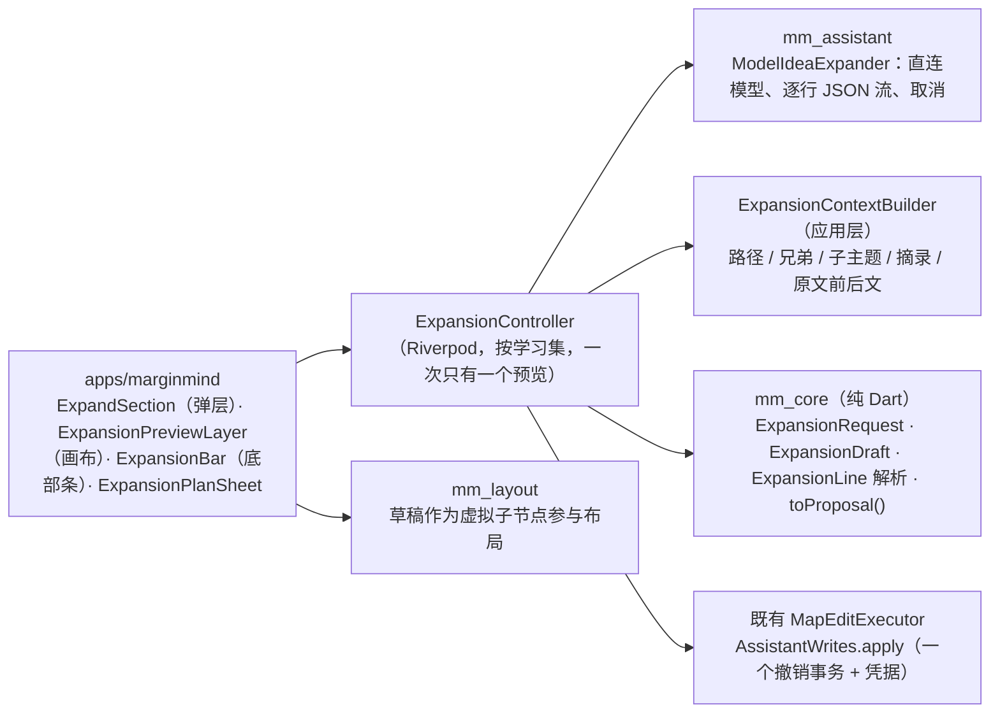

# 脑图 AI 扩展想法设计方案

> 建立日期：2026-10-30（GUL-581）。状态：**设计稿待确认**，确认后再拆分开发。
> 配套高保真原型：[`design/prototype/mindmap-ai-expand.html`](../design/prototype/mindmap-ai-expand.html)。单文件、无依赖，浏览器直接打开。右侧演示控制台有 15 个场景，并可切换未配置 AI、断网和深色；画布上的操作都可以真实点按（点选、⇧ 点选、右键、⌥⇥、↩ / Esc、⌘Z）。
> 依据：当前 `main` 的节点 AI 入口（`MapNodeBar` / `MapSelectionBar` 的 ✦ → `AssistantQuickActions`）、助手的写操作契约（`MapEditProposal`、`AssistantWrites.apply`、`MapEditReceipt`），以及 [phase-3-assistant.md](phase-3-assistant.md) 的确认原则。本文不做工时评估。

---

## 0. 一页结论

- **一个动作：扩展想法（⌥⇥）。** 选中主题后，点节点工具条上的 ✦，或直接按 ⌥⇥（Tab 是“加子主题”，⌥⇥ 是“让 AI 加子主题”）。方向、层级、数量都有默认值，不用选就能开始。
- **结果直接长在脑图上。** AI 的输出以**虚线草稿节点**流式出现在目标主题下，不是在侧栏里给出一段文字，再让用户手动搬到脑图上。
- **先审阅，再写入。** 草稿可以逐条取舍、双击改字，也可以在某条草稿上继续扩展。↩ 一次写入所有勾选的草稿，整组只占一步撤销；Esc 放弃，脑图不变。这延续了助手“写操作必须确认”的原则，只是把提议卡换成了画布上的预览。
- **三种范围。** 单个主题：扩展子主题。多个主题：分别扩展、归纳上级主题、补全同级。中心主题：**扩展整张脑图**，先给出计划（哪些分支是空的或较薄、每个分支加几条），确认后再生成。
- **有依据。** “参考原文”默认开启：分支里的摘录及其原文前后文会一起作为上下文，基于原文的草稿带 `p.N` 出处；不依据原文的草稿不显示出处，不编造页码。
- **技术上复用助手的写入链路。** 草稿保留后转成一个 `MapEditProposal`（`addTopic` 加 `new:` 依赖，归纳时另有 `move`），通过现有的 `MapEditExecutor` 在一个撤销事务里应用。生成部分新增一个**直连模型的单次调用**（与翻译、查词相同，不走 Agent 工具循环），以逐行 JSON 流式输出。

---

## 1. 用户场景

| 场景 | 现在怎么做 | 扩展想法之后 |
| --- | --- | --- |
| 读完一章，脑图只有几个空主题 | 自己想，或者问助手后把回答一条条抄进脑图 | 选中主题 ⌥⇥，挑出想要的几条，↩ |
| 想从不同角度展开一个观点 | 在对话里反复提问 | 方向选“原因 / 例子 / 反方 / 问题 / 行动” |
| 某条思路值得深入 | 再开一轮对话 | 在草稿上 ✦ 继续扩展，最后一起保留 |
| 几个主题散在中心主题下 | 手动新建上级、逐个拖进去 | 多选 →“归纳上级主题” |
| 整张脑图结构不均衡 | 自己逐个分支检查 | 选中中心主题 →“扩展整张脑图…”，按计划补齐 |

原则：一键就能得到结果；所有 AI 内容在保留之前都只是草稿；保留后一步就能撤销；有出处的才标出处。

---

## 2. 交互设计（对应原型场景）

### 2.1 入口

| 入口 | 行为 | 场景 |
| --- | --- | --- |
| 节点工具条 ✦ | 打开 AI 弹层。最上面是“扩展想法”区，下面保留原有的解释 / 总结 / 出题 / 查证和自由提问 | 1 |
| ⌥⇥ | 选中一个或多个主题时，直接按当前设置开始扩展，不打开弹层；选中中心主题时打开扩展计划；审阅中焦点在草稿上时，继续扩展这条草稿 | 2、6 |
| 选择工具条 ✦（多选） | 弹层主按钮变为“分别扩展 N 个主题”，另有“归纳上级主题 / 补全同级” | 7 |
| 右键菜单“AI 助手”分组 | 扩展想法 ⌥⇥ / 归纳上级主题（多选时）/ 解释 / 出复习题 / 带上它提问 | — |
| 中心主题 ✦ | 主按钮变为“扩展整张脑图…”，次按钮为“只加新分支” | 9 |
| 菜单栏 › 脑图 › AI 扩展想法 | 同 ⌥⇥ | — |

快捷键 ⌥⇥ 目前没有被占用（见 `mindMapShortcuts`），与 Tab（子主题）、⇧⇥（提升）组成一组。

### 2.2 弹层里的“扩展想法”区

- **主按钮**：扩展想法 ⌥⇥。
- **方向**（单选，默认“自动”）：自动 / 原因 / 例子 / 反方 / 问题 / 行动。“自动”由模型根据主题自己判断，通常是细分。
- **层级**：1 层（默认）/ 2 层 / 3 层。**数量**：少（约 3 条）/ 适中（约 5 条，默认）/ 多（约 8 条）。数量是每个父节点的上限，不是硬性要求。
- **补充要求**（可选单行输入）：例如“结合编程学习”“用英文”；在输入框里按 ↩ 直接开始。
- **参考原文**开关（默认开，按学习集记住）。
- 上一次的方向、层级和数量会被记住，下次用 ⌥⇥ 时沿用。

### 2.3 生成中

- 弹层关闭，目标主题外圈出现紫色脉冲描边；其余分支变淡，祖先路径保持清晰。
- 第一条草稿出现之前，目标下方先显示一个闪烁的占位草稿，底部条显示“正在读取分支和原文…”。
- 草稿按到达顺序逐条出现，布局随之平滑展开；内容超出可视区域时，画布自动缩放以完整显示这次的扩展。
- 底部条：`⟳ 扩展「间隔重复」 3 条 · 停止 Esc`。停止后，已经生成的草稿保留并进入审阅。

### 2.4 审阅（核心）

| 操作 | 结果 |
| --- | --- |
| 点草稿 / 空格 | 切换保留 / 不要。不要的草稿显示为删除线和灰色虚线 |
| 取消父草稿 | 它的子草稿一起取消；重新勾选子草稿时，祖先草稿也会自动勾上 |
| 双击 / F2 / 悬停 ✎ | 原地改字，↩ 确认，Esc 取消；改过的草稿自动设为保留 |
| 悬停 ✦ / ⌥⇥ | 在这条草稿下继续扩展，结果仍在同一次预览里 |
| ↑ / ↓ | 在草稿之间移动焦点 |
| 换一批 | 用同样的设置重新生成，并避开刚才和已有的内容 |
| 调整 | 在审阅中修改方向、层级和数量后重新生成 |
| ↩ / 保留 N 条 | 一次写入所有勾选的草稿；新节点闪烁，HUD 显示“已添加 N 个主题 · 撤销” |
| Esc / 放弃 | 清除所有草稿，恢复原来的选择 |

- **审阅期间不允许其他脑图编辑**（Tab、删除、拖动、打字），尝试时 HUD 提示“先保留（↩）或放弃（Esc）这次 AI 扩展”。平移、缩放、切换文档、阅读原文仍然可以。这样提议基于的脑图版本在保留时一定没有变化，`baseRevision` 校验不会失败，也就不需要做变基。
- 草稿标签（原因 / 例子 / 反方 / 问题 / 行动）和 `p.N` 出处只在预览中显示。保留后写成普通主题，不写入标签；出处的处理见 §4.6。
- 草稿只存在于内存中。窗口关闭或应用退出时，草稿直接丢弃，不写入学习集，也不会自动恢复。

### 2.5 多个主题

- **分别扩展**：对每个选中的主题各生成一组草稿（并发上限 3），统一审阅，一次保留。
- **归纳上级主题**：只有选中的主题属于同一个上级时才可用，否则按钮变灰并悬停说明原因（与“合并”“概要”不可用时的处理一致）。预览中，新上级是草稿节点，被移动的主题显示在它下面，连线变为紫色；放弃后位置完全还原。保留时生成 `addTopic` + `move`。
- **补全同级**：为选中主题的共同上级补充缺少的并列主题。

### 2.6 扩展整张脑图

1. 选中中心主题后，点“扩展整张脑图…”（或按 ⌥⇥），先显示**扩展计划**：列出每个一级分支（以及值得补充的二级分支）、它的现状（“还是空的”“已有 2 个子主题”），以及建议新增的数量；可能会建议 1–3 个新分支。
2. 用户可以取消某个分支，或用 −/+ 调整数量；底部显示总数，**上限 50**，与 `AssistantWrites.apply` 的单次提议上限一致。
3. 点“开始扩展”后，各分支依次生成（并发上限 3），统一审阅，一次保留，一步撤销。
4. 计划本身由一次轻量调用得出（只发送结构和标题，不发送原文）；用户没有修改时，不重复请求。

### 2.7 状态与退路

| 情况 | 表现 |
| --- | --- |
| 未配置 AI | 弹层里显示助手现有的连接卡（连接服务 / 使用本机模型）；⌥⇥ 会打开这个弹层 |
| 断网（云端模型） | 底部条显示“网络不可用，没有生成内容 · 重试 · 改用本机模型”，脑图不变 |
| 部分生成后失败或停止 | 已经出现的草稿进入审阅，底部条标题显示“已停止” |
| 没有新内容（全部重复或模型认为已经完整） | 不留下空的预览，HUD 提示“这里暂时没有值得补充的方向，换个方向试试” |
| 输出格式错误的行 | 跳过这一行，继续解析后面的内容；整轮没有一条有效输出时按失败处理 |
| 另一个助手运行占用模型 | 与快捷问答相同：提示稍后再试，不排队 |
| 只读对话、图片卡、概要主题 | 图片卡只提供标题作为上下文；概要主题可以扩展（它本身就是主题） |

### 2.8 界面文案

遵循 [phase-3-assistant.md §9](phase-3-assistant.md)：原型里的说明性副标题（例如计划卡下面那一行）在实现时只保留会影响用户决策的部分（上限 50）。

---

## 3. 内容规则

| 项 | 规则 |
| --- | --- |
| 标题长度 | 每条一个短主题：中文不超过 24 字，英文不超过 8 个词；超长时截断，并在提示词中要求简短 |
| 语言 | 跟随目标主题的语言；补充要求里指定的语言优先 |
| 去重 | 发送给模型的上下文里包含已有的子主题和兄弟主题；返回后在本地用规范化标题（去空白和标点、统一大小写、全角转半角）去重，同一批内部也去重 |
| 草稿数量 | 每个父节点不超过所选数量；每次总数不超过 50，超出部分丢弃，并在底部条注明“已达上限” |
| 层级 | 1–3 层；子草稿只能挂在本次生成的父草稿下面 |
| 节点类型 | 只新增**主题**。首批不新增笔记和复习卡；后续可在方向里加入“附说明”（写入 `addNote`） |
| 出处 | 只有当草稿依据的是本次实际发送的某张摘录或页面时，才允许带 `page`；页码不在本次上下文中的，一律丢弃 |
| 禁止 | 不删除、不改名已有节点、不修改原文、不跨脑图（复用 `MapEditKind` 的白名单） |

---

## 4. 技术方案

### 4.1 分层



- **为什么不走 Agent 工具循环。** 扩展的输入是确定的（目标节点 + 上下文），输出是结构化列表，不需要模型自己决定读什么、调用什么工具。直连模型的单次调用更快、更便宜，也更容易测试；仓库里已有同样的做法（`ModelParagraphTranslator`、查词：“Direct model calls: no agent, skills, tools”）。如果用户在助手对话里说“帮我扩展这个分支”，仍然走现有的 `propose_map_edits` 提议卡；提议卡上新增“在脑图中预览”，复用同一个预览层（§4.5）。
- **依赖方向不变。** 生成器在 `mm_assistant`，数据结构和校验在 `mm_core`，`mm_core` 仍然不依赖任何包。

### 4.2 mm_core：数据结构（纯 Dart，可单测）

```dart
enum ExpansionScope { children, group, siblings, map }
enum ExpansionDirection { auto, why, example, counter, question, action }

class ExpansionRequest {           // 不可变；也是“换一批”的输入
  final String studySetId, mapId;
  final ExpansionScope scope;
  final List<String> targetIds;    // 地图根节点用 mapId（与提议契约一致）
  final ExpansionDirection direction;
  final int depth;                 // 1..3
  final int breadth;               // 每个父节点的上限：3 / 5 / 8
  final String? hint;              // ≤ 200 字
  final bool grounded;
  final Map<String, int>? plan;    // 仅 scope == map：branchId → 数量
  final int round;                 // 换一批时 +1，并携带上一批的标题作为排除项
}

class ExpansionDraft {             // 预览状态，只在内存中
  final String id;                 // 'd1'、'd2'…（作为 MapEditOperation.id）
  final String parentRef;          // 已有节点 ID，或 'new:<draftId>'
  final String title;
  final ExpansionDirection tag;
  final int? page;                 // 已通过出处校验
  final bool kept, edited;
}

/// 解析一行模型输出；任何字段不合法都返回 null（跳过这一行）。
ExpansionDraft? parseExpansionLine(String line, ExpansionLineContext ctx);

/// 保留时调用：被取消的父草稿连同它的子孙一起排除；
/// group 场景生成 addTopic(new 上级) + move(被归纳的主题 → new:上级)。
MapEditProposal expansionToProposal(ExpansionRequest r, List<ExpansionDraft> drafts, {required String proposalId, required int baseRevision});
```

`expansionToProposal` 的结果原样交给 `MapEditExecutor.apply`，因此依赖顺序、50 条上限、`baseRevision`、字段白名单和撤销凭据都复用现有校验，不另写一套。

### 4.3 模型契约：逐行 JSON（NDJSON）

系统提示要求模型只输出若干行 JSON，每行一个节点：

```json
{"ref":"a","parent":"T1","title":"间隔怎么定：1-3-7-14 天","tag":"auto","page":47}
{"ref":"b","parent":"a","title":"具体做法","tag":"action"}
```

- `parent` 只能是输入里给出的目标别名（`T1`、`T2`…，由应用映射到真实 ID，**不把真实节点 ID 发给模型**），或者本次输出中更早出现的 `ref`。
- 选择逐行输出，是为了让每一行一到达就能校验并画出来。工具调用的参数要等整个 JSON 完成才能解析，做不到流式出现。
- 解析器按行缓冲；一行不完整就继续等待；解析失败就跳过这一行，并记录到诊断信息（只记原因，不记内容）。
- `page` 必须落在本次上下文实际包含的页码集合内，否则丢弃（这条规则与助手的 `[page:N]` 校验一致）。
- 扩展计划使用另一个更短的提示，输出形如 `{"branch":"T2","add":4,"reason":"empty"}` 的行。

### 4.4 上下文构建（`ExpansionContextBuilder`，应用层）

按优先级装入，直到达到预算（默认约 6k tokens，可按模型的上下文窗口调整）：

1. 脑图名、中心主题、目标的祖先路径。
2. 目标已有的子主题和兄弟主题的标题（用于去重，也让模型了解已有的粒度）。
3. 目标子树中摘录卡片的标题和原文（宋体段落），按距离由近到远。
4. `grounded` 开启时：这些摘录在原文中的前后段落（复用 `WorkspaceReader` / `read_pages` 的取文逻辑），附上页码。
5. 补充要求。

多个主题和整张脑图时，按目标平均分配预算。图片卡只发送标题。所有内容都只发送给当前选定的模型服务，不联网搜索（扩展想法不需要外部资料，也就不受“联网”开关影响）。

### 4.5 预览层与布局

- `ExpansionController` 持有 `ExpansionPreview { request, drafts, moves, phase: generating|review|error, stopped }`，按学习集各有一个；另一个预览存在时，新的扩展请求会被忽略。
- `MindMapCanvas` 计算布局时，把草稿当作虚拟子节点插入树中（`moves` 中的节点挂到草稿上级下面）。布局仍然由 `mm_layout` 的 `TreeLayout` 计算，不需要新的布局算法。草稿使用新的 `MapGhostNode` 组件：`research` 色 1pt 虚线描边，底色为 `researchTint` 的一半。
- 审阅期间，`MindMapCanvas` 的编辑命令被拦截，并显示 HUD 提示；`mindMapShortcuts` 中的 ↩ / Esc / 空格 / ↑↓ / F2 / ⌥⇥ 在预览期间改为作用于草稿。
- 无障碍：每个草稿都是可聚焦的语义节点，读作“AI 草稿，{标题}，{已保留 / 未保留}”；底部条按钮有完整的标签。系统开启“减少动态效果”时，取消脉冲描边和逐条出现的动画。

### 4.6 保留与撤销

1. `expansionToProposal` → `MapEditExecutor.apply(proposal, keptIds)`，在一个撤销事务里执行，并写入 `MapEditReceipt`。
2. `workspace.flashAssistantNodes(receipt.nodeIds)` 让新节点闪烁（已有方法）。
3. HUD 显示“已添加 N 个主题 · 撤销”；⌘Z 一步撤回整组。
4. **出处**：首批不新增字段，带 `page` 的草稿保留后写成普通主题，出处信息不保存。待确认项 1 讨论是否保存为“AI 生成 · 依据 p.47”。

### 4.7 设置与限制

- 模型：使用助手当前选定的模型；未配置时显示连接卡。可选：在设置里为扩展单独选一个更快的模型（后置）。
- 一次只运行一个扩展；与助手对话共用同一个“busy”判断，避免同时占用本机模型。
- 单次请求设置输出上限（例如 1500 tokens）和超时（60 秒），按现有的预算机制计费。

---

## 5. 测试计划（目标覆盖率 ≥ 80%）

| 层 | 用例 |
| --- | --- |
| `mm_core` | `parseExpansionLine`：合法行、未知字段、超长标题、非法 parent、超出上下文的页码、空行和半行；`expansionToProposal`：级联取消、`new:` 依赖顺序、归纳时的 move、上限 50；规范化去重 |
| `mm_assistant` | `ModelIdeaExpander` 用 `RecordingLLMClient` 回放：流式分块跨行、取消、网络错误分类、全部无效时报告失败；提示词快照测试 |
| 应用层 | `ExpansionContextBuilder` 的预算截断和优先级；`ExpansionController` 的状态机（generating → review → kept / discarded / error / stopped）；widget 测试：⌥⇥、空格 / ↑↓ / F2 / ↩ / Esc、编辑被拦截、保留后 ⌘Z、草稿的语义标签 |
| 回归 | `node_assistant_test`、`assistant_quick_actions_test`、`map_keyboard_test` 保持通过；Tab / ⇧⇥ 行为不变 |

---

## 6. 分批

1. **A：单个主题 · 1 层。** mm_core 数据结构和解析、`ModelIdeaExpander`、上下文构建、预览层、底部条、⌥⇥、保留和撤销。原型场景 1–4、11–15。
2. **B：方向、层级和继续扩展。** 方向 chip、2–3 层、草稿上 ✦、换一批时排除已有内容。场景 5、6。
3. **C：多个主题。** 分别扩展、补全同级、归纳上级（move 预览）。场景 7、8。
4. **D：整张脑图。** 计划调用、计划卡、分支并发、50 上限提示。场景 9、10。
5. **E：后置。** 助手提议卡“在脑图中预览”、保存 AI 出处、“附说明”、单独的扩展模型。

---

## 7. 待确认

1. **AI 出处要不要保存？** 方案一：不保存（首批）。方案二：主题上增加一个可选字段 `origin: {kind: ai, page?}`，悬停时显示“AI 生成 · 依据 p.47”，需要为文件格式增加一个可选字段（旧文件读入时为 null）。建议先用方案一，根据使用反馈再决定。
2. **审阅期间禁止编辑**是否可以接受？另一种做法是允许编辑，保留时再对提议做变基（只含新增操作时可以安全变基）。这种做法更复杂，收益也不明显。
3. **快捷键 ⌥⇥** 是否可以？备选是 ⌥⌘E。
4. 扩展整张脑图的**上限 50** 是否合适？如果需要更多，可以分轮进行，每轮都单独审阅。
