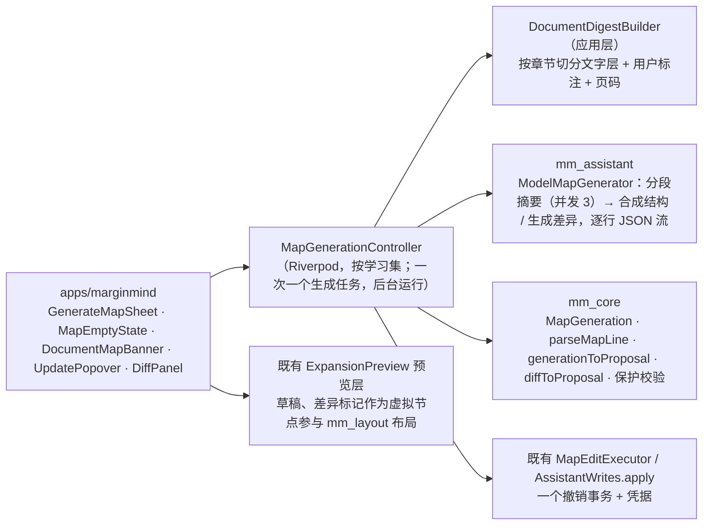

# 基于文档生成与更新脑图设计方案

> 建立日期：2026-10-31（GUL-600）。状态：**方案待确认**（§8 列出需要确认的决定）。
> 配套高保真原型：[`design/prototype/mindmap-from-document.html`](../design/prototype/mindmap-from-document.html)。单文件、无依赖，浏览器直接打开；右侧演示控制台有 14 个场景，可以切换深色、未配置 AI、断网，“▶ 播放”演示完整的生成过程。`?scene=12&theme=dark` 可以直接打开某个场景。
> 视觉沿用扁平化规格（[layout-density.md](layout-density.md)，GUL-610）；AI 草稿、审阅、保留与撤销沿用 [AI 扩展想法](mindmap-ai-expand.md)（GUL-581）。本文不做工时评估。

---

## 0. 一页结论

- **一个入口，两种状态。** 脑图栏表头新增一个按钮：脑图还没有关联文档时显示“生成脑图”，关联后显示“更新”。文档有新内容时按钮上出现紫点。图标用 `LucideIcons.wandSparkles`，与助手（sparkles）、整理笔记（notebook-pen）区分开。
- **一句话就能生成。** 空脑图直接显示入口：标题写明依据哪份文档，下面一行补充要求，⌘↩ 生成；“设置”里可以选多份文档、部分章节、组织方式和详细程度。
- **先通读，再成图。** AI 按章节分段通读全文（目录先画成骨架），再合成整体结构；节点以虚线草稿逐个长出来。生成在后台进行，期间可以继续阅读。
- **原文是锚点。** 每个生成的主题都带出处 `p.N`，点一下原文跳页并闪烁；用户已有的高亮作为摘录卡片挂进对应主题，不会丢。
- **多文档：脑图跟着文档走。** 脑图记录自己依据哪些文档。切换到有脑图的文档，脑图栏随之切换；切换到还没有脑图的文档，顶部提示“生成新脑图 / 并入当前脑图”。也可以一次选多份文档，按主题合并成一张图。
- **更新是差异，不是重画。** 文档读了更多、加了高亮、或者用户补了一句要求，“更新”只针对变化生成新增、改名、移动、建议删除，在画布和列表里逐项取舍。**用户改过或自己添加的节点永远不会被改写或删除。**
- **所有 AI 结果先审阅再写入。** 保留 / 应用是一个撤销事务，⌘Z 一步撤回；放弃时脑图不变。

---

## 1. 用户场景

| 场景 | 现在怎么做 | 有了这个功能 |
| --- | --- | --- |
| 刚导入一本教材的一章，想先看整体结构 | 自己边读边建主题，或者问助手再一条条抄进脑图 | 空脑图里 ⌘↩，一分钟左右得到带出处的结构图 |
| 已经高亮了一些句子，想让结构把它们串起来 | 手动建主题、把摘录拖进去 | 生成时这些高亮自动挂到对应主题下 |
| 学习集里有第 6 章、第 7 章两份文档 | 两张图之间手动切换，或把内容挤在一张图里 | 每份文档一张图，切换文档时脑图跟着切；需要时合成一张“记忆与遗忘” |
| 读完后半章又加了 5 条高亮 | 手动补主题，担心覆盖自己改过的内容 | “更新”只处理新内容，以差异审阅，改过的节点受保护 |
| 想换个角度组织，比如“按考试要点” | 重建一张图 | 写一句要求重新生成，或者生成到一张新图里对照 |

原则：一步就能开始；生成过程可见可停；每个节点能回到原文；用户自己的内容（高亮、批注、改过的节点）优先于 AI。

---

## 2. 交互设计（对应原型场景）

### 2.1 入口

| 入口 | 行为 | 场景 |
| --- | --- | --- |
| 空脑图的空状态 | 标题“从「文档名」生成脑图”，补充要求输入框，“设置”，“生成 ⌘↩”，常用要求建议（点了追加到输入框），以及“新建空白主题” | 1 |
| 脑图栏表头“生成脑图 / 更新” | 没有关联文档：打开生成设置；已关联：打开更新弹层；生成中显示“生成中”，审阅中显示“审阅中” | 1、11 |
| 侧栏文档行右键 | “生成脑图…”（预选这份文档） | — |
| 侧栏“脑图”分组的 + | 新建脑图… / 从文档生成… | — |
| 切换到没有脑图的文档 | 脑图栏顶部的非模态提示：生成新脑图 / 并入当前脑图 / ✕ | 8 |
| 菜单栏 › 脑图 › 从文档生成… | 同表头按钮 | — |

空状态只在脑图除中心主题外没有任何节点时出现；已有内容的脑图不会被空状态遮挡，入口只在表头。

### 2.2 生成设置（场景 2）

`MMSheet`，宽 640，一个两列表单：

| 项 | 内容 | 默认 |
| --- | --- | --- |
| 文档 | 学习集里的所有文档，可多选；每份显示页数。单份文档可以“选择章节”，列出目录（没有目录时用页码范围）。扫描版标出“需先识别文字”，超长电子书标出“分 N 段阅读” | 当前打开的文档、全文 |
| 组织方式 | 按原文章节（一级主题对应章节）/ 按主题重组（打破章节按概念归类）/ 按问题组织（每个分支回答一个问题）。选了多份文档时，第二项变成“按主题合并” | 单文档：按原文章节；多文档：按主题合并 |
| 详细程度 | 概要（2 层）/ 适中（3 层）/ 详细（4 层），右侧显示预计规模 | 适中 |
| 内容 | 放入我的高亮和批注（显示条数）；摘录原文关键句（生成摘录卡片，原文上用虚线标出） | 开；关 |
| 生成到 | 新脑图（以文档命名，可改）/ 当前脑图的新分支 / 替换某张已关联的脑图（进入更新流程） | 新脑图 |
| 要求 | 多行输入，≤ 500 字 | 空 |

- 底部显示总页数；选中了需要识别的文档时“生成”不可用，并说明原因。
- 设置按学习集记住，下次在空状态一句话生成时沿用。

### 2.3 生成中（场景 3、4）

1. **通读。** 中心主题脉冲描边，文档目录先画成一级主题骨架（灰色，当前章节闪烁）。每读完一章，对应骨架变成草稿。底部条：`⟳ 阅读「第6章 记忆」 ▬▬▬▭▭▭ 6.4 长时记忆的类型 · 停止 Esc`。
2. **成图。** 通读完成后合成整体结构，节点以虚线草稿按到达顺序逐个出现，画布自动适配；底部条：`⟳ 生成脑图 12 个主题 · 停止 Esc`。
3. **后台进行。** 生成期间可以阅读、标注、切换文档和脑图；侧栏对应脑图行显示进度。正在生成的这张脑图不能编辑（同 AI 扩展想法的审阅期规则）。
4. **停止。** 已经读完的章节和已经出现的节点保留，进入审阅。

### 2.4 审阅（场景 5、6）

与 AI 扩展想法一致：点草稿（或空格）切换保留 / 不要，取消父节点时子节点一起取消；双击 / F2 改字；↑↓ 移动焦点。另外：

- **出处 `p.N`**：点了原文栏跳到那一页并闪烁对应段落；多文档时会先切换文档。
- **换一批**：同样设置重新生成。**调整**：弹层里改组织方式、详细程度、要求后重新生成；改过字的草稿作为约束保留。
- **保留 ↩**：创建脑图并写入，一个撤销事务；HUD“已生成脑图「第6章 记忆」· 19 个主题 · 撤销”。**放弃 Esc**：不创建脑图。

### 2.5 保留之后（场景 7）

- 新脑图出现在侧栏“脑图”分组，以文档命名；文档行出现脑图标记，表示二者已关联。
- 生成的主题保存出处：平时不显示，悬停或选中时显示 `p.N`，⌘L 回到原文（与摘录卡片一致）。
- 用户的高亮作为普通摘录卡片写入，和手动摘录完全相同。

### 2.6 多文档（场景 8、9、10）

- **脑图记录依据的文档**（§4.1 `MindMap.sources`）。一张脑图可以依据多份文档；一份文档也可以被多张脑图引用。
- **切换到有脑图的文档**：脑图栏切到它关联的脑图（多张时取最近使用的），右上角提示“已切换到「第6章 记忆」”。设置 › 脑图 ›“随文档切换脑图”可以关闭。
- **切换到没有脑图的文档**：当前脑图不动（用户可能正在对照），顶部提示：`第7章 遗忘 还没有脑图 · 生成新脑图 · 并入当前脑图 · ✕`。每份文档只提示一次。
  - 生成新脑图：直接按记住的设置开始。
  - 并入当前脑图：打开生成设置，文档预选为“当前脑图的依据 + 这份文档”，组织方式“按主题合并”，结果以更新差异呈现（§2.7）。
- **一次合成多份文档**：设置里多选，按主题合并；出处前的色点区分文档，底部条显示图例。

### 2.7 更新（场景 11、12）

**什么时候提示更新。** 保存生成时的依据指纹（§4.1）：页数和文字层、用户在这些文档上的高亮和批注、阅读进度。之后任何一项变化，表头“更新”出现紫点，侧栏脑图行同样标出。不弹窗。

**更新弹层**（表头按钮下方，宽 360）：

- 依据：当前依据的文档，“+ 添加文档”。
- 上次生成之后：新增高亮 5、新增批注 2、读到 p.38 → p.46。
- 范围：**只处理新内容**（默认，便宜、快，不扰动已有结构）/ 全文重新梳理。
- 要求：一句话，例如“补充提取练习一节，例子放到对应概念下面”。只写要求、没有新内容时也可以更新。
- 保护说明：“你改过、添加的 7 个节点保持不变”。
- “预览更改 ⌘↩”。

**差异审阅**（场景 12）。脑图栏切到全宽，右侧 340 的“更新脑图”面板：

| 类型 | 画布表现 | 列表默认 |
| --- | --- | --- |
| 新增 | 虚线草稿，标“新” | 勾选 |
| 改名 | 新名字，上方删除线显示旧名，标“改名” | 勾选 |
| 移动 | 出现在新位置，连线为紫色实线，标“移自 编码” | 勾选 |
| 建议删除 | 灰色虚线、删除线，标“建议删除”，列表里写明理由 | **不勾选** |

- 列表和画布联动：点列表项，画布定位并聚焦；点画布节点，列表滚到对应项。
- 带锁的节点是用户改过的，AI 不会改写它们，也不会把它们作为建议删除的对象。
- “应用 N 项 ↩”：一个撤销事务；“放弃”：脑图完全不变；“换一批”：同样要求重新生成。审阅期间禁止其他脑图编辑。

### 2.8 状态与退路（场景 13、14）

| 情况 | 表现 |
| --- | --- |
| 未配置 AI | 空状态和设置里显示助手现有的连接卡（连接服务 / 使用本机模型） |
| 断网（云端模型） | 底部条“网络不可用，没有生成内容 · 重试 · 改用本机模型”，脑图不变 |
| 某一章失败（超时、输出无效） | 其他章节照常进入审阅，底部条标出“6.6 提取 没有生成 · 重试”，只重试这一章 |
| 扫描版没有文字层 | 顶部提示“先识别文字才能生成 · 识别文字”（现有 OCR），识别完成后自动继续 |
| 文档很长（> 200 页或超过模型上下文） | 按章节或固定页数分段，设置里提前显示“分 N 段阅读”；不设页数上限 |
| 没有生成任何有效内容 | 不留空的预览，HUD“没有从文档中得到可用的结构，换个组织方式试试” |
| 另一个 AI 任务占用本机模型 | 排队等待，底部条显示“等待中”；云端模型可并发 |
| 生成期间关闭学习集 | 生成取消，草稿丢弃（只存在内存中，同 AI 扩展想法） |

### 2.9 界面文案

遵循 [phase-3-assistant.md §9](phase-3-assistant.md) 和扁平化规格：只留控件名称和必要状态；不加副标题和操作提示。原型中的说明文字只出现在演示控制台。

---

## 3. 内容规则

| 项 | 规则 |
| --- | --- |
| 结构 | 中心主题 = 文档主题（多文档时为合并后的主题）；层数由详细程度决定；每个父节点 3–8 个子主题 |
| 标题 | 一个短主题：中文 ≤ 24 字，英文 ≤ 8 个词；概念类用“概念：一句话要点”的形式（如“加工水平：加工越深越牢”） |
| 语言 | 跟随文档语言；要求里指定的语言优先 |
| 出处 | 每个主题必须带 `page`，且必须落在本次实际读过的页内，否则丢弃出处（节点保留）；多文档时同时带文档别名 |
| 用户高亮 | 只引用、不改写：按出处页和语义挂到最相关的主题下，作为摘录卡片；找不到合适位置的放进“其他摘录”分支 |
| 摘录原文关键句 | 打开时才生成；必须是原文逐字片段（本地校验能在页面文字中找到），否则丢弃 |
| 更新：保护 | 用户改过标题、添加、移动过的节点，以及所有摘录卡片、笔记、图片卡：不能被改名、移动或建议删除；可以在它们下面新增 |
| 更新：删除 | 只能建议删除“AI 生成且没被动过”的主题，必须附理由；默认不勾选 |
| 去重 | 与 AI 扩展想法相同的规范化标题去重，跨批次、跨分支 |

---

## 4. 技术方案

### 4.1 数据模型（mm_core，纯 Dart）

```dart
/// A document a map was generated from, plus what it looked like then.
class MapSource {
  final String documentId;
  final List<String> chapters;     // 空 = 全文；否则为目录条目 ID
  final String fingerprint;        // 文字层哈希 + 该文档上标注集合的哈希
  final int readThrough;           // 生成时的阅读进度（页）
}

class MapGeneration {              // 写在 MindMap 上，格式向后兼容（缺省为 null）
  final List<MapSource> sources;
  final MapOrganization organization;  // chapter | topic | question
  final int depth;                 // 2..4
  final String? instructions;      // 最近一次的要求
  final DateTime generatedAt;
  /// cardId → 生成时的标题哈希。当前标题哈希不同、或节点被移动过，即视为“用户改过”。
  final Map<String, String> generated;
}

class MindMap { ... final MapGeneration? generation; }

/// 新增：主题卡片的出处（摘录卡片已有 annotationId，不需要）。
class CardSource { final String documentId; final int page; }
class Card { ... final CardSource? source; }
```

- “依据的文档”= `generation.sources`；“随文档切换脑图”按它查找。
- “有更新”= 任一 `MapSource.fingerprint` 或 `readThrough` 与当前不同（应用层计算，不落盘）。
- “用户改过”不需要在每次编辑时打标记：比较 `generated` 里的哈希即可；用户手动添加的节点不在 `generated` 里，天然受保护。
- 文件格式：`MindMap.generation`、`Card.source` 都是可选字段，旧版本读取时忽略，不需要迁移。

### 4.2 流程与分层



- **为什么分两段。** 一章几十页无法一次放进小模型的上下文，也无法让用户尽早看到进度。第一段对每章独立生成“章节要点”（结构化 JSON，带页码和用户标注 ID），可以并发、单独重试；第二段只读这些要点（不读原文）合成整体结构，成本低、可多次“换一批”而不重读全文。
- **复用。** 直连模型的单次调用与 `ModelIdeaExpander`、`ModelParagraphTranslator` 相同（不走 Agent 工具循环）；预览层、审阅交互、保留与撤销复用 AI 扩展想法的 `ExpansionPreview` 和 `MapEditExecutor`；扫描版复用 `PdfOcrService`；章节来自 `DocumentOutline`。
- **缓存。** 章节要点按（文档文字层哈希、章节、模型）缓存在学习集包内的 `ai-cache/`，“换一批”“调整”“全文重新梳理”时没变的章节不重读。缓存可在设置里清除。

### 4.3 模型契约（NDJSON）

第一段（每章一次）输出章节要点：

```json
{"k":"point","id":"p1","title":"加工水平：加工越深越牢","page":20,"marks":["A12"]}
{"k":"point","id":"p2","parent":"p1","title":"语义判断的单词记得最好","page":21}
```

第二段（成图）与 AI 扩展想法同一格式，`parent` 只能是 `ROOT` 或本次更早出现的 `ref`；`mark` 把用户标注（以别名 `A12` 发送，不发真实 ID）挂到节点下：

```json
{"ref":"a","parent":"ROOT","title":"编码","page":19}
{"ref":"b","parent":"a","title":"加工水平：加工越深越牢","page":20}
{"mark":"A12","parent":"b"}
```

更新使用差异格式；节点以别名 `N1…` 发送，并标出受保护的别名：

```json
{"op":"add","ref":"x","parent":"ROOT","title":"提取与提取练习","page":40}
{"op":"rename","node":"N7","title":"编码：信息怎样进入长时记忆"}
{"op":"move","node":"N9","parent":"x"}
{"op":"remove","node":"N4","why":"原文只在脚注提到，与「中央执行系统」重复"}
```

- 每一行到达即校验：页码不在本次上下文中的去掉出处；`rename / move / remove` 指向受保护节点的直接丢弃（模型提示里也会说明，但以本地校验为准）。
- `MapEditKind` 需要新增两种：`addExcerpt`（引用一条已有标注，挂到指定父节点下）和 `remove`。`remove` 仅允许来源为“文档生成更新”的提议使用，且只能作用于未被改过的生成节点；对话里的 `propose_map_edits` 不开放这两种。

### 4.4 上下文与成本

- 第一段每章：章节文字（超长时按页再切）、该章的用户标注（原文 + 批注，带页码）、组织方式、要求。
- 第二段：所有章节要点、脑图名、组织方式与层数、要求；更新时另加现有脑图的结构（标题 + 别名 + 是否受保护 + 出处页）。
- 只处理新内容：只重读有新标注或新读到的页所在的章节，其余章节用缓存的要点。
- 输出上限与超时按段设置（例如每章 2k tokens / 90 秒，合成 4k tokens / 120 秒）；按现有预算机制计费。生成前在设置里显示页数，不显示 token 估算。
- 发送内容只到当前选定的模型服务；不联网，不受“联网”开关影响。

### 4.5 写入

- 新脑图：`generationToProposal` 生成 `addTopic`（含 `CardSource`）和 `addExcerpt`（为用户标注创建摘录卡片；标注已有卡片时把同一张卡片放进这张脑图），在一个事务里创建 `MindMap`（带 `generation`）并应用。
- 并入当前脑图 / 更新：`diffToProposal` → `MapEditExecutor.apply`，同时更新 `generation`（新指纹、新 `generated` 哈希）。撤销会一起还原 `generation`。
- 提议的 50 条上限：与 AI 扩展想法相同，按来源放开（生成脑图通常 20–80 个节点）。

---

## 5. 界面规格要点

令牌与组件沿用 [layout-density.md](layout-density.md) 的扁平化规格和 [mindmap-ai-expand-ui.md](mindmap-ai-expand-ui.md) 的草稿样式；本功能新增：

| 组件 | 规格 |
| --- | --- |
| 表头按钮 | `MMToolbarButton` 带文字，`research` 文字，选中 / 生成中 `researchTint` 底；“有更新”紫点 7pt，`research`，1.5pt 窗口底色描边 |
| 空状态 | 宽 440 居中；图标块 56pt，圆角 16，`researchTint` 底；补充要求框 `surface` + 1pt `separator`，聚焦时 `research` 描边 + 3pt `researchTint` 外环 |
| 生成设置 | `MMSheet` 宽 **新** `MMSizes.mapGenerateSheetWidth`（640），标签列 96；文档列表行高 40，章节行 30（`quaternaryFill` 底） |
| 文档提示条 | 顶部浮动，`surface` + 0.5pt `border`，圆角 12，高 44，距表头 8 |
| 骨架主题 | `quaternaryFill` 底，`secondaryLabel` 文字；当前章节透明度 1.2 秒呼吸；“减少动态效果”时不动画 |
| 出处标签 | 高 18，圆角 9，11pt 中等字重，`quaternaryFill` 底 / `secondaryLabel`；草稿中 `researchTint` / `research`；多文档时前置 6pt 文档色点 |
| 差异标记 | 标签 10pt 半粗，圆角 4：“新 / 改名 / 移自…”为 `researchTint` / `research`，“建议删除”为 `fill` / `secondaryLabel`；旧名 11pt `secondaryLabel` 删除线，位于节点上方 |
| 受保护标记 | 18pt 圆形徽标，`surface` + 0.5pt `border`，锁图标 12pt `secondaryLabel`，压在节点左上角 |
| 更新弹层 | 宽 360，`surface` + 0.5pt `border`，圆角 14 |
| 差异面板 | 宽 **新** `MMSizes.mapDiffPanelWidth`（340），`windowBackground`，左侧 1pt `separator`；行内边距 7×8，复选框勾选为 `research` |

无障碍：草稿、差异节点都是可聚焦语义节点，读作“AI 草稿，{标题}，第 N 页，已保留 / 未保留”或“建议改名，{旧名} 改为 {新名}”；底部条和面板按钮有完整标签；生成进度用 `SemanticsService.announce` 按章节播报。

---

## 6. 测试计划（目标覆盖率 ≥ 80%）

| 层 | 用例 |
| --- | --- |
| `mm_core` | `MapGeneration` / `CardSource` 的 JSON 往返与旧文件兼容；指纹比较；“用户改过”判定（改名、移动、新增）；`parseMapLine` 三种格式的合法 / 非法行、越界页码、指向受保护节点的操作；`generationToProposal`、`diffToProposal` 的依赖顺序和一步撤销；`remove` 只允许生成来源 |
| `mm_assistant` | `ModelMapGenerator` 用 `RecordingLLMClient` 回放：分段并发与单章失败、流式跨行、取消、网络错误分类、全部无效时报告失败；三类提示词快照 |
| 应用层 | `DocumentDigestBuilder` 的章节切分、无目录时按页切分、超长分段；`MapGenerationController` 状态机（reading → streaming → review → kept / discarded / failed / stopped，update → diff → applied / discarded）；随文档切换脑图；提示条只出现一次；widget 测试：空状态 ⌘↩、设置表单、审阅键盘、差异列表与画布联动、应用后 ⌘Z |
| 回归 | AI 扩展想法、`multiple_maps_test`、`map_keyboard_test`、`reader_ocr_test` 保持通过 |

---

## 7. 分批

1. **A：单文档生成。** 数据模型、通读 + 成图、空状态、表头按钮、生成设置（文档、组织方式、详细程度、要求）、审阅与保留、出处与 ⌘L、用户高亮挂入。场景 1–7、13。
2. **B：多文档。** `MindMap.generation` 驱动的随文档切换、提示条、多选合并、文档色点。场景 8–10。
3. **C：更新。** 指纹与“有更新”、更新弹层、差异格式与 `remove`、受保护校验、差异面板。场景 11、12。
4. **D：增强。** 章节选择、摘录原文关键句、扫描版自动接续、章节要点缓存与清理。场景 2、14。

---

## 8. 待确认的决定

1. **出处保存为 `Card.source`。** 本方案选择保存（原文是锚点，是这个功能的价值所在），这会给卡片格式加一个可选字段。备选：首批不保存，与 AI 扩展想法一致。
2. **建议删除默认不勾选。** 也可以完全不提供删除，只做新增、改名、移动。
3. **随文档切换脑图默认开启。** 备选：默认关闭，只在提示条里提供“切换到它的脑图”。
4. **用户高亮进入脑图的方式。** 本方案把还没在脑图上的高亮作为摘录卡片挂进去；已经在别的脑图上的高亮，在这张图上再放一份（卡片可以出现在多张图里）。备选：只引用页码，不放卡片。
5. **一次只运行一个生成任务**（与助手共用 busy 判断）。云端模型下是否允许不同学习集并行。
