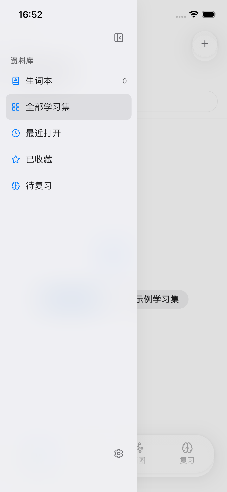
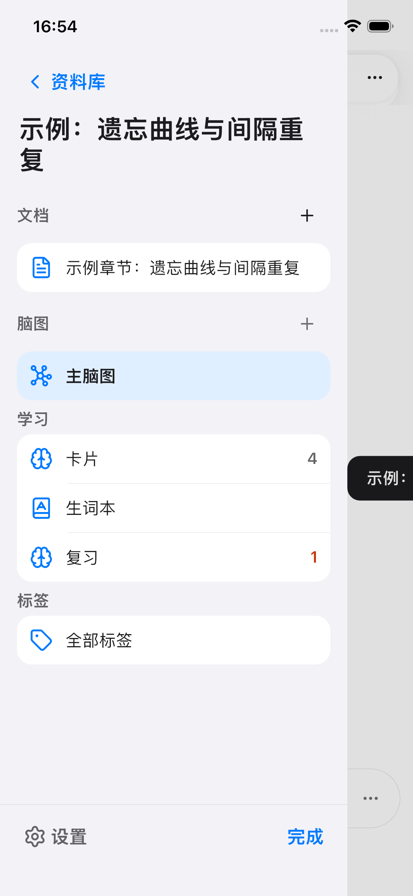
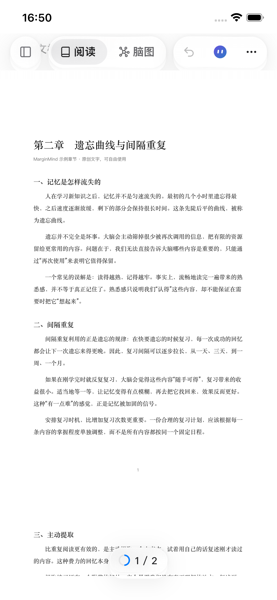
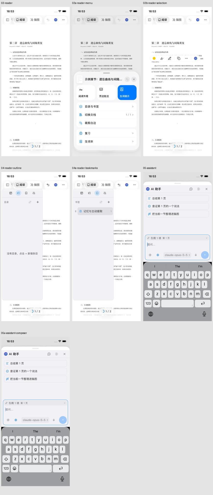
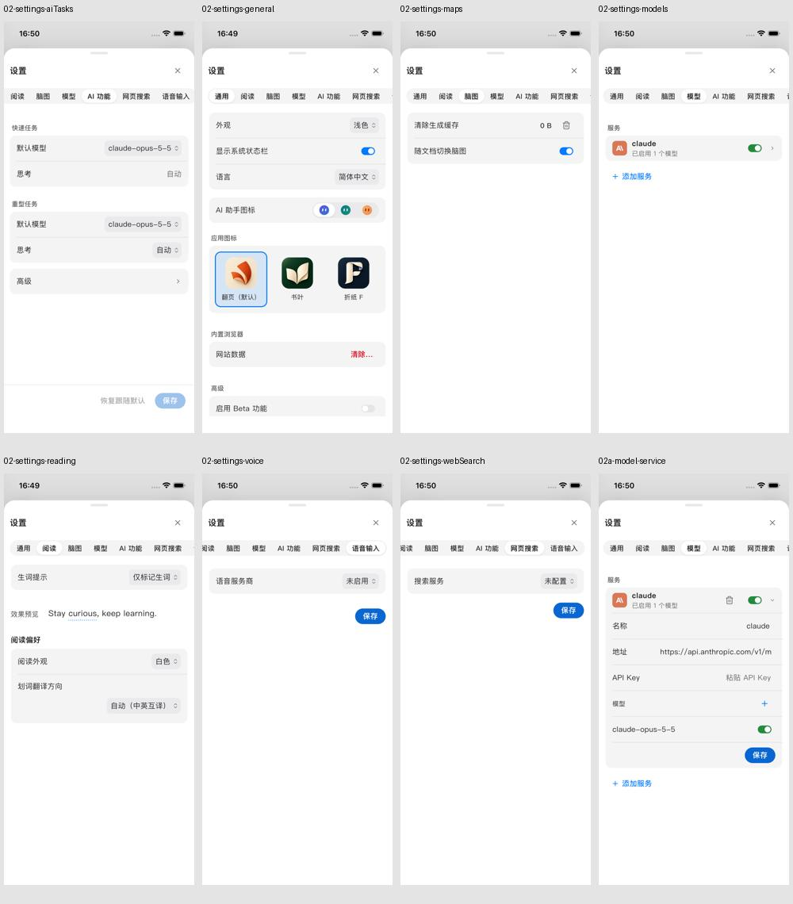
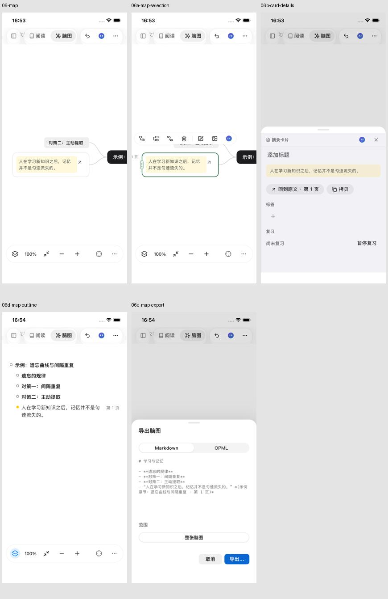
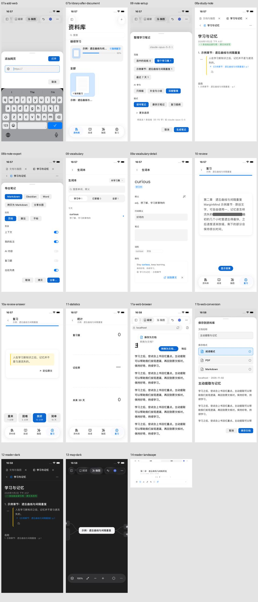
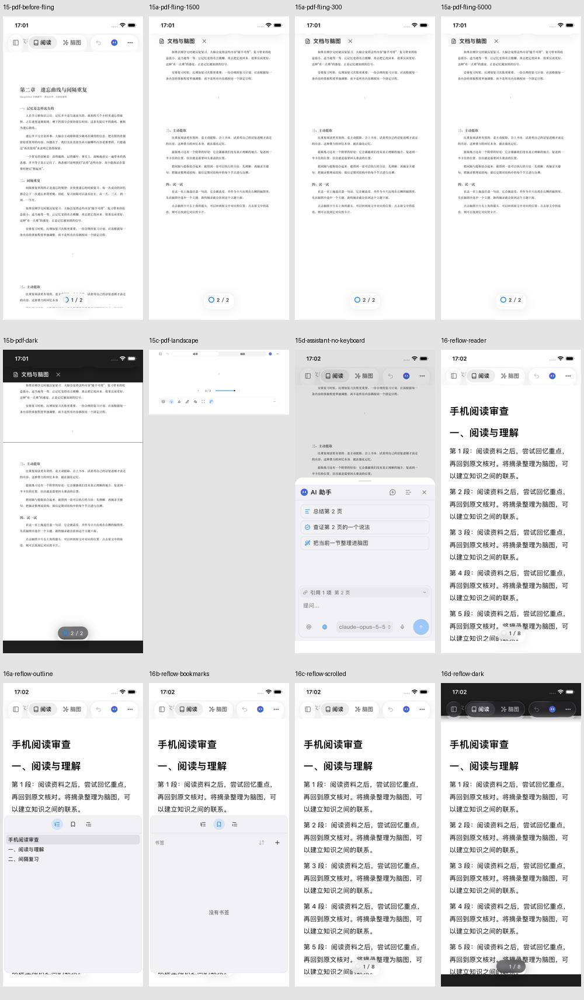
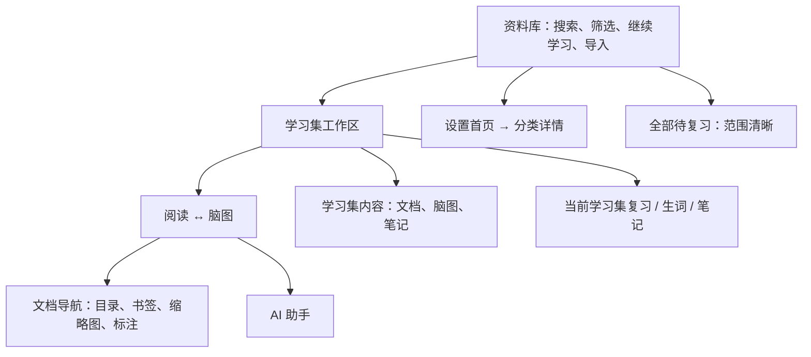

# 手机端体验审查与整体改造方案

日期：2026-11-02。对象：Foliarc，当前提交 `76b8ddd2`。本轮交付截图、问题依据和设计方案，不修改产品功能。

## 结论

当前手机端的问题，集中在三个层面：**全局导航混入了学习集内部功能；桌面面板只是缩窄或搬到底部；同一类控件存在多套材质实现。** 只替换几个圆角、透明度或动画参数，不能消除这些问题。

建议采用“资料库 → 学习集工作区 → 当前任务”的结构：主页不再放依赖上次学习集的底栏；阅读和脑图只在学习集内切换；目录、资源管理、设置采用手机自己的页面结构。iOS 和 Android 共用业务、层级与组件规格，各自采用合适的材质与返回手势。

## 1. 取证方式与限制

- 在 iPhone 16e、iOS 26.2 模拟器上，重新编译当前代码并通过 Flutter 集成测试启动真实应用。PNG 来自 `simctl io screenshot`，不是组件截图或设计稿。
- 先记录已安装应用，随后用当前源码运行。审查依据使用本轮新截图，不使用历史截图。
- 操作包含可见按钮点击、输入、拖动，以及通过应用控制器直接进入指定状态。直接进入状态能验证布局，不能证明入口易发现或整个入口链路无误。
- 当前电脑控制工具无法接入模拟器窗口，因此没有完成真人手指自由操作。模拟器注入的滑动、测试环境中的滑动数值，不等同于真机手感或帧率。
- 使用示例学习集、测试书签、摘录与本机模型元数据；没有发出模型请求。助手生成质量、网络异常、长时间任务恢复不属于本轮已验证范围。
- 原有截图脚本仍查找旧的 `reader-more`，运行中断。本轮临时采集脚本改用现有入口，并记录中断、续跑日志；脚本过期不计作产品缺陷。
- 安卓按本次要求纳入方案及验收清单；这一阶段没有把安卓验证冒充为已完成。

所有原图及运行日志位于 [本轮证据目录](evidence/mobile-audit-2026-11-02/)。

### 逐步检查结果

| 步骤 | 页面或状态 | 本轮结论 |
| --- | --- | --- |
| 1 | 资料库首次进入、打开文档后返回 | 导航范围混合，需重构 |
| 2 | 资料库筛选侧栏 | 可用，但与学习集资源导航不统一 |
| 3 | 设置七个分类、展开服务 | 可布局，横向分类不适合手机 |
| 4 | PDF 默认、更多、选区 | 可进入；顶部拥挤、默认文字偏小 |
| 5 | PDF 目录、书签 | 已复现半宽覆盖，需改全宽 |
| 6 | AI 助手、输入、草稿 | 可输入；底色分裂、打开即聚焦 |
| 7 | 脑图、选中、大纲、卡片详情、导出 | 可进入；视野与操作密度需改 |
| 8 | 学习集资源侧栏 | 可用；“完成”多余，管理层级需整理 |
| 9 | 网页地址输入、浏览、转存表单 | 已有底部适配；样式及任务结构需统一 |
| 10 | 笔记设置、结构笔记、导出 | 可进入；桌面式多标签需要替换 |
| 11 | 生词列表与详情 | 全屏结构较合适；需统一组件和来源返回 |
| 12 | 复习问题、显示答案、统计 | 可进入；全局底栏干扰独立复习任务 |
| 13 | 笔记深色/横屏、脑图深色 | 已取证；不代表全部页面和字体尺寸已覆盖 |
| 14 | PDF 三档滑动指令、深色、横屏，助手收键盘 | 已采集；转换过程记录到 32 像素溢出，待定位 |
| 15 | 导入 Markdown、阅读、目录、书签、拖动、深色 | 排版可读；文档导航形态与 PDF 不一致 |

以上“可进入”只指本轮指定任务路径与状态，不代表所有隐藏菜单、网络请求、导出文件或手势均已通过。

## 2. 已确认的问题与截图

### 2.1 首页：底栏的功能层级不成立（优先级 P0）

**画面与交互：** 四个底栏按钮中，阅读、脑图、复习首次不可用，资料库按钮又指向当前页。用户看得到三个主要功能，却不能进入，也没有明确解释缺什么条件。

**业务原因：** `app/phone_tabs.dart` 用 `recentStudySetId` 决定后三项可用性；`app/navigation.dart` 的 `_recent` 在打开学习集、复习或统计时被赋值。它是本次运行中的隐含上下文，不是用户主动选择的导航范围。返回首页后按钮会带人进入之前那个学习集，页面又没有把这个目标说清楚。

**与其他功能的关系：** “资料库”是全局范围，“阅读/脑图/复习”是单个学习集范围，放进同一组会造成误解。工作区顶部又有阅读/脑图切换，入口重复。

**方案：** 首页移除现有四项底栏；用“继续学习”卡片明确显示学习集、文档和上次位置。搜索、全部/最近/收藏筛选、新建/导入留在首页。复习从待复习入口进入，并明确是全部学习集还是当前学习集，不偷偷沿用上次对象。

### 2.2 玻璃材质：白色叠边、阴影过重，而且规则互相覆盖（P1）

首页图中，顶部圆形按钮和底栏都有明显白色叠层，白底上尤其像厚塑料按钮。阅读页的几个大胶囊进一步挤占横向空间。

**代码原因：** `MMLiquidGlass` 使用 Flutter 的背景模糊、饱和度矩阵、填色、渐变高光、自绘边缘与阴影；它不是系统的原生 Liquid Glass。手机 regular 材质饱和度为 1.9，浅色边缘渐变最高白色透明度为 .95。另一方面，工作区设置 `MMFlatSurface`，部分手机控件又局部关闭它；普通底部面板使用不透明底色。是否“玻璃”取决于嵌套上下文，页面之间很容易不同。

**方案：** 先统一材质用途，再处理实现。正文、设置表单、目录列表、聊天内容使用稳定底色；只有覆盖在内容之上的导航与少量操作控件使用浮动材质。不要求每一页的所有背景都变玻璃。

Apple 将 Liquid Glass 定位为浮在内容上的导航与控制层，见 [Materials](https://developer.apple.com/design/human-interface-guidelines/materials) 与 [Adopting Liquid Glass](https://developer.apple.com/documentation/TechnologyOverviews/adopting-liquid-glass?changes=_2_11)。下面的平台实现策略是针对本项目的建议，并非 Apple 对 Flutter 的保证。

### 2.3 资料库侧栏与学习集侧栏：两种组织方式，关闭方式冗余（P1）

**画面：** 资料库抽屉较窄、像筛选栏；学习集抽屉接近全宽，采用大标题和分组卡片，底部还有设置与“完成”。两者虽然都是侧栏，却没有统一的导航含义。学习集长标题占两行，压低文档入口；大量蓝色图标、加号和数量同时争夺注意力。

**判断：** 抽屉用于快速切换，选完即关闭，本身没有需要“完成”的编辑任务。手机屏幕也不适合在窄栏里承载文档、脑图、卡片、复习、标签等完整管理功能。

**方案：** 资料库侧栏保留筛选语义，设置在资料库有稳定入口；学习集侧栏改为全宽“学习集内容”页面，分组为文档、脑图、学习笔记，标签和卡片作为次级管理入口。标题采用正常导航标题；行显示标题、选中态与必要信息。选择内容后返回工作区并保留其状态；使用返回/关闭退出。删除底部“完成”，设置也不必在每个资源页面重复常驻。

常用操作直接提供图标；重命名、删除、移动等次级操作用长按菜单，也保留清晰的“更多”入口。不能让手机只靠桌面的右键或悬停发现操作。

### 2.4 PDF 阅读：顶部拥挤、正文过小，目录覆盖半边（P0）

**画面：** 顶部多个胶囊挤在一行，底下仍有被遮住的文档标题残片。示例 PDF 按整页宽度缩小后，正文很小；虽然能缩放，但默认阅读体验不理想。页码胶囊覆盖了第二页正文的一部分，需要核对首尾内容的避让范围。

**目录与书签：** 当前截图中，左侧列表约占六成宽，右侧剩下的正文无法正常阅读；目录、缩略图、书签、标注共用小图标栏。示例 PDF 没有嵌入目录，因此目录截图为空，不能用它判断复杂目录树好不好用；书签截图包含实际测试书签，足以确认面板形态问题。

**代码原因：** `reader_pane.dart` 在空间不足时，用 `Positioned(left: 0, ...)` 把 `_ResizableReaderSidebar` 盖在正文上，仍沿用桌面侧栏。它没有变成独立手机导航任务。

**方案：** 手机采用全宽“文档导航”面板，默认接近全高；目录/书签是文字切换，缩略图/标注按文档能力提供。短书签列表可收至中等高度，复杂目录默认全高。点击条目立即定位并关闭；下次打开记住上次分类、展开层级和滚动位置。关闭但未选择不改变原阅读位置。PDF、EPUB、Markdown 共用这一呈现规则，列表内容由各自能力提供。

**PDF 特有问题：** 增加可发现的“适合宽度/裁白边”，保留用户缩放。不要假设任意 PDF 都能像电子书一样重新排版；扫描件尤其不能承诺自动重排。

### 2.5 PDF 滑动：确有自定义速度和弹簧，不是单纯的渲染动画（P0）

`MMPhoneScrollPhysics` 继承 `BouncingScrollPhysics`，直接拖动后，对松手速度乘 2；摩擦按每毫秒 .998 衰减；触边后转入自定义弹簧。缩放另用 `BouncingScrollPhysics`。手机和其他触控设备都可能用到这条惯性路径，Android 也没有独立平台选择。

本轮运行已有的 `phone_pdf_scroll_test.dart`，5 个尺寸/方向场景全部通过。测试使用 60 页模拟 PDF 后端，以下数值是其中 393×852、缩放 .655、正向滑动的**测试环境结果**，不是真机测量：

| 注入松手速度（逻辑像素/秒） | 旧路径松手后位移 | 手机路径松手后位移 |
| --- | ---: | ---: |
| 300 | 26.8 | 289.4 |
| 1500 | 133.8 | 1488.5 |
| 5000 | 445.6 | 4984.9 |

证据：[精简数值](evidence/mobile-audit-2026-11-02/pdf-scroll-summary.json)、[逐帧数据](evidence/mobile-audit-2026-11-02/pdf-scroll-measurements.json)。变化约 11 倍，包含摩擦模型差异，不能简化成“速度翻倍所以位移翻倍”。

**结论边界：** 能确认惯性和回弹被人为调整；不能仅凭测试通过断言没有掉帧，也不能断言用户说的“不顺滑”全部由弹簧造成。大型图片 PDF 的解码、缓存、缩放和工具栏显隐仍需单独检查。

补充在真实 iOS 模拟器对示例 PDF 注入 300、1500、5000 三档滑动指令并截图，日志位于 `iphone-reading/run.log`。三次最终偏移都约 434.8，样本仅两页，且注入指令速度不代表系统实际采样的手势速度。因此这组运行数据只证明滑动及其后状态被实际执行，不用来量化真实速度响应；上表的 60 页受控测试另行保留。

**方案：** 移除无依据的统一速度倍增，从平台正常减速行为建立基线；iOS 只在文档真实边缘有轻微回弹，翻页接缝不触发弹簧；Android 默认触边停止，避免继承整套 iOS 回弹。拖动跟手为 1:1，触摸立即打断惯性。缩放与单指滚动分别处理。先在 Profile/Release 和较长真实 PDF 上测量，再决定微调参数。

### 2.6 AI 助手：容器与内容底色分裂，打开就进入输入状态（P1）

助手截图见上面的阅读合图；本轮初次打开助手后，键盘已经出现。顶部把手所在区域是白底，助手内容和输入区又是偏灰紫的底色，面板层级很明显。顶部仍排列多个小图标，输入区有引用、联网、模型、语音、发送，信息密度高。

**代码原因：** 外部 `MMBottomSheet` 使用 `windowBackground`；`RightPanelView` 在触控端使用 `sidebarOpaque`，助手标题本身透明，移动端仍套着桌面右侧面板的背景。底色问题应在面板容器层修复，而非只给标题涂色。

**方案：** 单一面板背景覆盖把手、标题、对话和底部安全区，消息通过气泡/间距区分。普通打开先给建议与上下文，不自动弹键盘；从选中文本“问 AI”进入可直接聚焦。开始输入后扩展为全高。引用对象显示为可移除的清晰条目，模型、联网等放入紧凑操作区；关闭保留草稿、会话及正在运行的任务，返回文档保留原位置。手机同时只显示一个主要任务面板，查看来源时在助手内进入来源页，返回仍回到原回答。

### 2.7 设置：横向标签需要整体替换（P1）

本轮打开了通用、阅读、脑图、模型、AI 功能、网页搜索、语音输入，并展开了模型服务。

**画面：** 分类栏超出手机宽度，后面的入口需要横向寻找；有些分类只有一两项，整页大量空白；服务编辑把名称、地址、密钥和模型挤在一张桌面式表单卡里。保存位置也不一致，有的在内容右下，有的在页面底部。

**方案：** 手机设置改为全屏“设置首页 → 分类详情 → 编辑项”。首页使用分组列表：外观与语言、阅读、脑图、AI 服务与模型、AI 功能、网页搜索、语音。详情有自己的标题与返回；关联跳转例如“AI 功能 → 选择模型 → 添加服务”走同一个设置导航栈，完成后回原任务，不叠多个面板。

开关、外观、语言等即时生效；服务地址、密钥、模型配置采用明确“保存”，失败保留输入并给出具体错误。离开未保存配置才询问丢弃/继续编辑。读取、表单校验和保存状态应清楚区分。字段在手机上采用“上标签、下输入”，长 URL 和模型名不会挤掉标签；需要输入的页面自动避让键盘。

### 2.8 脑图、卡片详情与导出：已有底部适配，但控制密度仍高（P1）

**画面：** 脑图默认视野中根节点位于右侧边缘之外，屏幕中央大量留白；选中节点后，节点上方再出现一排无文字小图标，底部仍是一整条缩放工具。卡片详情已经用全宽底部面板，方向正确，但把手白底与灰紫内容仍是两套表面。导出也是底部面板，但格式、范围和底部操作保持桌面紧凑布局。

**方案：** 首次打开没有保存视野的脑图时，按实际可用画布居中或适配主要内容；已有视野时恢复，不每次重置。底部常用操作保留定位全图、添加、阅读/脑图切换；缩放百分比和加减缩放归入视图选项，双指缩放作为主要方式。节点操作优先保留添加子节点、编辑、摘录回原文；其余放更多并提供长按说明。卡片编辑沿用助手同一套面板容器，输入时全高，回原文保留节点位置。导出保留短任务面板，采用手机行距和稳定主按钮。

本轮通过控制器选中节点，没有完成真人双指缩放、节点拖放或实际系统分享，不能据此宣布这些交互已经顺畅。

### 2.9 网页、笔记、生词、复习与统计：整条链路需要跟随同一层级（P1）

**网页：** 当前添加地址已经从底部出现，且输入框能避让键盘。因此“网页输入仍是桌面居中弹窗”在本次版本中没有复现。问题转为任务风格不一致：地址输入是短表单，网页转存又用接近全高表单；后者的三个格式、名称、预览和主按钮需要明确分组。保留前者方向，后者作为独立保存任务；返回应回网页，失败保留名称和格式。

**学习笔记：** 打开设置、生成不调用模型的结构笔记、查看笔记及导出均已截图。笔记页顶部仍有多个可关闭的桌面式标签，再叠返回/标题，手机导航重复。改成单一笔记页面；来源文档/脑图通过“查看来源”进入临时全屏伴随页，返回保留笔记滚动和输入，不拆毁笔记编辑器。

**生词本：** 列表与详情已经是完整页面，比窄侧栏更合适，可以作为其他手机任务的结构参考。仍需统一搜索、筛选、分组行距和返回。详情有“回到原文”，要保留来源学习集及位置，不能被上次全局学习集覆盖。

**复习：** 本轮完成显示答案，截图可见评分按钮紧挨屏幕底部，下面仍留着全局四项底栏。复习是需要连续作答的独立任务，移除这组干扰导航；退出提供明确返回目标并保留进度，难度评分安排在拇指容易点击的位置，显示评分对应的下次复习时间。

**统计：** 当前零值状态有大片空白和短横线。明确区分“尚无记录”和“数据为零”，提供回到待复习的入口；用学习集名称说明范围。统计不必占用一个变相全局导航状态。

**深色与横屏的取证纠正：** 原采集脚本把 `12-reader-dark`、`14-reader-landscape` 命名为阅读，实际截图是此前打开的学习笔记；这两张只作为笔记深色/横屏证据，不作为 PDF 深色/横屏证据。`13-map-dark` 是脑图深色状态。文件名不能替代实际画面检查。

### 2.10 补充阅读验证：PDF 与可重排文档用了两种导航容器（P1）

本轮通过实际导入链路导入一份含标题和 40 段正文的 Markdown，再打开阅读、目录和书签。正文能按手机宽度排版，明显比整页缩小的 PDF 更易读；但目录使用下半屏的全宽容器，PDF 则是左侧窄栏，同一操作出现两种形态。两者都应接入统一文档导航，而非分别修补。

Markdown 当前为分页阅读，截图显示第 1/8 页；本轮垂直拖动后仍是第 1/8 页，不能据此判断连续滚动是否正常。后续要分别检查分页和连续两种阅读模式。深色截图中界面变深而正文仍白，和独立的阅读外观设置有关，不应直接判定为主题失效；入口需要让用户能理解这两类设置的区别。

补充采集到 PDF 深色导航和横屏工具栏。横屏截图停在第二页靠下的空白区域，只用于检查导航布局，不能证明正文在横屏默认位置的效果良好。横屏时工具条切换成另一套宽屏排列，说明设备身份与可用高度必须共同参与布局判断。

**新增运行问题：** 横屏切回竖屏、打开助手并收起键盘这一连续过程中，框架记录 `A RenderFlex overflowed by 32 pixels on the bottom`。稳定截图没有可见黄黑溢出条，尚不能确定溢出发生在哪个过渡帧、是否由旋转还是键盘动画触发。应加入后续修复与回归，不能因为采集测试最终显示通过就忽略；本次采集器收集了错误而没有让它导致测试失败。

## 3. 统一的手机结构

### 3.1 页面关系

同一学习集内部切换视图应保留文档滚动位置、脑图缩放和选中节点、未提交的输入。全屏呈现不意味着销毁底下的阅读器。

### 3.2 工作区控件排布

- 顶部一条紧凑导航：返回资料库；当前内容标题（点击打开学习集内容，带展开提示）；AI；更多。长标题单行省略，资源页显示完整标题。
- 底部只留一条当前工作区工具条：阅读态为“目录、阅读/脑图切换、页码/进度、标注”；脑图态替换为“阅读/脑图切换、定位全图、添加节点”等当前任务动作。它是学习集内工具，不伪装成应用全局 Tab。
- 标注模式替换工具条内容，不在它上面再叠一排。选中节点时使用紧凑操作条，删除等放入更多。
- 滚动时可隐藏导航工具，点击正文空白处恢复；选字、拖动标注、输入时不触发显隐。隐藏只改变控件可见性，不反复修改 PDF 视口高度，避免滑动跳动。
- 目录和资源都是直接入口。AI 不必先打开更多；低频外观与导出放到更多里。

### 3.3 什么用整页，什么从底部打开

| 任务 | 手机上默认形态 | 关闭或返回规则 |
| --- | --- | --- |
| 设置与多步服务配置 | 全屏导航页 | 逐级返回，未保存时保护输入 |
| 学习集资源管理 | 全屏内容页 | 点选返回工作区；长按次级操作 |
| 目录/书签/标注 | 全宽、默认接近全高面板 | 选中定位并关闭；保留列表状态 |
| 添加网页地址 | 底部短表单 | 键盘出现后避让；取消不修改内容 |
| 新建/重命名等单字段输入 | 底部短表单 | 标题、输入、主按钮位置一致 |
| AI 对话 | 全宽可扩展面板，输入时全高 | 关闭保留对话与任务 |
| 导出与简单选项 | 内容高度的底部面板 | 主操作清晰，失败留在当前面板 |
| 阅读外观 | 中等高度面板，正文可预览 | 修改即时生效；返回同一阅读位置 |
| 删除确认 | 系统风格确认或操作面板 | 说明具体对象，保留撤销能力 |
| 系统文件选择与分享 | 系统组件 | 遵循对应平台行为 |

不能把所有任务机械地换成半屏。当前公共 `showMMDialog/showMMSheet` 已有 compact 底部适配，但它无法判断任务复杂程度；应由调用方声明任务类型，再由手机呈现策略选择短表单、全高面板或导航页面。

## 4. 材质、字体与平台适配

| 层级 | 规则 |
| --- | --- |
| 文档、脑图、正文 | 保持内容本色和足够对比度，避免把背景染成玻璃 |
| 列表、表单、对话内容 | 共用页面底色及分组底色，标题与内容同属一个容器 |
| 覆盖导航与工具条 | 统一浮动材质，去掉自绘强白边、叠层阴影和过度饱和 |
| 系统弹层 | 统一圆角、边距、标题、主按钮和安全区规则 |

**真正系统 Liquid Glass 的路线：** 先做一个 iOS 26+ 导航/工具条小范围技术验证，确认原生控件与 Flutter 内容的背景合成、触摸响应、滚动联动、VoiceOver 和性能都可行，再扩大使用。Flutter 的背景滤镜不等于原生系统材质，不能承诺改几个参数就一致。若混合渲染达不到要求，采用统一克制的平面/半透明材质；这是一条明确的降级策略，不继续增强现在的假高光。

Android 共用页面结构、图标含义、颜色体系和状态逻辑，浮动工具条采用其平台适合的稳定底色与轻微层次，不照搬白亮折射边缘。旧 iOS、减少透明度、增强对比度均有确定回退；减少动态效果时取消装饰性形变。

手机正文列表建议 16–17 逻辑像素、次级说明 13–14，行高按内容调整；操作热区 iOS 至少 44、Android 至少 48 逻辑像素。多行标签、长模型名、系统大字体应自动换行或进详情页，而不是把整组控件越挤越小。这里是目标规格，尚未逐控件测量或完成无障碍认证。

## 5. 实现架构与落地顺序

### 第一步：导航与任务呈现（P0）

移除首页依赖 `_recent` 的底栏；增加显式继续学习入口。建立手机的设置导航、学习集内容页、文档导航面板；统一系统返回、关闭和状态恢复。桌面/iPad 继续使用适合宽屏的侧栏和并排视图，复用同一份目录、书签、资源与设置数据，不复制业务逻辑。

建议在展示层明确区分：全局页面、学习集内视图、覆盖任务。呈现策略接收设备类别、可用宽高、任务类型和键盘状态；不能只看“宽度小于 600”。横屏手机仍是手机，iPad 分屏也不应无条件等同手机。

### 第二步：阅读滚动与空间（P0）

建立正常平台减速基线；分别验证长 PDF、图片 PDF、放大状态、电子书。处理正文避让、缩放保持、工具栏显隐与视口稳定。目录定位不应改变当前学习集或打开桌面式分栏。

### 第三步：公共视觉与表单（P1）

在 `mm_design` 中建立按用途选择的公共表面与标题/操作组件，收拢 `MMGlass`、`MMLiquidGlass`、`MMFlatSurface` 和局部背景覆盖。先完成原生玻璃小范围验证，再决定最终 iOS 材质。统一助手、设置、资源、导出面板的背景与安全区。

输入组件复用校验、保存和错误处理；各功能只声明字段、动作和数据，不自行绘制一套手机弹层。

### 第四步：iOS 验收后做 Android 验证

采用同一组任务和数据，两端独立安装、启动、操作、截图。安卓至少检查系统返回、键盘避让、文件导入/分享、边缘滚动、底部手势安全区；不能只编译 APK。

## 6. 验收清单

| 范围 | 必须通过的行为 |
| --- | --- |
| 首次使用 / 重启 | 首页主要动作可用；没有依赖上次学习集的灰色主导航 |
| 学习集 A → 首页 → B | 所有阅读、脑图、复习操作都明确作用于 B，不串到 A |
| 目录与书签 | 全宽呈现；选中定位正确；关闭返回原位置；再次打开保留状态 |
| PDF | 中段连续滑动、首尾触边、快速反向、惯性中触摸停止、放大后拖动均自然 |
| 性能 | 用 Profile/Release 记录 UI/渲染帧耗时，按设备刷新率预算检查，不能用 Debug 手感代替 |
| 长文档 | 长 PDF、图片 PDF、EPUB/Markdown、空目录、长书签标题分别检查 |
| 脑图 | 拖动、缩放、选中、添加、编辑、返回原文不被导航抢手势；键盘出现后节点可见 |
| 表单 | 开键盘、输入错误、保存失败、取消、返回重进，内容与状态正确 |
| AI | 无配置、有配置、键盘开关、长回答、来源往返、生成中关闭后重进分别检查 |
| 设置 | 列表进入分类、跨页选择模型、保存、未保存退出、系统返回均有明确结果 |
| 视觉与无障碍 | 浅深色、大字体、减少动态效果/透明度、VoiceOver/TalkBack、长中文标题 |
| Android 最终验证 | 上述核心流程实机或模拟器独立跑通，明确注明设备、版本与剩余限制 |

本轮不把“截图采集成功”称为全功能验收；未联网的 AI、生产数据同步、大型扫描 PDF 性能和真人触摸手感仍需后续专项验证。

## 7. 改造入口与证据交付

| 改造对象 | 当前代码入口 |
| --- | --- |
| 首页与依赖最近学习集的底栏 | `apps/marginmind/lib/app/phone_tabs.dart`、`app/navigation.dart`、`features/library/library_screen.dart` |
| 手机工作区与覆盖任务 | `apps/marginmind/lib/features/workspace/workspace_screen.dart`、`widgets/phone_workspace_sidebar.dart` |
| PDF 目录的覆盖布局 | `apps/marginmind/lib/features/workspace/widgets/reader_pane.dart`、`reader_sidebar.dart` |
| PDF 惯性与缩放 | `packages/mm_pdf/lib/src/phone_scroll_physics.dart`、`pdf_view.dart` |
| 助手底色与面板 | `apps/marginmind/lib/features/workspace/widgets/right_panel.dart`、`features/assistant/widgets/assistant_panel.dart` |
| 设置分类与任务导航 | `apps/marginmind/lib/settings/settings_window.dart` |
| 公共材质与底部面板 | `packages/mm_design/lib/src/widgets/glass.dart`、`flat_surface.dart`、`bottom_sheet.dart`、`tokens/phone_glass.dart` |

本轮保留 61 张 PNG 原图，含重复状态及初始已安装版本截图；这不是 61 个独立页面。另提供 [原图索引](evidence/mobile-audit-2026-11-02/index.md)、多组联系图、运行日志、滑动逐帧数据及采集脚本文本。采集脚本放在证据目录，不加入产品测试或正式应用入口。

采集结束后已重新构建 `lib/main.dart` 正常 Debug 应用，在同一 iPhone 模拟器安装、启动并截图检查。构建产物与已安装应用的 `Runner`、`kernel_blob.bin` 哈希均一致，见 [恢复验证](evidence/mobile-audit-2026-11-02/restored-app-verification.json)。当前产品源码无改动，新增内容仅为本报告与证据。
