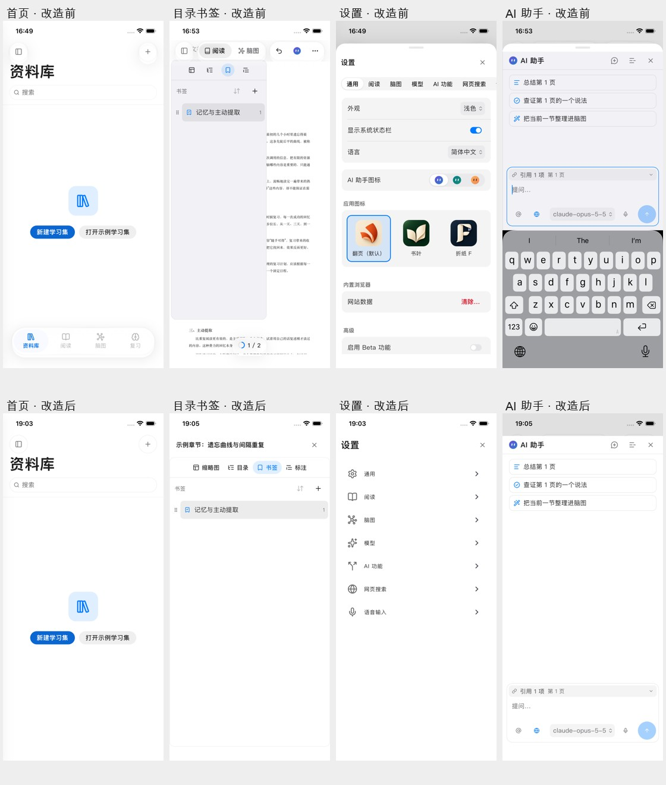

# 手机端改造与验收

日期：2026-11-02。改造开始于提交 `76b8ddd2`；最终构建基于 `4c8ee6cf` 与当前工作区的手机改造。手机改造、测试与验收证据作为一次独立提交归档。

## 已落地的结构

- 首页、复习和统计移除依赖“最近学习集”的全局四项底栏。继续学习卡片恢复显示文档与位置，进入对象明确。
- 设置使用手机全屏分类列表与详情页，分类间保留已访问表单。模型、搜索、语音表单共用未保存状态登记；退出可保存或放弃，失败留在设置。AI 功能继续沿用原有草稿保护。
- 学习集资源变为全宽页面，标题、搜索和关闭入口固定，选择文档/脑图后回工作区，删除无意义的“完成”。
- PDF、Markdown 等可重排内容使用统一的全宽文档导航外框。分类带文字，选中目录/书签/缩略图后关闭；关闭时保留导航列表、目录展开和阅读器状态。手机不显示桌面侧栏拖动分隔线。
- 阅读页移除旧的桌面标签条、顶部撤销胶囊，底部增加目录与标注直接入口。网页、笔记、复习等独立任务不再被阅读工具条覆盖。
- 助手与详情采用手机横竖屏一致的全高容器，统一标题、内容、输入和安全区背景。普通打开不自动弹键盘，未发送文字按学习集和会话保存在内存中，关闭重开可恢复；短横屏采用紧凑输入。
- 手机统一使用稳定的平面表面，去掉自绘玻璃的强白边、高饱和度与多层阴影。该版本没有声称实现系统原生 Liquid Glass，采用方案中明确的回退路线。
- 手机 PDF 保留真实松手速度，不再乘 2。iOS 使用正常指数减速与有界边缘回弹，Android 单指拖动和惯性触边停止；缩放独立处理。
- 手机脑图首次打开允许适配全图，避免根节点被挤出屏幕；用户已有缩放和平移不会重置。无复习记录的手机统计增加明确空状态和下一步入口。

## iPad 与 PC 的隔离

布局与材质分支按 `MMInput.phone` 判断，iPad 分屏不会因此被当作手机。设置、资源、目录和助手在非手机上保留原来的宽屏组织方式。

PDF 的平板 `touch` 路径显式保留旧的 2 倍惯性配置；桌面空 profile 保留原渲染器路径。公共设置保存控件只在手机设置作用域内登记草稿，桌面保存方式不变。

## 本轮验证方式

真实模拟器画面由集成测试驱动，并在状态稳定后用 iOS 系统截图或 Android `screencap` 保存。测试包括实际按钮点击、输入、目录选择、表单退出、打开/收起键盘及横竖屏切换；一些指定状态通过控制器进入。页面总览与关键原图已按实际内容检查。

采集入口：`apps/marginmind/integration_test/mobile_redesign_acceptance_test.dart`。

采集工具：`tool/capture_mobile_redesign.py`，支持 iOS Simulator 和 Android emulator。

证据目录：[mobile-redesign-2026-11-02](evidence/mobile-redesign-2026-11-02/)。设备、截图与测试结果以此目录最终日志为准。

## 验收边界

模拟器滑动与受控逐帧测试用于确认速度、边缘、打断和缩放逻辑；不把 Debug 模拟器结果称为真机帧率或手指手感。没有发送真实模型请求，也没有验证线上服务可用性或大扫描 PDF 在真机上的性能。

少数既有测试依赖过期的助手配置入口和默认模型行为；已用原始提交作对照，确认两组桌面回归没有新增失败。旧测试里针对四项全局 Tab、抽屉“完成”和半高详情的断言已随新交互更新；触控单元测试增加系统状态栏原生通道替身，真实集成测试仍调用真实平台实现。

## 针对实际问题补充的回归

- 可重排目录原有跳转完成回调会再次 toggle 面板，和立即关闭冲突。手机端改为幂等关闭，等待异步跳转结束后仍保持关闭。
- 横屏原来会因宽度进入桌面式右侧面板。手机横竖屏统一为覆盖任务，不受 compact 宽度变化影响。
- 键盘/旋转瞬间可能只有很小的可用高度。助手标题限制高度，输入区按实际可用空间滚动，避免过渡帧溢出。
- 助手未发送文字此前只在输入组件内部，关闭组件会丢失。手机增加按会话隔离的会话内草稿；不会发送或写入磁盘。
- 模型服务卡片收起后仍需要保护草稿。登记放在服务卡片状态上，避免只靠可见的保存按钮判断是否有未保存内容。

最终应用层回归：67 项通过；公共设计组件回归：60 项通过；PDF 的 iOS/Android 物理与缩放回归：16 项通过，共 143 项定向测试通过。静态分析无问题。

### iOS 最终结果

- iPhone 16e / iOS 26.2，完整页面验收通过，所有采集阶段未记录 Flutter 布局错误。
- 额外的状态验收通过：设置草稿、助手关闭重开、横屏输入、竖屏恢复、资源页系统返回、可重排目录选择与异步定位。
- 原图与日志：[全页面](evidence/mobile-redesign-2026-11-02/ios/)、[状态复验](evidence/mobile-redesign-2026-11-02/ios-state/)。

## 截图与覆盖范围

[全部原图索引](evidence/mobile-redesign-2026-11-02/README.md)。文件名中的数字表示操作阶段；同一阶段的不同状态保留独立截图。

| 页面 | 主要验收内容 |
| --- | --- |
| 资料库 | 首次进入、筛选侧栏、打开文档后返回、继续学习对象与位置 |
| 设置 | 分类列表、全部分类、服务展开编辑、分类往返保留草稿、退出保存/放弃 |
| PDF 阅读 | 工具、颜色、更多、选区、目录与书签、全宽导航开关、深色与横屏 |
| 可重排阅读 | Markdown 导入、目录选择、异步定位后导航保持关闭 |
| 脑图 | 首次适配全图、节点选择、详情、大纲、导出、深色 |
| 资源页 | 文档与脑图入口、搜索、返回资料库、关闭、系统返回、网页地址输入 |
| AI 助手 | 普通打开不弹键盘、输入、关闭重开恢复草稿、横竖屏及键盘收起 |
| 学习笔记 | 创建设置、正文与摘录、导出设置 |
| 生词与复习 | 列表、词条详情、复习题、显示答案、空统计入口 |
| 内置浏览器 | 本地测试网页加载、转存表单与阅读入口互不遮挡 |

## 安卓复验发现并修复的问题

第一次安卓完整验收在横屏键盘阶段报告 `29 pixels` 纵向溢出。额外诊断指向 `phone_workspace_sidebar.dart`，不是助手输入框：资源侧栏即使关闭也会保持挂载，安卓键盘将它的可用高度压到约 126 逻辑像素，固定标题与搜索框超过该高度。

修复后，正常高度仍固定标题和搜索框；高度不足 240 时整个资源页一起滚动，搜索框通过稳定的组件身份保留输入状态，列表内容仍可滚动访问。新增回归覆盖 126 高度、搜索文字保留与列表项可见，避免只隐藏溢出提示。

诊断日志：[首次完整验收](evidence/mobile-redesign-2026-11-02/validation/android-before-keyboard-fix.log)、[定位记录](evidence/mobile-redesign-2026-11-02/validation/android-keyboard-diagnostics.log)。最终通过结果以平台目录下 `run.log` 为准。

### Android 完整流程结果

- Android 16 / API 36 ARM64 模拟器，完整流程通过（4 分 28 秒）。首次发现的后台资源页溢出已修复，最终完整流程未记录 Flutter 布局错误。
- 覆盖与 iOS 相同的主要页面、深色、横竖屏、键盘与草稿恢复。
- [原图与日志](evidence/mobile-redesign-2026-11-02/android/)。

### iPad 核心回归结果

- iPad mini（A17 Pro）/ iOS 26.2，核心页面验收通过。
- 设置保留宽屏分类侧栏，阅读与助手仍可并列显示，未采用手机全屏分类页或手机助手覆盖层。
- [原图与日志](evidence/mobile-redesign-2026-11-02/ipad/)。窄分屏与桌面尺寸另由布局单元测试覆盖。

### 横屏表单补充

通用表单入口原来只按宽度选择容器，手机横屏会退回居中弹窗。现按设备身份保证手机横竖屏都使用底部表单；iPad 与 PC 仍按原有宽度规则。键盘使高度不足 240 时，表单整体可滚动，让标题、输入和操作都可访问。

全页面采集完成后补充了这一横屏分支；最终 iOS/Android 专项采集覆盖真实网页地址表单及键盘操作。每组证据目录的 `build-source.json` 分别记录当次源码哈希：全量流程与后续横屏专项分开记录。

公共组件回归：60 项通过，包含横屏手机表单、平板设置侧栏、表单、材质、导航及键盘。原有抽屉测试将整个抽屉外框的起点写成安全区起点；原始提交也同样失败，对照后修正测试断言，外框覆盖全屏、内容自行处理安全区。[原始提交对照日志](evidence/mobile-redesign-2026-11-02/validation/design-baseline.log)。

横屏表单复验还发现了一个输入状态问题：按键盘高度切换“普通表单/整体滚动表单”的组件层级，会重新创建输入框，打断软键盘连接。修复为保持相同的滚动容器和输入框，只改变高度限制与是否允许外层滚动；回归检查输入组件身份、文字和焦点在键盘尺寸变化前后保持不变。

## 最终检查与交付

| 检查 | 结果 | 证据 |
| --- | --- | --- |
| 应用层定向回归 | 67 项通过 | [日志](evidence/mobile-redesign-2026-11-02/validation/app-unit-tests.log) |
| 公共设计组件 | 60 项通过 | [日志](evidence/mobile-redesign-2026-11-02/validation/design-tests.log) |
| PDF 物理与缩放 | 16 项通过 | [日志](evidence/mobile-redesign-2026-11-02/validation/pdf-tests.log) |
| iOS/Android 真实运行时手势与表单 | 两端通过，软键盘确实显示，取消操作可访问 | [iOS](evidence/mobile-redesign-2026-11-02/ios-pdf/)、[Android](evidence/mobile-redesign-2026-11-02/android-pdf/) |
| 桌面两组回归对照 | 当前与原始提交均为 21 通过、5 失败，无新增失败 | [对照明细](evidence/mobile-redesign-2026-11-02/validation/pc-comparison.json)、[当前日志](evidence/mobile-redesign-2026-11-02/validation/pc-current.log)、[基线日志](evidence/mobile-redesign-2026-11-02/validation/pc-baseline.log) |
| 静态分析、格式、差异检查 | 通过 | [分析](evidence/mobile-redesign-2026-11-02/validation/analyze.log)、[格式](evidence/mobile-redesign-2026-11-02/validation/format.log) |
| macOS Debug 构建 | 通过 | [日志](evidence/mobile-redesign-2026-11-02/validation/macos-build.log) |
| iOS Simulator 正常入口构建 | 通过 | [日志](evidence/mobile-redesign-2026-11-02/validation/ios-normal-build.log) |
| Android Debug 正常入口构建 | 通过 | [日志](evidence/mobile-redesign-2026-11-02/validation/android-normal-build.log) |

桌面的 5 项既有失败涉及旧助手配置入口、模型默认行为及侧栏菜单定位，详细名称见对照明细。本轮不将这两组测试描述为全部通过，也不为满足旧断言修改桌面产品行为。

真实运行时的 80 点拖动，在 iOS 与 Android 中分别得到约 80 点的页面位移；第二次触摸可停止惯性，双指缩放结束后保持稳定。受控逐帧测试中，1500 点/秒的手机松手惯性距离约 739 点，平板原配置约 1488 点；这验证了手机速度不再额外翻倍、平板仍保留原配置。[逐帧数据](evidence/mobile-redesign-2026-11-02/pdf-scroll-measurements.json)。

正常版本在 iPhone、iPad、Android 模拟器分别安装与启动；iOS 核对安装前后可执行文件与 Dart 内核哈希，Android 核对已安装 APK 与构建 APK 哈希，确保运行的是正常入口。[安装启动记录](evidence/mobile-redesign-2026-11-02/validation/install-launch.log)、[核对结果及正常启动截图](evidence/mobile-redesign-2026-11-02/installed/)。

验收期间工作区还有并行的新建学习集、网页图片抓取和可重排文档划线改动，均保留。手机改造清单与平台布局隔离以本文前半部分为准，各组截图记录当次源码哈希；最终正常包构建期间的源码一致性另有[记录](evidence/mobile-redesign-2026-11-02/validation/normal-build-source.json)。

截图已归档并建立索引，共 135 张系统原图，包含两端完整流程、状态与手势专项、iPad 回归及正常版本启动。
