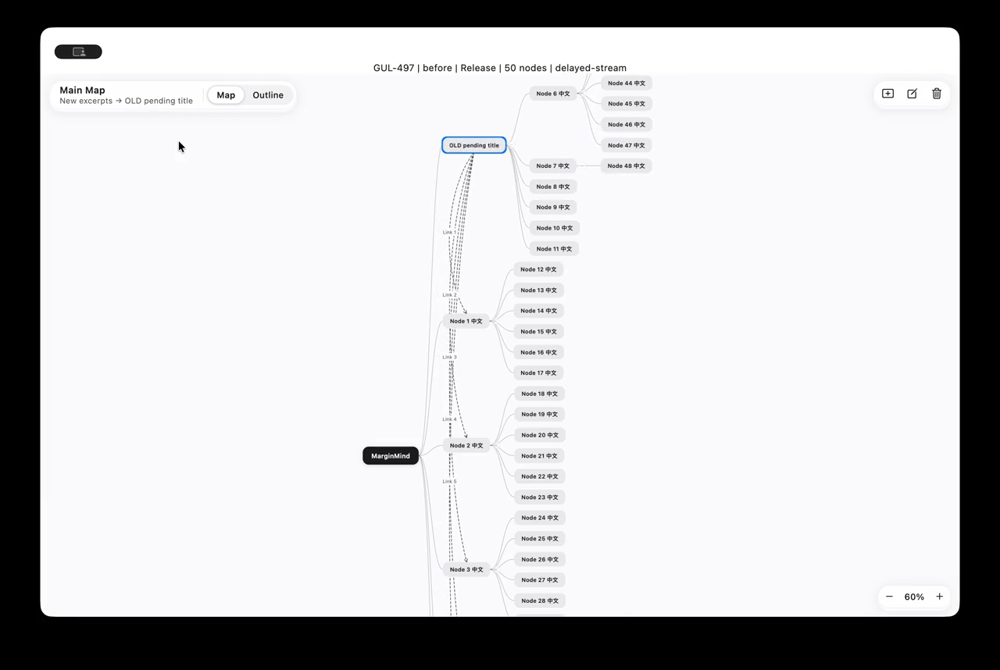
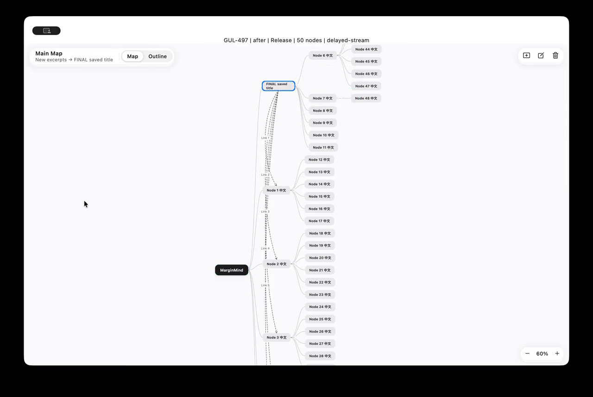

# GUL-497 脑图流畅度与闪烁验收

基线为 `b24198e`，使用同一份 `apps/marginmind/tool/map_performance.dart` 驱动真实 `MapPane`、`WorkspaceController` 和画布；仓库使用隔离的内存数据，不读取用户资料库。50／500 节点均包含虚拟根节点，数据为主题树和 5 条带标签的关联线。

环境：Mac mini，macOS 26.6.2，Flutter 3.47.2 / Dart 3.13.2，Metal Impeller，窗口 1280×820。**Profile 采样与 Release 录屏分开运行，不混合比较。** 同一台机器存在其他任务，数字是单次配对采样，不是独占机器的统计结论。

## Profile 帧耗时

每个场景执行 90 次操作步进（约 16 ms 间隔），连续输入／选择每三步变化一次，折叠及新建删除每十五步变化一次。场景间留 500 ms 接收引擎批量上报。下表单位 ms；超预算指 UI 或 Raster 任一超过 16.667 ms 的帧数。帧数和初始载入数据完整保留在 [before-profile.json](before-profile.json) / [after-profile.json](after-profile.json)。

| 场景 | 50 节点 UI p95 前→后 | 500 节点 UI p95 前→后 | 500 节点 Raster p95 前→后 | 500 节点超预算帧 前→后 |
| --- | ---: | ---: | ---: | ---: |
| 矩阵平移 | 0.92 → 1.75 | 4.70 → 4.96 | 2.06 → 1.52 | 0 → 0 |
| 矩阵缩放 | 0.89 → 1.52 | 4.67 → 4.09 | 2.96 → 1.90 | 0 → 0 |
| 鼠标框选 | 3.43 → 2.13 | 24.83 → 9.22 | 2.22 → 1.72 | 29 → 0 |
| 鼠标滚轮缩放 | 1.00 → 1.67 | 4.55 → 6.30 | 2.84 → 2.75 | 1 → 0 |
| 触控板平移缩放事件 | 0.95 → 1.65 | 4.56 → 6.48 | 2.43 → 2.25 | 0 → 1 |
| 原地连续输入 | 2.77 → 2.28 | 20.15 → 12.35 | 2.45 → 1.97 | 23 → 2 |
| 切换选中节点 | 2.13 → 1.62 | 18.11 → 6.81 | 2.39 → 1.80 | 17 → 1 |
| 多选切换 | 2.06 → 2.33 | 17.64 → 6.06 | 2.04 → 1.81 | 19 → 0 |
| 折叠／展开 | 1.97 → 2.47 | 17.76 → 7.56 | 2.16 → 1.90 | 4 → 3 |
| 新建／删除 | 1.81 → 2.58 | 17.16 → 15.43 | 2.38 → 3.08 | 2 → 0 |
| 节点拖拽 | 0.70 → 0.61 | 0.30 → 0.47 | 3.76 → 5.44 | 0 → 2 |
| 延迟旧流事件 | 1.88 → 2.00 | 19.12 → 16.36 | 2.38 → 2.47 | 3 → 0 |

交互场景修改后 UI p95 均低于 16.667 ms；仍有零星超预算帧，不能据此声称零掉帧。首次切换到 500 节点的 setup UI p95 为 72.75 → 64.37 ms（各 11 帧、各 1 个长帧），不计入上表交互阶段。50 节点部分小耗时场景存在测量波动，未宣称所有场景都加速。

采集的是 DevTools 使用的 VM Service Timeline，启用 Dart / Embedder / GC 流，带 `GUL-497 <规模>/<场景>` 标记。附件 [修改前](before-profile-timeline.json.gz) / [修改后](after-profile-timeline.json.gz) 保存引擎环形缓冲的末段（主要是 500 节点场景），解压为 trace JSON 可用 Perfetto 等工具查看；并非 DevTools UI 专用导出格式。全场景指标来自 `FrameTiming`，不是用布局单元测试代替真实帧耗时。

## Release 逐场景证据

[修改前完整录屏](before-release.mp4) · [修改后完整录屏](after-release.mp4)。每段画面顶部标明 before / after、Release、节点数和场景名；按下列顺序先执行 50 节点，再执行 500 节点。

| 场景标识 | 原因与处理 | 前后录屏对照 |
| --- | --- | --- |
| `pan` / `zoom` | 基线已通过 InteractiveViewer 变换矩阵；保留此路径和几何缓存，测试确认连线不因视图操作重绘。 | 两段录屏同名场景 |
| `mouse-box-select` | 框选每次指针移动重建画布，原来连未变化节点也重建；按视觉签名复用节点组件。 | 两段录屏同名场景 |
| `mouse-wheel-zoom` / `trackpad-pan-zoom` | 验证真实画布的 pointer signal / pan-zoom 路由，继续复用场景。 | 两段录屏同名场景 |
| `typing` | 原地输入引发全树节点组件重建，关联线标签重复遍历当前矩形；复用未变节点，每帧共享矩形和避让区域。 | 两段录屏同名场景 |
| `selection` / `multi-select` | 选择状态变化使整个画布的节点组件重新构造；只有视觉签名变化的节点替换组件，回调仍读取当前 widget。 | 两段录屏同名场景 |
| `collapse` | 布局变化时未变节点也重建；保留布局与锚定算法，复用未变节点并清理隐藏节点缓存。 | 两段录屏同名场景 |
| `add-delete` | 内容更新引发节点重建；复用未变节点，相同仓库快照不重复发布。 | 两段录屏同名场景 |
| `drag` | 保留现有落点解析、预览和边缘滚动；复用节点和当前帧几何，现有拖拽回归测试通过。未确认独立的拖拽闪烁根因。 | 两段录屏同名场景 |
| `delayed-stream` | 连续保存 OLD 和 FINAL，随后故意投递旧事件。基线 `_latest = c` 接受旧载荷，FINAL 闪回 OLD；现在通知触发读取仓库当前快照，请求序号防止异步读取倒序，工作区统一读取已发布快照。 | 修改前可见 OLD pending title，修改后保持 FINAL saved title |

输入使用脚本注入 Flutter 指针／pan-zoom 事件和文本控制器，运行在 macOS 真机的 Release 引擎中。它覆盖真实画布和原生窗口，但不等同于人工用物理触控板验证手感，也未覆盖所有真实文档、字体、图片节点组合。

同一延迟事件时刻的截图：

| 修改前：回退到旧标题 | 修改后：保留已保存标题 |
| --- | --- |
|  |  |

Release 录屏期间的辅助帧数据另存于 [before-release.json](before-release.json) / [after-release.json](after-release.json)，不与上面的 Profile 数据混用。录屏期间修改后 500 节点折叠、增删仍有超过帧预算的采样（UI p95 分别 21.31、20.34 ms）；因此此交付是已证实的闪回修复和显著性能改善，并非所有机器／操作都零掉帧的保证。

## 回归与复现

- 延迟流测试在基线失败：期望 `final`，实际 `first`；取消后节点短暂重现。修改后覆盖连续写入、撤销重做、取消、失败重试、外部更新、乱序读取和关闭工作区后完成写入。
- 节点组件身份断言阻止选择／编辑重建无关节点；动画中途改字的首帧位置连续性断言通过。原有字体环境测量逻辑保留。
- E-12 三轮交替配对测试全部通过 16 ms 门槛：编辑 p95 为修改前 0.533／0.540／0.548 ms，修改后 0.555／0.578／0.550 ms；中位数约 0.42 ms 持平，p95 有 0.02 ms 级波动。完整布局 p95 前 0.116／0.133／0.134 ms，后 0.148／0.152／0.140 ms。布局和测量算法未修改，见 [原始日志](e12-paired.txt)。
- format、analyze、七个套件全部通过；整体覆盖率 90.20%，修改的可执行行 136/136（100%，包含移动代码）。详见 [coverage.md](coverage.md)、[changed-coverage.txt](changed-coverage.txt)。诊断脚本不属于 lib 覆盖率分母。

```sh
cd apps/marginmind
flutter run -d macos --profile -t tool/map_performance.dart --dart-define=RUN_LABEL=after --vmservice-out-file=/tmp/gul497-vm
# 另一个终端：
dart run tool/capture_timeline.dart /tmp/gul497-vm /tmp/gul497-timeline.json
# Release：
flutter build macos --release -t tool/map_performance.dart --dart-define=RUN_LABEL=after
```

Release 本地重签时先签内部组件，再使用 `macos/Runner/Release.entitlements` 签整个应用，保留沙盒授权。录屏只针对本次验收窗口。诊断入口不接入产品菜单或界面。
