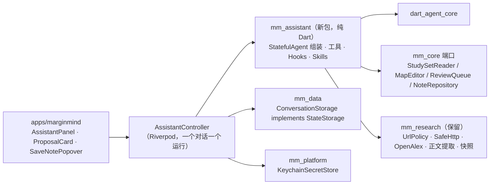

# 三期：助手（Agent）设计方案

> 建立日期：2026-10-27（GUL-527）。状态：**方案已确认，进入开发**（GUL-527 拆分执行）。
> 配套高保真原型：[`design/prototype/phase-3-assistant.html`](../design/prototype/phase-3-assistant.html)。它是单个文件，没有依赖，用浏览器直接打开即可。右侧的“演示控制台”可以跳到 16 个场景，也可以切换无 AI、断网、深色和窄窗口。
> 界面规格（组件尺寸、令牌、入口、删除清单）：[`phase-3-assistant-ui.md`](phase-3-assistant-ui.md)。
> 依据：二期原型 [`phase-2.html`](../design/prototype/phase-2.html)、当前 `main` 的代码（v0.8.0）、应用截图，以及 [dart_agent_core](https://github.com/memex-lab/dart_agent_core) 2.1.8 的源码。本文不做工时评估。

---

## 0. 一页结论

- **把“研究”简化成一个“助手”。** 用户选中原文或卡片，按 ⇧⌘E 或点“问助手”，右侧就打开对话。所选内容已经作为上下文贴在输入框上方，用户直接打字，或点“解释 / 翻译 / 查证 / 总结 / 出复习题 / 整理进脑图”之一就能发送。二期需要先在启动卡里选意图、方式、关键词、来源和上下文开关才能开始；现在这些都不用选了。
- **一个面板、一条对话流。** 解答、资料、已摘取三个标签合并成一条消息：工具步骤可以折叠，正文内联引用，回答下方列出来源。点 `p.42` 回到原文，点 `[1]` 在面板内打开来源快照。
- **助手可以修改学习集，但不会悄悄修改。** 加主题、移动卡片、改标题、生成复习卡这类写操作，都以“提议卡”的形式出现。用户可以逐条取消，悬停时在脑图上预览位置，确认后才应用，应用后可以 ⌘Z 撤销。助手不删除卡片，也不改动原文。
- **保存只需一步。** 回答下方点“存为笔记”，默认放进脑图的相关分支；如果是从原文发起的，同时附到那句话旁边。笔记沿用二期的研究笔记实体（界面上改名为“AI 笔记”）。
- **工具栏布局以现有应用为准。** PDF 工具放在原文栏（缩略图、缩放、阅读主题、选择 / 高亮 / 框选 / 画笔、颜色、与脑图联动），脑图工具放在脑图栏（脑图 / 大纲、添加 / 编辑 / 删除），右下角是紧凑 / 完整、插图、导出、全图、缩放。窗口工具栏只保留布局切换和“助手”。
- **用 dart_agent_core 作为 Agent 框架。** 每个对话对应一个 `StatefulAgent`。学习集操作做成 Dart 工具，写操作通过 `AgentHook.beforeToolCall` 转成提议，由用户确认后才执行。`runStream()` 的事件直接驱动对话界面，`StateStorage` 把对话存进学习集。二期的安全边界（钥匙串、URL 策略、预算、不自动重发）全部保留。这一点需要新写一条 ADR，修订 ADR 0001 里“不执行客户端工具”的约定。
- **第 8 节记录已定的 6 项决定，第 9 节是界面文案原则。**

---

## 1. 原型与现有应用的差距

依据 `phase-2.html`、v0.8.0 代码和截图逐项比对。“处理”一列说明三期原型里怎么处理这一项。

| 项目 | 二期原型 | 现有应用 | 三期处理 |
| --- | --- | --- | --- |
| PDF 工具 | 放在窗口工具栏 | 原文栏自带工具条：缩略图 / 缩放 / 适合宽度 / 阅读主题 / 工具 / 颜色 / 联动 | **以应用为准**，原型已同步 |
| 文档切换 | 原文上方有文档标签 | 侧栏“文档”分组 | 以应用为准，去掉文档标签 |
| 翻页 | 没有 | 底部紧凑页码导航 | 原型补上“‹ 页码 / 总页数 · 缩放 ›” |
| 脑图标题栏 | 没有 | “主脑图”、脑图 / 大纲、添加 / 编辑 / 删除 | 原型补齐 |
| 大纲视图 | 没有 | 有，可原地编辑 | 原型补上只读大纲（可点选），编辑交互以应用为准 |
| 底部栏 | 紧凑 / 完整 + 缩放 | 另有当前路径提示（“新摘录 → …”） | 原型补上路径；导出改到右下角 |
| 节点菜单 | 研究 ▸ 6 个意图 | 意图子菜单 + 复习分支、导出分支等 | 顶部换成“问助手”的 4–5 个动作，其余菜单保留 |
| 研究入口 | 工具条“研究”→ 启动卡 | 同原型 | **简化**成“问助手”，直接进入对话 |
| 研究面板 | 来源卡 + 可编辑问题 + 三个标签 + 保存表单 | 同原型（约 1400 行） | **合并**成一条对话流 |
| 追问 | 只在“解答”标签下 | 同原型 | 对话本身就是追问，所有能力都能追问 |
| 改脑图 | 不能 | 不能 | **新增**提议卡 |
| 生成复习题 | 不能 | 不能 | **新增**，作为提议卡的一种 |
| 本机模型 | 没有 | 没有 | **新增**：Ollama，断网时可以改用 |

**判断依据。** 原型里体现不好的部分（PDF 工具栏、脑图交互）以应用为准，不另做一套。研究流程反过来：应用照搬了原型的复杂度，所以要简化的是原型本身。

---

## 2. 为什么 Research 难用，以及简化原则

二期的研究流程从“选中”到“看到答案”需要用户做 6 个决定：意图（7 选 1）、问题、方式（3 选 1）、关键词、来源类型、上下文开关。结果又分散在 3 个标签和 1 个保存表单里，状态有 7 种以上。功能都对，但这样的流程适合研究员，不适合正在读书的人。

用户的真实诉求只有三类：**看不懂（解释 / 翻译）、不确定（查证 / 找资料）、想留下来（记笔记 / 出题 / 整理）**。三期按下面几条原则设计：

1. **先问再说。** 能推断的都不让用户选。上下文自动附带并可见；需要联网时由助手自己决定，只发送关键词；意图从用户的话里识别，`/` 指令只是给熟手的快捷方式。
2. **一个地方。** 回答、过程、来源、保存都在同一条消息里，不切换标签。
3. **写操作必须确认。** 读操作直接执行，写操作先给提议。这是用户能放心把学习集交给助手的前提。
4. **诚实。** 二期的硬约束全部保留：不联网的回答写明“未联网”；引用只来自真正读到的内容；失败就如实失败，并给出可行的下一步。
5. **不配 AI 也不影响主流程。** 摘录、脑图、复习、搜索都照常可用；连接 AI 在面板里一屏就能完成。

---

## 3. 交互设计（对应原型场景）

### 3.1 入口

| 入口 | 行为 |
| --- | --- |
| 选区工具条“问助手”（A）/ ⇧⌘E | 打开面板，所选内容作为上下文；出现快捷操作行 |
| 已有高亮的工具条“问助手” | 同上，并沿用这条高亮的锚点 |
| 节点右键“问助手” | 解释这个主题、整理这个分支…、为这个分支出复习题…、查证这张卡片、带上它自由提问… |
| 卡片详情右上角“问助手” | 带着这张卡片进入对话 |
| 窗口工具栏“助手” / ⌃⌘R | 打开或关闭面板；空对话页给出 5 条基于当前页面的建议 |
| 侧栏“对话” | 最近 5 个对话，显示进行中 / 未完成 / 失败 |

### 3.2 面板结构

- **标题栏**：显示对话标题（点开是对话记录），以及新对话、设置、关闭。
- **消息**：
  - 用户消息上方显示附带的引用块，点击回到原文或脑图节点。
  - 助手消息由以下几部分组成：
    - 步骤条：进行中显示当前步骤；完成后折叠为“用了 N 步 · 已联网 / 未联网”，可展开。
    - 正文：`p.42` 是本地引用，点击跳回原文并闪烁；`[n]` 是外部引用。
    - 来源行。
    - 提议卡（如果有）。
    - 操作行：存为笔记、复制、重新生成。
- **输入区**：
  - 上下文条：手动附带的内容是实色 chip；自动附带的“正在看的页面 / 选中的卡片”是虚线 chip，点 × 这次就不带。
  - 快捷操作行：有选区或卡片时出现。
  - 输入框：↩ 发送，⇧↩ 换行，兼容输入法。
  - 底部一行：`@` 引用文档 / 页面 / 分支 / 整张脑图，`/` 快捷指令，联网开关，模型切换，发送 / 停止。

### 3.3 提议卡（写操作）

- 每一条显示为 `+` 新增、`→` 移动或 `✎` 修改，附简短说明，并带一个勾选框。
- 鼠标悬停时，脑图上对应的位置会出现虚线框，必要时自动滚动到那里。
- 点“应用 N 处”后执行，整组修改只占一步撤销，新节点会闪烁。完成态提供“在脑图中查看 / 撤销”。
- 点“不用了”后脑图不变，之后可以点“重新查看”。
- 助手不能删除节点，也不能修改原文。

### 3.4 状态与退路

| 情况 | 表现 |
| --- | --- |
| 未配置 AI | 面板内选服务、粘贴 Key、点连接，也可以选本机 Ollama；输入框禁用 |
| 断网，云端模型 | 如实报错“网络不可用”；问题和上下文已保存；提供“重试”和“改用本机模型” |
| 断网，本机模型 | 联网步骤标为“已跳过（当前断网）”，回答顶部注明未联网核对 |
| 联网关闭 | 不调用搜索工具；回答顶部注明“未联网”，并去掉外部引用 |
| 生成中 | 发送键变为停止（Esc 也可停止）；停止后保留已生成的部分，可以重新生成 |
| 上次退出时中断 | 对话标为“未完成”；已读到的资料都在；**不自动重发**，点“继续”才重新请求 |

---

## 4. 删掉和合并了什么

| 二期 | 三期 |
| --- | --- |
| 7 个意图按钮 + 推荐标记 | 6 个快捷操作 + `/` 指令；平时直接说话 |
| 方式三选一（只搜索 / 问 AI / 联网研究） | 一个“联网”开关（默认开），由助手决定是否检索 |
| 关键词编辑、来源类型 chip | 去掉。助手生成查询；需要指定时直接说“找论文 / 找视频” |
| “将发送给 AI”可展开的开关列表 | 输入框上方的上下文 chip（可见、可去掉） |
| “作为新研究 / 加入当前问题”二选一 | 去掉。默认在当前对话里继续，新话题点“新对话” |
| 稍后研究 | 去掉。对话本身会保存，侧栏可以回到任何一个对话 |
| 解答 / 资料 / 已摘取三个标签 | 一条消息：步骤 + 正文 + 来源 + 操作 |
| 勾选要点 → 保存表单（位置、父节点、拆分子节点） | “存为笔记”一个小弹层：标题 + 两个位置勾选 |
| 资料阅读视图里划选摘取证据 | 来源抽屉显示被引用的段落和快照；整段存笔记。逐句摘取后置 |
| 只搜索（不用 AI） | 去掉单独的模式；侧栏搜索和外部链接保留 |

**保留**：引用必须来自真实读取的内容、网页快照与段落定位、URL 安全策略、预算上限、钥匙串、不自动重发。研究笔记的数据实体、原文与脑图双向关联、复习开关也都保留。

---

## 5. 技术方案：接入 dart_agent_core

### 5.1 框架评估（基于 2.1.8 源码）

| 需要的能力 | dart_agent_core 提供 | 结论 |
| --- | --- | --- |
| 多供应商 | `ClaudeClient` / `OpenAIClient` / `ResponsesClient` / `GeminiClient`，Ollama 和 OpenAI 兼容服务走 `OpenAIClient` | 满足，替代 `mm_research` 里手写的三个适配器 |
| 工具调用循环 | `Tool`（JSON Schema，支持 object 参数模式）、`AgentToolResult`、循环检测 | 满足 |
| 流式界面 | `runStream()` → `modelChunkMessage` / `functionCallRequest` / `functionCallResult` / `fullModelMessage` | 满足，直接映射到步骤条和正文 |
| 写操作确认 | `AgentHook.beforeToolCall` → `proceed` / `deny` / `defer` / `abort` | 满足（见 5.3） |
| 会话持久化 | `AgentState` + 可替换的 `StateStorage` 接口 | 满足，实现存进学习集的版本 |
| 取消 | `CancelToken` 贯穿运行过程 | 满足 |
| 长对话 | `LLMBasedContextCompressor` + `retrieve_memory` | 可选，后置 |
| 规划 | `PlanMode` + `write_todos` | 只给“整理”类长任务用，默认关闭 |
| 依赖 | `dio`、`http`、`mcp_dart`、`aws_*`、`uuid`、`logging`；MIT 许可；SDK ^3.9.2 | 可以接受。`aws_*` 和 `mcp_dart` 本期用不到，需要评估包体积（决定 3） |

### 5.2 分层

- **新增 `mm_assistant` 包。** 它依赖 `dart_agent_core`、`mm_core` 和 `mm_research`，负责组装 Agent、定义工具、写系统提示和 Hooks。包里不放 Flutter 代码，可以用框架自带的 eval 和 record / replay 做测试。
- **`mm_research` 瘦身。** 去掉三个供应商适配器和 `session_engine`，由框架接管。保留 `url_policy`、安全传输、OpenAlex、正文提取和快照，它们会被包装成工具。
- **依赖方向不变。** `apps → mm_assistant → mm_research / mm_core`，`mm_core` 仍然不依赖任何包。

### 5.3 工具清单与确认策略

| 工具 | 类型 | 作用 | 策略 |
| --- | --- | --- | --- |
| `read_selection` | 读 | 读取所选内容及前后段、章节标题 | 直接执行 |
| `read_pages(doc, from, to)` | 读 | 读取页面文字（OCR 后的扫描页也可以） | 直接执行，单次最多 N 页 |
| `search_study_set(query)` | 读 | 在文档、卡片、笔记里检索相关段落（已有搜索索引） | 直接执行 |
| `read_branch(nodeId)` | 读 | 读取分支结构与卡片内容（图片只给标题） | 直接执行 |
| `web_search(query)` | 联网 | 检索网页，只发送关键词 | “联网”关闭时不注册这个工具 |
| `search_papers(query)` | 联网 | OpenAlex 论文检索 | 同上 |
| `fetch_source(url)` | 联网 | 抓取正文、生成快照和段落 ID，经过 `UrlPolicy` | 同上，并受预算限制 |
| `propose_map_edits(ops[])` | 写 | 新增主题 / 笔记 / 复习卡、移动、改标题 | **`beforeToolCall` 返回 `defer`**：界面渲染提议卡，工具结果告诉模型“已提交给用户确认”，本轮结束 |
| `save_note(...)` | 写 | 存为 AI 笔记 | 只能由界面按钮触发，不注册给模型 |

- **确认流程。** `ProposalHook` 拦截所有写工具，把参数校验后存成 `Proposal`（放进 `AgentState.metadata`），然后返回 `defer`。用户点“应用”时，控制器在一个撤销事务里执行修改；点“不用了”就丢弃这条提议。下一轮的 `beforeModelCall` 会注入一句状态（“用户应用了第 1、3 条 / 拒绝了”），让模型知道结果。
- **硬性拒绝。** `PolicyHook` 拒绝删除、修改原文、访问本机或内网地址，也拒绝超出预算的调用。
- **Skills。** 解释、翻译、查证、总结、出题、整理、找论文、找视频各做成一个 `Skill`，每个有自己的提示词和工具子集，由 `/` 指令或模型自己激活。默认只常驻“读”类工具，节省上下文。

### 5.4 流式事件到界面的映射

| 框架事件 | 界面 |
| --- | --- |
| `functionCallRequest` | 步骤条新增一行（工具名 → 人话，例如“联网搜索：…”） |
| `functionCallResult` | 这一步打勾；如果有来源就登记到来源行 |
| `modelChunkMessage` | 正文增量渲染；`[source:N]` 和 `[page:42]` 标记转成引用 chip |
| `fullModelMessage` / 运行结束 | 消息完成，出现操作行和提议卡 |
| 取消 / 错误 | 按 ADR 0001 的错误分类显示“已停止 / 失败 + 下一步” |

**引用的诚实性。** `[source:N]` 只能指向本轮 `fetch_source` 或 `search_papers` 实际返回、并且已经存好快照的来源；`[page:N]` 只能指向已经读取过的页面。其他编号一律丢弃。这条规则沿用二期“引用必须逐字命中快照”的要求，由 `onModelChunk` / `afterModelCall` Hook 执行。

### 5.5 持久化

- `ConversationStorage implements StateStorage`：每个学习集内写 `conversations/<id>.json`，使用 `AgentState` 的 JSON，加上界面需要的元数据（标题、附带的上下文、提议的状态、存成的笔记 ID）。写入方式沿用现有的原子替换。
- AI 笔记沿用 `ResearchNote` 实体和关联字段，**不需要升级文件格式**；只新增一个可选字段 `conversationId`，旧文件读进来是 null。
- 旧的研究会话会迁移成只读对话：问题变成用户消息，回答和引用变成助手消息，原来存的笔记保持关联。迁移只读、不删除，旧数据保留一个版本周期。
- 钥匙串、预算、“不自动重发”的规则照旧。中断的运行在启动时标为“未完成”，必须由用户点“继续”才会重新请求。

### 5.6 测试

- `mm_assistant`：工具参数校验、`ProposalHook` / `PolicyHook` 的单元测试；用框架的 `RecordingLLMClient` 录制 / 回放，做端到端 eval（每个 Skill 至少 3 个用例，并断言引用合法）。目标覆盖率 ≥ 80%。
- `apps`：AssistantPanel 的 widget 测试，覆盖流式、停止、错误、提议的应用 / 拒绝 / 撤销，以及存为笔记的双位置关联。
- 回归：二期的 URL 策略、快照和预算测试原样保留。

---

## 6. 分批

1. **A：框架落地。** 新建 `mm_assistant`，接入一个供应商和全部“读”类工具，实现 `ConversationStorage`；面板的流式、停止、错误能跑通。此时研究功能继续保留。
2. **B：替换研究入口。** 加入选区 / 节点 / 详情的“问助手”入口、快捷操作和上下文 chip；实现“存为笔记”（复用研究笔记）；迁移旧会话；去掉启动卡和三个标签。
3. **C：写操作。** 实现 `propose_map_edits`、提议卡、撤销事务和复习卡生成。
4. **D：联网与来源。** 把搜索、论文、抓取包装成工具；实现来源抽屉和引用校验 Hook；接入本机 Ollama。
5. **E：增强（后置）。** 上下文压缩、`@` 整本检索的召回质量、逐句摘取证据、MCP。

---

## 7. 原型说明

- 文件 `design/prototype/phase-3-assistant.html` 以 `phase-2.html` 为基础改出，二期的内容能力（C01–C07、OCR、导出、复习）都保留并可演示。`phase-2.html` 原样保留，作为二期验收的对照。
- 关键场景：①选中原文 → 问助手；②查证（联网、引用、来源快照、存为笔记）；③整理分支（提议 → 应用 → 撤销）；④出复习题；⑤追问、`/` 和 `@`；⑥无 AI / 断网；⑦恢复未完成的对话；⑧工具栏（以现有应用为准）。
- 原型里的回答、来源和模型名称都是演示数据，不代表最终选定的服务。

---

## 8. 已定决定（2026-10-27，项目所有者授权 GUL-527 全权负责）

1. **助手整体替换“研究”入口**，不并存。旧研究会话迁移为只读对话。
2. **“联网”默认开启**，助手按需检索，只发送关键词；输入区可关闭。
3. **接受 dart_agent_core 依赖。** 批次 A 测量包体积；若 `aws_*` / `mcp_dart` 带来的增量不可接受，在 `third_party/` 维护裁剪版并在 ADR 0002 记录。
4. **写操作首批范围**：新增主题 / 笔记 / 复习卡、移动、改标题。不删除、不跨脑图、不改原文。
5. **本机模型（Ollama）进入批次 D**，作为断网时的真实退路。
6. **新写 ADR 0002**：允许执行白名单内的客户端工具，修订 ADR 0001 对应条款，其余安全边界不变。

## 9. 界面文案原则

- 不加多余的次级标签和说明，让布局本身说明问题。
- 不加多余的辅助文字、描述性文案和重复的界面微文案。原型里的建议副标题、提示条、按钮旁说明在实现时一律去掉，除非缺了它用户会做错事（例如失败原因）。
