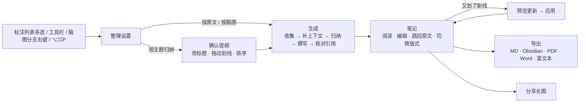

# 学习笔记：AI 整理与导出 设计方案

> 建立日期：2026-10-30（GUL-583）。状态：**已确认**，按第 13 节分期开发。
> 配套高保真原型：[`design/prototype/study-notes.html`](../design/prototype/study-notes.html)。单文件、无依赖，浏览器直接打开。右侧演示控制台有 14 个场景，可以切换“未配置 AI / 深色 / 窄窗口”；“导出 Markdown / Obsidian”会真实下载 .md 文件。
> 依据：GUL-583 的需求，以及当前 `main` 的代码：`Annotation`（含 `TextAnchor` 和上下文）、`MarginNote`、`Card` / `MapNode`、`ResearchNote`（`NoteOrigin.mixed` 已存在）、`MapExporter`（脑图转 Markdown / OPML）、`DocumentOutline` 和助手的 `ReadScope`。本文不做工时评估。

---

## 0. 一页结论

- **新增一种学习集内容：“笔记”。** 它和脑图一样属于学习集，放在侧栏“笔记”分组里。脑图负责结构，笔记负责成文：一篇可以从头读到尾、可以导出、可以分享的学习笔记。
- **一步整理。** 在标注列表里多选划线后点“整理成笔记”，或者点工具栏的“整理笔记”（⌥⌘P），也可以在脑图分支上右键。整理设置只有一个表单：范围、素材、组织方式、AI 参与程度、上下文、版式。默认值可以直接用。
- **自动关联上下文。** 每条划线自动带上原文前后句和所在章节；以“这”“它”开头、单独看不懂的句子，由 AI 补一句说明。用户自己写的页边批注和脑图笔记，自动挂在对应的摘录下面。不同章节、不同书里讲同一件事的摘录，AI 会归到一起，并标出它们之间的关联。
- **分得清谁说的。** 沿用现有的设计原则“书里的话用宋体，自己的话用系统字体”，再增加第三种：AI 写的内容带紫色“AI”标签。AI 段落被用户改过后，标签变成“AI · 已改”，以后重新整理时不会被覆盖。
- **原文不会被 AI 改写。** AI 只输出划线 ID，引文由应用根据 ID 逐字填入。标题下方显示“N 条划线全部引用 · 原文未改写”，如果有划线没用上，也会列出来，并且可以一键放回笔记。
- **笔记会随阅读更新。** 整理之后新划的线，会在笔记顶部提示“又划了 N 条”。预览会显示每条新划线会放进哪一节，确认后才合并，不会重写整篇笔记。
- **版式和内容分开。** 同一份内容可以切换三种版式：读书笔记、康奈尔笔记、复习提纲。复习题可以一键加入 FSRS 复习。
- **导出和分享。** 支持 Markdown、Obsidian（callout、页码链接、复习题格式）、PDF、Word、复制为富文本，以及分享长图（一句金句 / 一节 / 整篇摘要，三种主题）。所有导出都在本机生成。
- **没有 AI 也能用。** 没有配置 AI 时，可以按原文或脑图结构排版，自动补前后句、附出处并导出。发送给 AI 前会写明要发多少字、发给哪个模型。

---

## 1. 需求分析

### 1.1 用户说的和用户想要的

需求原文：“做的笔记，划线支持 AI 整理，自动关联上下文，输出结构良好的学习笔记”，标题是“笔记导出”。把它拆开，背后其实有三个诉求：

| 诉求 | 用户真正卡在哪里 | 本方案的回答 |
| --- | --- | --- |
| **学习**：读完要能“消化” | 划线是碎片，离开原文就看不懂；同一个观点散在不同章节、不同书里 | 补前后句和指代；按主题归纳，跨书合并；每节写小结和要点；生成复习题 |
| **记录**：留下一份自己的东西 | 现有的“导出脑图 Markdown”只是一棵树，没有成文的段落，也没有“我想了什么” | 笔记是一篇可编辑的文章，自己的批注是一等公民；AI 写的内容可以改，改过的不会被覆盖；笔记会随继续阅读而更新 |
| **分享**：给别人或别的工具 | 发朋友圈需要好看，进 Obsidian / Notion 需要格式正确，交作业需要 Word / PDF 和规范引用 | 6 种导出目标，引用格式可选，可以隐藏 AI 内容和私人批注，长图有三种主题 |

### 1.2 现状

| 已有 | 可复用的部分 | 缺口 |
| --- | --- | --- |
| 划线 `Annotation`：`quote`、颜色、`TextAnchor`、页码 | 原文、位置、颜色 | 没有“前后句”这样的上下文字段，需要在整理时从文档文本中取 |
| 页边批注 `MarginNote`、脑图笔记卡片 | 用户自己的话 | 没有和划线一起输出的入口 |
| 文档目录 `DocumentOutline` | 章节归属 | — |
| 脑图 `MapNode` 树、`MapExporter` | 按脑图结构组织；Markdown 和 OPML 的写法 | 只能导出脑图，结构是树而不是文章 |
| 助手：`ReadScope`、`search_study_set`、AI 笔记 `ResearchNote`（`NoteOrigin.ai / mixed`） | 模型接入、读取范围、钥匙串、预算，以及“AI 写的、用户改过”的语义 | 助手适合一问一答，不适合批量整理 |
| 复习：FSRS | 复习题可以直接加入复习 | — |

结论：数据几乎都已经有了，缺的是“整理成文”这一层，以及一个能长期保存、能更新的笔记实体。

---

## 2. 用户场景

| 场景 | 用户想要什么 | 对应功能 |
| --- | --- | --- |
| 读完一章或一本书 | 把零散的划线变成能复习的提纲 | 整理笔记（按主题或按章节） |
| 同时读两本相关的书 | 看到两本书在哪些地方相互印证 | 按主题归纳 + 跨书关联 |
| 划线时只划了半句 | 回头看时还能看懂 | 自动带前后句、补全指代 |
| 读了一半先整理，之后继续读 | 笔记跟着阅读进度长大，自己改过的地方不丢 | 增量更新，已改段落加锁 |
| 准备考试 | 直接拿来自测 | 复习提纲版式、加入 FSRS 复习 |
| 写读书报告或交作业 | Word / PDF，带规范出处 | 导出，引用方式可选“脚注” |
| 用 Obsidian / Notion 管理知识 | 格式正确，不需要手动清理 | Obsidian 导出、复制为富文本 |
| 发朋友圈或小红书 | 好看，只露出想分享的部分 | 分享长图，可隐藏批注和 AI 内容 |

---

## 3. 流程



---

## 4. 整理设置

| 项 | 选项 | 规则 |
| --- | --- | --- |
| 范围 | 选中的划线 / 整个学习集 / 单份文档 / 最近 7 天 | 从多选进入时默认“选中的划线”；从脑图分支进入时默认“该分支” |
| 素材 | 划线（必选）、我的批注、脑图笔记、已存的 AI 笔记、图片卡片 | 每项显示数量；划线不能取消 |
| 组织方式 | 按主题归纳（AI）/ 按原文顺序 / 按脑图结构 | 没有 AI 时“按主题归纳”变灰；选“不用 AI”时自动改为“按原文顺序” |
| AI 参与 | 不用 AI，只排版 / 补全上下文 + 小结 / 深度整理（+ 关联、要点、复习题） | 默认“深度整理”，之后记住上次的选择 |
| 上下文 | 每条划线前后 0–3 句（默认 1 句）；残句补全指代（开关） | 上下文在笔记里默认折叠；残句默认展开 |
| 版式 | 读书笔记 / 康奈尔笔记 / 复习提纲 | 之后可以随时切换 |
| 隐私说明 | “将发送 N 条划线、M 条批注及上下文（约 X 字）给 〈模型〉” | 只在会调用 AI 时出现 |
| 按钮 | 取消 / 先看提纲 / 生成笔记 | “先看提纲”只在按主题归纳时出现 |

**上下文怎么取**：用划线的 `TextAnchor`（流式文档）或 `AnnotationPage` 加页面文本（PDF）定位所在段落，按句号、问号、感叹号切句，取前后各 N 句，不跨章节。章节标题取自 `DocumentOutline`。扫描版 PDF 使用已经 OCR 的文本；没有文本时不取上下文，并在笔记里标注“无原文文本”。

**什么算残句**：以指代词开头（这、那、它、其、此、该、上述、以上……）、长度少于 12 个字，或者以连词开头（但是、因此、所以……）。规则在本地判断，命中后才交给 AI 补全，补出的说明作为 AI 注释显示，不改动原文。

---

## 5. 确认提纲（按主题归纳时）

| 项 | 规则 |
| --- | --- |
| 内容 | AI 给出分节、每节的标题，每节包含哪些划线，以及一句分组理由 |
| 可以做的操作 | 改标题、把划线拖到别的节、拖动左侧把手调整节的顺序、删除一节（其中的划线移到“未归入”）、添加一节 |
| 未归入 | 放在这里的划线不进入笔记；生成后标题下方提示“N 条划线未用上”，点开后可以“放回笔记”（放进最相关的一节） |
| 空节 | 生成时跳过 |
| 跳过提纲 | 直接点“生成笔记”，等同于原样接受 AI 的提纲 |

---

## 6. 生成与“核对引用”

**步骤**：收集素材 → 补全上下文 → 归纳主题 → 撰写（流式显示）→ 核对引用。可以随时停止，已写好的部分会保留，之后可以“继续整理”。

**防止编造引文的约定**（这是本功能可信度的底线）：

1. 发给模型的每条素材都带一个短 ID（`h1`、`n3`……）。
2. 模型的输出是结构化的块列表，**引文只能写 ID**，不能写原文，例如：
   ```json
   {"sections":[{"title":"检索：回想胜过重读","why":"4 条都在讲主动回想",
     "blocks":[{"type":"summary","text":"…"},
               {"type":"quote","ref":"h1"},
               {"type":"gloss","ref":"h9","text":"「这」指前文的实验…"},
               {"type":"xref","to":0,"text":"是同一机制…"},
               {"type":"points","items":["…"]}],
     "question":"为什么回想比重读更有效？"}]}
   ```
3. 应用根据 ID 填入原文、出处和批注。ID 不存在时丢弃该块并记录；同一条划线重复出现时只保留第一次。
4. 核对完成后，统计“已引用 / 未用上”，显示在标题下方。

模型输出的 JSON 用 schema 校验，不合格时重试一次，仍然失败则回退到“按原文顺序”，并提示“AI 整理失败，已按原文排版”。

---

## 7. 笔记

### 7.1 三种声音

| 内容 | 字体与标记 | 能否编辑 |
| --- | --- | --- |
| 原文摘录 | 宋体，左侧色条为划线颜色，下方显示出处 | 不能（原文就是原文）；可以从笔记中移除，划线保留 |
| 原文上下文 | 灰色宋体，摘录本身加浅色底 | 不能 |
| 我的批注 | 系统字体，浅黄底，带“我的批注”和来源（页边批注 p.12 / 脑图笔记） | 可以，修改会同步回原批注 |
| AI 小结、要点、关联、补充说明 | 系统字体，紫色“AI”标签和左侧细线；可以用“显示 AI 标记”隐藏 | 可以；改过后变为“AI · 已改”，对应 `NoteOrigin.mixed` |

### 7.2 出处与联动

- 点击“《认知天性》p.28”：左侧原文切换到对应文档并跳页，闪烁划线。快捷键 ⌘L 与卡片一致。
- 点击原文中的高亮：笔记滚动到对应摘录并闪烁（分栏时）。
- 原文中带批注的高亮旁边显示黄色批注标记，与页边批注一致。
- 跨节关联：例如“与 1. 检索 是同一机制”，点击后跳到对应的节。

### 7.3 段落操作（悬停段落左侧的 ⋯）

| 段落 | 菜单 |
| --- | --- |
| AI 段落 | 换一种说法 · 更简洁 · 展开说明 · 改为我的话 · 加入脑图 · 生成复习卡 · 删除这段 |
| 摘录 | 展开 / 收起上下文 · 在原文中查看 ⌘L · 解释这句话（AI）· 加入脑图 · 生成复习卡 · 从笔记中移除（不删划线） |
| 我的批注 | 加入脑图 · 删除这段；改写类菜单项变灰，并说明“这是你自己写的，AI 不会改写” |

所有操作都可以在提示条里撤销，也接入全局 ⌘Z。

### 7.4 版式

| 版式 | 结构 |
| --- | --- |
| 读书笔记（默认） | 一句话总结 → 各节（小结、摘录 + 批注、关联、要点）→ 行动清单 → 复习题 → 出处 |
| 康奈尔笔记 | 每节左栏是 AI 提出的问题（线索），右栏是摘录与批注，底部是本节总结 |
| 复习提纲 | 问题在前，答案（原文）遮住，点击后显示；每条都可以“加入复习” |

切换版式不改变内容；修改过的段落在各个版式中保持一致。

### 7.5 目录

内容区宽度 ≥ 1000pt 时，右侧显示浮动目录，并高亮当前所在的节；宽度不够时，目录收进笔记工具栏的“目录”菜单，正文不会被挤压。

---

## 8. 增量更新

| 项 | 规则 |
| --- | --- |
| 触发 | 笔记范围内的文档有新的划线或批注（按笔记的 `scope` 规则判断） |
| 提示 | 笔记顶部显示横幅“整理之后，你又划了 N 条、写了 M 条批注”；侧栏中的笔记显示数量角标 |
| 预览 | AI 为每条新划线选择最相关的一节，并写一句理由；预览中用绿色标出插入位置，不会改动其他内容 |
| 保护 | 用户改过的段落（`edited`）加锁，永远不会被覆盖；“重新整理”同样遵守这条规则 |
| 不用 AI 时 | 按原文顺序插入到对应章节 |
| 忽略 | 收起横幅；之后可以在“重新整理”中再加入 |

---

## 9. 导出

| 目标 | 内容与格式 |
| --- | --- |
| Markdown | 标题、引用块 `>`、出处“—— 《书名》p.12”或脚注 `[^h1]`、批注、要点列表、任务列表形式的行动清单 |
| Obsidian | YAML frontmatter（title / source / tags / created）；原文、批注、AI 小结分别用 `[!quote]` / `[!note]` / `[!abstract]` callout；页码写成 `[[书名#p12]]`；复习题使用 Spaced Repetition 插件的 `?` 格式；图片放入附件文件夹 |
| PDF | A4，正文 11pt；原文用宋体，左侧色条为划线颜色；批注浅黄底；页眉显示标题，页脚显示页码 |
| Word (.docx) | 内置“引用”样式；批注用底纹；脚注用 Word 原生脚注，方便继续修改 |
| 复制为富文本 | 粘贴到飞书、Notion、备忘录时保留标题、引用和列表 |
| 分享长图 | 见第 10 节 |

通用选项：出处标注（页码跟在原文后 / 脚注 / 不标）；包含（展开过的上下文、我的批注、AI 小结与要点、复习题、出处列表）；AI 内容标记（标“AI 整理”或 callout / 不标）。右侧预览就是最终的文件内容。

入口：笔记工具栏中的“导出”；菜单 文件 › 导出笔记…。脑图原有的导出不变。

---

## 10. 分享长图

- 内容：一句金句 / 一节 / 整篇摘要（每节最多 2 条摘录）。
- 主题：纸张、简洁、夜读，都有固定的浅色或深色版本，不随系统外观变化。
- 开关：我的批注、AI 小结。
- 页脚：“摘自我的 MarginMind 笔记”和划线数量。不放二维码或链接。
- 图片在本机渲染（Flutter `RepaintBoundary` 转 PNG，2× 倍率），可以拷贝或存储。

---

## 11. 状态与边界

| 情况 | 处理 |
| --- | --- |
| 未配置 AI | AI 相关选项变灰并给出“去设置”；排版、上下文、导出照常可用 |
| 断网或模型报错 | 已写好的部分保留；提示“继续整理 / 改为只排版” |
| 范围内没有划线 | “生成笔记”变灰，提示“没有可整理的划线” |
| 划线很多（> 200 条） | 按章节分批发送，先归纳每一批，再合并提纲；进度显示“第 k / n 批” |
| 超出预算 | 沿用助手的预算上限；生成前显示预计的字数 |
| 原文被删除（文档被移除） | 摘录保留文字，出处显示“原文已移除”，不能跳转 |
| 划线被删除 | 笔记中的摘录保留文字，并标记“划线已删除”；下次更新时询问是否移除 |
| 划线颜色或批注被修改 | 笔记实时读取，自动同步 |
| 扫描版 PDF 没有文本 | 不取上下文，提示“无原文文本，建议先识别文字” |
| 窄窗口 | 目录收进菜单；原文栏可以收起 |
| 深色模式 | 全部使用语义色；分享长图的主题固定，不随系统外观变化 |

---

## 12. 数据模型与架构

### 12.1 实体（`mm_core`，纯 Dart）

```dart
/// A written study note built from highlights; lives in a study set like a mind map.
class StudyNote {
  final String id, title;
  final NoteScope scope;            // which highlights belong (for updates)
  final NoteTemplate template;      // reading | cornell | review
  final NoteSettings settings;      // org, depth, contextSentences, materials
  final List<NoteSection> sections;
  final List<String> unusedAnnotationIds;
  final DateTime createdAt, updatedAt, organizedAt; // organizedAt = cut-off for "new since"
}

sealed class NoteScope {}           // SelectedAnnotations(ids) | WholeSet | DocumentScope(id) | BranchScope(mapId, nodeId) | SinceScope(date)

class NoteSection { final String id, title; final String? why, question; final List<NoteBlock> blocks; }

sealed class NoteBlock { String get id; NoteOrigin get origin; bool get edited; }
class QuoteBlock   extends NoteBlock { final String annotationId; final bool contextOpen; }
class OwnBlock     extends NoteBlock { final String sourceId; final OwnSource source; } // marginNote | card
class TextBlock    extends NoteBlock { final String text; final TextKind kind; }        // summary | gloss | paragraph
class PointsBlock  extends NoteBlock { final List<String> items; }
class XrefBlock    extends NoteBlock { final String toSectionId; final String text; }
```

- **引文不复制原文**：`QuoteBlock` 只保存 `annotationId`，渲染和导出时实时读取 `Annotation.quote`，所以颜色、文本修改会自动同步。上下文同样实时从文档文本计算，不需要存储。
- `NoteOrigin` 复用现有的 `user / ai / mixed`，`edited` 用于加锁。
- 存储：`StudySetContent` 新增可选的 `studyNotes` 列表；旧文件读入时为空，**不需要升级文件格式**。写入沿用现有的原子替换。
- 撤销：笔记的编辑接入现有的编辑器撤销栈（与脑图相同的 `commit` 模式）。

### 12.2 服务

| 模块 | 位置 | 职责 |
| --- | --- | --- |
| `NoteMaterialCollector` | mm_core | 按 scope 收集划线、批注、卡片；计算章节归属和上下文句子；判断残句 |
| `NoteOrganizer`（端口） | mm_core | `outline(materials)`、`write(outline)`、`place(newMaterials, note)`；实现在 apps 层，复用助手的模型客户端、预算和钥匙串 |
| `NoteAssembler` | mm_core | 把模型的 ID 化输出还原成 `NoteSection` / `NoteBlock`；校验 ID、去重、统计未用上的划线 |
| `LocalNoteOrganizer` | mm_core | 不用 AI 时：按章节或脑图分支分组，确定性输出 |
| `NoteExporter` | mm_core | Markdown / Obsidian / HTML（富文本）输出，纯函数；格式参照 `MapExporter` |
| PDF / DOCX | apps | PDF 复用现有的 PDF 生成；DOCX 生成最小的 OOXML（document.xml 和 footnotes.xml） |
| `NoteView` | apps | 笔记视图、块编辑、版式、目录、更新预览、分享长图 |

依赖方向不变：`apps → mm_core`，`mm_core` 不依赖模型 SDK。

---

## 13. 分期

| 期 | 内容 | 价值 |
| --- | --- | --- |
| A：不用 AI 的笔记 | `StudyNote` 实体、收集与上下文、按原文 / 按脑图组织、笔记视图（摘录、批注、出处联动、编辑）、Markdown / Obsidian 导出 | 不依赖 AI 就能交付“结构化导出” |
| B：AI 整理 | 提纲、ID 化输出与核对、三种声音、段落操作、复习题加入复习 | 需求的核心 |
| C：持续更新与更多格式 | 增量更新、版式切换（康奈尔 / 复习提纲）、PDF / Word / 富文本、分享长图 | 记录与分享 |

---

## 14. 已确认的决定（2026-10-30）

1. 在笔记里修改批注，会同步回原批注（批注只有一份）。
2. AI 参与程度默认为“深度整理”，首次使用后记住用户的选择。
3. 一个学习集的笔记数量不限，侧栏“笔记”分组按更新时间排序。
4. 分享长图不加二维码或链接。
5. Obsidian 页码链接指向 `书名.md#p12`。

文案原则：不加多余的次级标签和说明，让布局来表达；不加多余的辅助文字、描述性文案和重复的界面微文案。

## 15. 测试计划

- `mm_core` 单元测试（目标覆盖率 > 80%）：
  - 上下文切句：中英文标点、跨段、章节边界，以及 0–3 句的取值。
  - 残句判断规则。
  - `NoteAssembler`：未知 ID、重复引用、空节、schema 不合格时的回退、“未用上”的统计。
  - `LocalNoteOrganizer`：按章节、按脑图分支的分组与排序。
  - 增量更新：已改段落加锁、`organizedAt` 截止时间。
  - `NoteExporter`：Markdown 和 Obsidian 的 golden 文件，覆盖三种出处方式和所有开关组合。
  - `StudySetContent` 读写往返测试，以及旧文件兼容。
- apps 层 widget 测试：整理设置的联动（无 AI 时的回退）、提纲拖动、生成时停止、段落菜单、版式切换、更新预览的应用与取消。
- 使用假的 `NoteOrganizer` 驱动端到端流程；真实模型只做手动验收。
